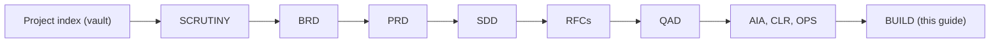

# Project Build Guide (BUILD)

> **Project memory lives in the AI Memory Vault, not in this repo.** Since 2026-10-19 every SILVR doc (PRD, SDD, RFCs, QAD, OPS, runbooks, CRs, the LOG and the audit) is a note in the Obsidian vault at `C:\AI Agentic Memory`. Before working:
>
> 1. Read the vault rules: `C:\AI Agentic Memory\AGENTS.md`.
> 2. Read the project index, which is also the doc status manifest: `C:\AI Agentic Memory\01_Projects\SILVR\00_Project_Index.md`.
> 3. Read prior session notes in `C:\AI Agentic Memory\01_Projects\SILVR\Memory\`.
>
> Write project knowledge (doc updates, CRs, session logs, decisions) in the vault, never in `docs/`. The repo's [docs/index.md](docs/index.md) only points there. This file is hand-maintained and is the only copy of the build guide.

**Project:** SILVR (quant trend-following system)
**Version:** 0.1
**Owner:** Cian Jake Francisco
**Status:** Draft
**Last updated:** 2026-11-10
**Last reconciled:** 2026-11-10 against code at commit `492c4b8` on `feat/be-trend-ensemble` for section 1 traceability, the section 3 scikit-learn row and the D-4 and D-11 rows, section 4 golden paths (a) to (c) and the section 5 Strategy Rules and Risk Rules (`trend_ensemble` and the `trend` risk profile; `pyproject.toml` changed only its description, so no pin changed); 2026-10-21 against code at commit `c523f04` for the section 3 stack table (ccxt, the first runtime dependency); 2026-10-08 against code at commit `62037d1` for the rest; section 1 traceability, the section 3 deprecations register and golden path (b) re-checked 2026-10-09 against `70ccaec`; the D-4 and D-11 rows of the deprecations register re-checked 2026-10-09 against `099085b`; the D-4 and D-11 rows and the golden path (b) line references re-checked 2026-10-14 against `40ea0b1` (paper and demo runtime `973cd82`, merged into `dev` 2026-10-22)

This guide tells a coding agent or a human how to build SILVR from the canonical docs. It is the root `AGENTS.md`, which every future session reads first. Safety rules in section 5 are carried over from the previous `AGENTS.md` and must not be weakened.

## 1. How to Build From These Docs

Read in this order. Start at the vault project index (`C:\AI Agentic Memory\01_Projects\SILVR\00_Project_Index.md`; [docs/index.md](docs/index.md) points there), then:



1. [scrutiny-silvr.md](<C:/AI Agentic Memory/01_Projects/SILVR/Planning/scrutiny-silvr.md>): gaps (`G-#`) and what is known to be wrong.
2. [brd-silvr.md](<C:/AI Agentic Memory/03_Resources/Blueprints/SILVR/brd-silvr.md>): business goals, metrics, owner-input register.
3. [prd-silvr.md](<C:/AI Agentic Memory/03_Resources/Blueprints/SILVR/prd-silvr.md>): features `PRD-F1`..`PRD-F12`, stories, status, task checkboxes (section 9).
4. [sdd-silvr.md](<C:/AI Agentic Memory/03_Resources/Blueprints/SILVR/sdd-silvr.md>): architecture and module design.
5. RFCs: [signal engine](<C:/AI Agentic Memory/03_Resources/RFCs/SILVR/rfc-silvr-signal-engine.md>), [risk and kill switch](<C:/AI Agentic Memory/03_Resources/RFCs/SILVR/rfc-silvr-risk-kill-switch.md>), [ML filter gate](<C:/AI Agentic Memory/03_Resources/RFCs/SILVR/rfc-silvr-ml-filter-gate.md>), [readiness gates](<C:/AI Agentic Memory/03_Resources/RFCs/SILVR/rfc-silvr-readiness-gates.md>).
6. [qad-silvr.md](<C:/AI Agentic Memory/02_Areas/Quality_&_Strategy/SILVR/qad-silvr.md>): test scenarios `QAD-T#`.
7. [aia-silvr.md](<C:/AI Agentic Memory/02_Areas/Compliance_&_Security/SILVR/aia-silvr.md>), [clr-silvr.md](<C:/AI Agentic Memory/02_Areas/Compliance_&_Security/SILVR/clr-silvr.md>), [ops-silvr.md](<C:/AI Agentic Memory/02_Areas/Dev_&_Ops/SILVR/ops-silvr.md>): AI risks, compliance rows, runbooks.
8. This guide. Supporting: [idea-silvr.md](<C:/AI Agentic Memory/01_Projects/SILVR/Planning/idea-silvr.md>), [val-silvr.md](<C:/AI Agentic Memory/02_Areas/Quality_&_Strategy/SILVR/val-silvr.md>), [ues-silvr.md](<C:/AI Agentic Memory/02_Areas/Quality_&_Strategy/SILVR/ues-silvr.md>), [sad-silvr.md](<C:/AI Agentic Memory/03_Resources/Blueprints/SILVR/sad-silvr.md>), [voice-silvr.md](<C:/AI Agentic Memory/02_Areas/Quality_&_Strategy/SILVR/voice-silvr.md>), [audit-docs-drift.md](<C:/AI Agentic Memory/04_Archives/Audits/2026-10/audit-docs-drift.md>), [README.md](README.md).

Draft docs are the best current knowledge and the code wins over them. Flag a doc/code disagreement or an `Open` / `Owner input required` item to the owner instead of guessing. Once a doc is Locked, changes to it need a Change Record. A disagreement is recorded in [audit-docs-drift.md](<C:/AI Agentic Memory/04_Archives/Audits/2026-10/audit-docs-drift.md>).

Re-ground (re-read the relevant doc and the code) when:

- a task touches `risk/`, `execution/`, `exchange/`, `config/`, `readiness.py` or `demo_readiness.py`;
- a doc and the code disagree, or a doc says `Open` or `Owner input required`;
- the pinned stack in section 3 may have changed;
- more than one task has passed since you last read the index.

### Traceability map

| To build | Read | Verify against |
|----------|------|----------------|
| Signal engine (PRD-F1, `trend_ensemble`) | [rfc-silvr-signal-engine.md](<C:/AI Agentic Memory/03_Resources/RFCs/SILVR/rfc-silvr-signal-engine.md>), SDD strategy section | `tests/test_trend_params.py`, `tests/test_trend_signals.py`, `tests/test_trend_sizing.py`, QAD strategy scenarios |
| Backtester and validation (PRD-F2) | SDD backtest section, [qad-silvr.md](<C:/AI Agentic Memory/02_Areas/Quality_&_Strategy/SILVR/qad-silvr.md>) | `tests/test_trend_engine.py`, `tests/test_trend_runner.py`, `tests/test_gate.py`; evidence reports must be non-empty before any performance claim |
| Risk engine and kill switch (PRD-F3) | [rfc-silvr-risk-kill-switch.md](<C:/AI Agentic Memory/03_Resources/RFCs/SILVR/rfc-silvr-risk-kill-switch.md>) | `tests/test_risk_engine.py`, `tests/test_risk_trend_profile.py`, `tests/test_sim_kill_switch.py`, [clr-silvr.md](<C:/AI Agentic Memory/02_Areas/Compliance_&_Security/SILVR/clr-silvr.md>), subagent SAD-A2 |
| Paper trading (PRD-F4), Planned: no runtime since `9df48c0` | PRD section 9 | `tests/test_main.py` (paper and demo exit 2 before any network or database) |
| Demo mode (PRD-F5) and readiness (PRD-F8) | [rfc-silvr-readiness-gates.md](<C:/AI Agentic Memory/03_Resources/RFCs/SILVR/rfc-silvr-readiness-gates.md>) | readiness tests, subagent SAD-A1 |
| ML filter (PRD-F6), Planned: no ML code since `9df48c0` | [rfc-silvr-ml-filter-gate.md](<C:/AI Agentic Memory/03_Resources/RFCs/SILVR/rfc-silvr-ml-filter-gate.md>), [aia-silvr.md](<C:/AI Agentic Memory/02_Areas/Compliance_&_Security/SILVR/aia-silvr.md>), the ML Rules in section 5 | `tests/test_config.py::test_ml_filter_enabled_rejected`, subagent SAD-A3 |
| Monitoring (PRD-F7), deployment (PRD-F11) | [ops-silvr.md](<C:/AI Agentic Memory/02_Areas/Dev_&_Ops/SILVR/ops-silvr.md>) | monitoring tests, runbook steps |
| Config (PRD-F9), data and storage (PRD-F10) | SDD config and data sections | config tests, the runbook-local-dev step 3 env block loads; `.env.example` loads as paper mode since `c6d909d` (G-4 closed, `tests/test_config.py:258`) |

## 2. Subagents

Four safety reviewers run before merge on the paths each guards, and one standard-library-only builder (`psl-purist`, SAD-B1) writes operator UI and Telegram code on request. The roster, trigger rules and orchestration are in [sad-silvr.md](<C:/AI Agentic Memory/03_Resources/Blueprints/SILVR/sad-silvr.md>) sections 3 and 4. The agent cards live in `.claude/agents/`, are hand-maintained and canonical. The SAD section 3 holds a snapshot: after editing a card, copy the change into the SAD.

## 3. Stack Currency & Deprecations

**Verified 2026-10-21** against `pyproject.toml`, `Dockerfile` and the code at commit `c523f04`. The `ccxt` row was checked against the installed package (`ccxt.__version__` is 4.5.89) and a Docker build on the same day. **Updated 2026-10-24** for PostgreSQL and **2026-10-25** for Oracle Cloud hosting (Railway dropped: Binance answers its regions with HTTP 451): `psycopg` 3.3.6 checked against the installed package; PostgreSQL is `postgres:18` in `docker-compose.yaml`.

| Component | Pinned value | Source |
|-----------|--------------|--------|
| Python | `requires-python = ">=3.11"` | `pyproject.toml` |
| Runtime dependencies | `dependencies = ["ccxt>=4.5,<5", "psycopg[binary]>=3.3,<4"]` (two declared; everything else is standard library) | `pyproject.toml` |
| ccxt | `>=4.5,<5`; 4.5.89 installed and verified 2026-10-21. Used for public candle history through `ccxt.async_support.binanceusdm`, plus funding-rate history; the ccxt client never carries an API key or secret | `pyproject.toml`; `src/silvr/exchange/binance_futures.py` |
| psycopg | `>=3.3,<4` with the `binary` extra; 3.3.6 installed 2026-10-24. The only database driver: `PostgresStorage` and the dashboard's read-only query | `pyproject.toml`; `src/silvr/storage/postgres.py`; `src/silvr/monitoring/status.py` |
| PostgreSQL | 18 (`postgres:18` in `docker-compose.yaml`). Paper and demo require `DATABASE_URL`; backtests use none | `docker-compose.yaml` |
| Hosting | Oracle Cloud Always Free VM (Ampere A1, Ubuntu, home region outside the US): `docker compose` run by a systemd unit (restart on exit 1, stop on exit 2), logrotate for `logs/` | `deploy/systemd/silvr.service`; `deploy/logrotate/silvr`; `deploy/scripts/prepare-host.sh` |
| Dev dependency | `pytest>=8.0` (optional extra `dev`) | `pyproject.toml` |
| Build backend | `setuptools>=68` | `pyproject.toml` |
| scikit-learn | Not used: the ML training code that imported it was deleted in `9df48c0`, and nothing in `src/` imports it | [aia-silvr.md](<C:/AI Agentic Memory/02_Areas/Compliance_&_Security/SILVR/aia-silvr.md>) section 1.2 |
| Docker base image | `python:3.11-slim` | `Dockerfile` line 1 |
| Binance Futures REST and WebSocket | Versionless public API; no pinned version | https://binance-docs.github.io/apidocs/futures/en/ |

No version in this table is invented. If `pyproject.toml` or the `Dockerfile` changes, update the table and its date.

### Deprecations register

| ID | Old convention (in old docs) | Current code | Use instead |
|----|------------------------------|--------------|-------------|
| D-4 | `ML_FILTER_ENABLED` and `ML_ENABLED` turn the ML filter on | Superseded (`9df48c0`): the ML filter, `build_ml_filter_config` and the ML registry and threshold settings are deleted; `ML_FILTER_ENABLED=true` raises `ConfigError` at load (`src/silvr/config/settings.py:148-150`) | Keep `ML_FILTER_ENABLED=false`; a future filter needs its own spec under the ML Rules in section 5 and [rfc-silvr-ml-filter-gate.md](<C:/AI Agentic Memory/03_Resources/RFCs/SILVR/rfc-silvr-ml-filter-gate.md>) |
| D-11 | `MAX_RISK_PER_TRADE`, `MAX_DAILY_LOSS`, `MAX_LEVERAGE` env keys set risk caps | Partly resolved (`5e4acc5`): `MAX_RISK_PER_TRADE` must be in (0, 0.005] in every mode and `RiskConfig` rejects more than 0.005; `build_risk_config` maps all three keys and the kill-switch path into a `default` profile `RiskConfig` (`src/silvr/risk/factory.py:15-23`), but since `9df48c0` only tests call it: the trend backtest builds `RiskConfig.trend()` with a simulated kill switch (`src/silvr/backtest/trend_runner.py:202-204`), and no paper or demo runtime exists; the daily-loss and leverage bounds are checked in demo mode only | A trend backtest takes `RiskConfig.trend()` (`src/silvr/risk/models.py:33-47`) and never the real kill-switch path; a future runtime builds its engine from settings through `src/silvr/risk/factory.py` and must select the `trend` profile (open for the follow-up runtime project); never hand-build a `RiskConfig` for a running bot; see [rfc-silvr-risk-kill-switch.md](<C:/AI Agentic Memory/03_Resources/RFCs/SILVR/rfc-silvr-risk-kill-switch.md>) |
| D-10 | Live trading is gated by `LIVE_TRADING` plus readiness | `LIVE_TRADING=true` is rejected at load; readiness is never consulted by the entrypoint | Live is `Planned, blocked`; see [rfc-silvr-readiness-gates.md](<C:/AI Agentic Memory/03_Resources/RFCs/SILVR/rfc-silvr-readiness-gates.md>) |

The full list is in [audit-docs-drift.md](<C:/AI Agentic Memory/04_Archives/Audits/2026-10/audit-docs-drift.md>).

## 4. Golden-Path Patterns

Excerpted from real code, verified 2026-11-10 against commit `492c4b8`. Copy the shape, not the line numbers.

### (a) A skipped entry carries a reason

`src/silvr/backtest/trend_engine.py:224-246`: at each daily close every flat slice of `trend_ensemble` either queues a `LONG` entry or is skipped with a named reason, counted in the report's `rejections`:

```python
    def _signals(self) -> list[tuple[str, int, float, float]]:
        """Raise open stops and return (symbol, n, vol, stop) for each flat slice to enter."""

        queued = []
        for symbol in self.symbols:
            closes = self.closes[symbol]
            vol = annualized_vol(closes)
            slices = self.book[symbol]
            for n in self.lookbacks:
                if n in slices:
                    slices[n].stop = raise_stop(slices[n].stop, channel_mid(closes, n))
                elif len(closes) < n + 1:
                    self.rejections["lookback warm-up"] += 1
                elif not is_breakout(closes, n):
                    self.rejections["no breakout"] += 1
                elif self.tripped_at is not None:
                    self.rejections["kill switch"] += 1
                elif vol is None or vol <= 0:
                    self.rejections["volatility warm-up"] += 1
                else:
                    queued.append((symbol, n, vol, channel_mid(closes, n)))
            self._refresh(symbol)
        return queued
```

A risk-engine rejection is counted under its own reason (golden path (b)), a slice the 2x gross cap leaves no room for under `gross cap`, and a slice below the exchange minimum under `below exchange minimum`. Pinned by `tests/test_trend_engine.py::test_risk_rejection_reason_counted` and `::test_gross_cap_and_exchange_minimum_skips`.

### (b) An order request passes through the risk engine and kill switch

`src/silvr/risk/engine.py:38-55` (an unreadable persisted risk state halts first; the kill switch is the first gate) and `src/silvr/backtest/trend_engine.py:253-269` (every queued slice asks the risk engine before any fill):

```python
    def evaluate(self, request: RiskRequest) -> RiskDecision:
        """Return a risk decision with an explicit approval or rejection reason."""

        if self.state_load_error is not None:
            return self._reject("Risk state could not be loaded; trading halted")
        previous_day = self.state.current_day
        self.state.roll_day(request.signal_day)
        if self.state.current_day != previous_day:
            self._save_state()

        if self.kill_switch.is_active():
            return self._reject("Kill switch is active")
        if request.equity <= 0:
            return self._reject("Account equity must be positive")
        if request.entry_price is None:
            return self._reject("Entry price is required")
        if request.stop_loss is None:
            return self._reject("Stop loss is required")
```

```python
        for symbol, n, vol, stop in queued:
            fill = costs.entry_price(minute[symbol].open, LONG, **self.bps)
            target = target_notional(equity=equity, vol=vol, k=self.engine.k)
            decision = self.risk.evaluate(
                RiskRequest(
                    equity=equity,
                    entry_price=fill,
                    stop_loss=stop,
                    take_profit=None,
                    direction=LONG.value,
                    signal_day=day,
                    requested_size=target / fill,
                )
            )
            if not decision.approved:
                self.rejections[decision.reason] += 1
                continue
```

A rejected decision is counted with its reason and the slice is skipped before any position exists. An approved slice takes the smaller of the volatility target and the 0.5% risk cap (`decision.position_size`), then the gross cap and the exchange rounding, and never grows afterwards.

### (c) Fail-closed config validation rejects live mode

`src/silvr/config/settings.py:100-103`:

```python
    if live_trading:
        raise ConfigError("LIVE_TRADING=true is rejected in Phase 1")
    if raw.get("TRADING_MODE", "").strip().lower() == "live":
        raise ConfigError("TRADING_MODE=live is not supported in Phase 1")
```

Any new mode or flag must follow the same rule: invalid or unsafe input raises `ConfigError`; it never degrades to a permissive default. `ML_FILTER_ENABLED=true` follows it too (`settings.py:148-150`).

## 5. Conventions & Guardrails

### Non-Negotiable Safety Rules

Never:

```text
enable live trading by default
place real orders unless LIVE_TRADING=true
hardcode API keys
commit .env files
use martingale
average down
trade without stop loss
let ML generate trades directly
bypass the risk engine
bypass the kill switch
optimize on the final test set
```

### Default Mode

Default mode must be:

```text
paper or backtest
```

Live trading must be blocked unless explicitly enabled and readiness checks pass.

### Development Style

Use:

```text
Python 3.11+
type hints
docstrings
modular files
pytest tests
clear error handling
structured logging
```

Prefer simple, understandable code over clever code.

### Expected Repository Layout

Use this structure unless there is a strong reason to change it:

```text
src/silvr/
  config/
  data/
  exchange/
  strategy/
  risk/
  execution/
  backtest/
  ml/
  monitoring/
  storage/
  utils/

tests/
data/
models/
logs/
reports/
```

### Implementation Rules

The bot must be developed phase by phase. Do not attempt to build the entire roadmap in one pass.

For every task:

1. Read the relevant documentation.
2. Implement only the requested phase or task.
3. Add or update tests.
4. Do not introduce live trading unless explicitly requested.
5. Update `PROGRESS.md`.
6. Update `TODO.md` checkboxes if tasks are completed.
7. Summarize changed files.
8. Explain how to run tests.

Note: `PROGRESS.md` and `TODO.md` were retired by the documentation suite. Read steps 5 and 6 as: update the vault project index (`01_Projects/SILVR/00_Project_Index.md`) and the LOG ([log-silvr](<C:/AI Agentic Memory/01_Projects/SILVR/Logs/log-silvr.md>)), and update the PRD section 9 checkboxes.

### Strategy Rules

The strategy is `trend_ensemble`: a long-only Donchian-ensemble trend follower over a frozen universe of 15 Binance USDT-M perpetuals (BTCUSDT, ETHUSDT, SOLUSDT, BNBUSDT, XRPUSDT, ADAUSDT, DOGEUSDT, AVAXUSDT, LINKUSDT, DOTUSDT, LTCUSDT, TRXUSDT, ATOMUSDT, NEARUSDT, BCHUSDT; `src/silvr/strategy/trend/params.py`). It follows Zarattini, Pagani and Barbon (2025), "Catching Crypto Trends" (SSRN 5209907). The rules and their reasons are in [rfc-silvr-signal-engine.md](<C:/AI Agentic Memory/03_Resources/RFCs/SILVR/rfc-silvr-signal-engine.md>) (RFC-001).

The bot looks for:

```text
daily bars in UTC, complete only once their last 1m candle has closed
nine lookbacks per symbol: 5, 10, 20, 30, 60, 90, 150, 250, 360 days (one slice each)
breakout: a daily close above the highest close of the prior N days
entry at the next day's first 1m open, never at the signal close
stop at the midpoint of the N-day close channel, only ever raised
a real intraday stop: a minute that opens below it fills at its open
long only, no take-profit, no resizing of an open slice
```

The strategy engine should output:

```text
LONG
NO_TRADE
```

Every rejected setup must include a reason.

Every parameter (symbols, lookbacks, volatility window and target, the scale factor `SCALE_K`, the caps, the kill-switch level) is frozen in code before a counted gate run. Nothing is tuned on the final test segment or after seeing a counted result.

### ML Rules

ML is optional.

ML can only:

```text
approve a rule-based signal
reject a rule-based signal
reduce risk
```

ML cannot:

```text
generate trades
place orders
increase risk beyond maximum
bypass stop loss
bypass kill switch
```

### Risk Rules

The risk engine is mandatory.

Every trade must pass:

```text
position sizing
stop-loss validation
reward-to-risk validation
daily loss validation
consecutive loss validation
max trades validation
kill switch validation
```

Each strategy selects a named risk profile, validated at startup (`RiskConfig.profile`, `src/silvr/risk/models.py`). The `default` profile keeps the limits above exactly as they were. `trend_ensemble` uses the `trend` profile (`RiskConfig.trend()`); under it the reward-to-risk and consecutive-loss checks in the list above are not applied, and every other check runs on every slice:

| Limit | `default` | `trend` profile | Why |
|---|---|---|---|
| Risk per trade | 0.5% | **0.5%, unchanged** (per slice) | Owner did not ask to loosen it |
| Max leverage | 3x | **3x, unchanged**; strategy caps itself at 2x | |
| Stop loss required | yes | **yes, unchanged** | Safety rule |
| Minimum reward-to-risk | 2.0, needs a take-profit | **not applied**: no take-profit exists; the trailing stop is the exit (owner chose separate limits for trend) | The check has nothing to measure |
| Minimum stop distance | absolute 0.01 | **relative: 0.1% of entry price** | The absolute 0.01 was too large for coins under a few dollars (found 2026-11-03) |
| Max daily loss | 2% | **2%, unchanged**: blocks new entries for the rest of the UTC day | Entries happen once a day at the open, so in practice this rarely binds |
| Max consecutive losses | 3, trips the kill switch | **not applied**: trend strategies lose most trades by design | Replaced by the drawdown kill switch |
| Drawdown kill switch | none | **a $4,500 drop from peak marked equity (30% of the $15,000 start)**, checked at every 1m close: flatten every position, block all entries until the owner clears it | Sits beyond the drops this sizing normally produces, so it catches a broken strategy, not an ordinary bad stretch |
| Max trades per day | 3 | **135** (15 symbols x 9 slices) | Many slices can trigger on one breakout day |
| Max open positions | 1 | **135** | |

Notes on the `trend` profile:

- Overrides of `RiskConfig.trend()` may tighten the values above but never loosen them: a looser leverage, daily loss, trade or position count, or minimum stop fraction raises `ValueError` (`src/silvr/risk/models.py`).
- The 2% daily-loss check runs on every entry but cannot bind in the trend engine: entries happen only at a day's first minute, right after the daily counter resets. The drawdown kill switch is the binding protection.
- In the backtest the drawdown kill switch is never cleared automatically: once it trips, that segment flattens and trades no more, and the report says so. Each segment (training, validation, final test) starts with a fresh $15,000 account, a fresh kill switch and no open positions.
- Sizing: slice notional = k x (0.25 / 90-day annualized volatility) / 15 / 9 x equity, with `SCALE_K` = 1.0, the paper's own per-slice weight (owner decision 2026-11-10, after a calibrated k = 4.011 tripped the kill switch on the training segment; one value taken from the paper, not fitted to results). The 0.5% risk cap, then the total notional cap of 2x equity (the day's new slices shrink pro rata) and the Binance minimums (skip, never round up) apply after it.
- Promotion gate criterion 5 allows a drawdown of 0.30 for `trend_ensemble` only (`src/silvr/backtest/gate.py:30`); every other strategy keeps 0.10, and every other threshold is unchanged.

### Testing Requirements

When adding code, add tests for:

```text
normal cases
edge cases
unsafe cases
invalid config
risk rejection
```

Use mocks for exchange calls.

Do not require real API keys for tests.

### Documentation Updates

When completing a task:

- update the vault project index (`C:\AI Agentic Memory\01_Projects\SILVR\00_Project_Index.md`) and the LOG ([log-silvr](<C:/AI Agentic Memory/01_Projects/SILVR/Logs/log-silvr.md>)) every task;
- update the PRD section 9 checkboxes ([prd-silvr.md](<C:/AI Agentic Memory/03_Resources/Blueprints/SILVR/prd-silvr.md>));
- if architecture, strategy, risk or ML changes, update the SDD, RFC-001 (signal engine), RFC-002 (risk and kill switch) or the AIA respectively;
- a change to a Locked doc requires a Change Record (section 5.1);
- doc edits happen in the vault, follow its frontmatter and wikilink rules (vault `AGENTS.md` sections 3 and 4), and never rename a note (repo code cites `runbook-backtest.md` and `runbook-demo-testnet.md` by basename).

### Diagrams

Every diagram in the docs is a fenced `mermaid` block (flowchart, sequenceDiagram, stateDiagram-v2 or erDiagram) so it renders in Obsidian and on GitHub. Validate with `npx -y @mermaid-js/mermaid-cli@11.4.2` run in a scratch directory outside the repo.

### Restraint ladder

Every change follows ponytail at level `full`: skills `ponytail`, `ponytail-review`, `ponytail-audit` and `ponytail-debt`. The block below is generated from upstream by the vault script `.vault/scripts/ponytail.py`; never hand-edit it. SILVR additions go after it.

<!-- ponytail:start v5.3.3 (generated by .vault/scripts/ponytail.py; never hand-edit) -->
You are a lazy senior developer. The best code is the code never written. You solve the whole problem with the least new code. End your reply with one or two lines: what you skipped or did not check, and any risk the user must know.

**Before you write.**

Read the task and the code it touches. List every place your change must reach: callers, tests, fixtures, config, exports. Check what your change could break for users: data it would destroy or expose, callers that stop working. That is scope. Extra features are not.

**The smallest complete change.**

Take the first option that fully works:

1. Does it need to exist? Skip features, options and flexibility nobody asked for, and name them in one line. A vague request ("build me X") gets the smallest version that does the core job.
2. Already in this codebase (a helper, component, service, pattern)? Use it the way the surrounding code does.
3. Standard library or a platform feature? Use it, unless the project has its own. A house component beats a native widget.
4. An installed dependency? Use it. Never add a dependency for a few lines.
5. Can it be one line a reader gets at a glance? One line.
6. Otherwise: the minimum code that works.

- Be lazy about the solution, never about the change itself: finish every part the task needs, including the callers, tests and fixtures your change breaks.
- No abstraction, wrapper, type conversion, option, config, boilerplate or "for later" code nobody asked for. Keep values in the form the platform already gives you. Deletion beats addition. Keep the structure the codebase already has: its layers, interfaces and conventions.
- The shortest working diff wins, once you know everything it must touch. A one-liner that needs decoding is not short.
- Comment only the why the code cannot show, in one line.
- Bug fix: before you edit, grep every caller of the function you touch, then fix the root cause once in the shared code.
- Code you move or merge keeps its error handling and validation.
- Between options of equal size, take the one that is correct on edge cases.
- Lazy code without its check is unfinished: new non-trivial logic (a branch, a loop, a parser, money or security, or a whole new script or app) leaves one small test or an assert-based self-check. Trivial changes need none.
- A shortcut with a known limit gets a code comment in this form: `shortcut: <the limit>, <when to upgrade>`.

Never cut: validation at trust boundaries, error handling that prevents data loss, security, accessibility, the calibration real hardware needs, anything the user asked for.
<!-- ponytail:end -->

SILVR additions, never cut: validation, risk gates, the kill switch, stop loss, tests or secret hygiene. YAGNI applies to features, not to safety.

### 5.1 Change Workflow

Branch flow (owner decision, 2026-10-14): BE and FE work, then merge to `dev`, then QA, then a PR to `main`. `main` is the production bot; nothing is developed, tested or pushed there.

1. Branch from `dev` per task: `feat/be-<name>` for bot code, `feat/fe-<name>` for the operator dashboard or Telegram (FE is built by `psl-purist`, SAD-B1).
2. Build on the branch with tests, and run the reviewers below before merging.
3. Merge the branch into local `dev`. Do not push: push `dev` only when the owner says "push" (fetch and compare with `origin/dev` first; never force-push). After the push, remove the branch's worktree and delete the branch. No PR and no owner sign-off is needed for this step (owner rule, 2026-11-10; also in the global agent instructions).
4. QA on `dev`: the full `python -m pytest`, the [QAD](<C:/AI Agentic Memory/02_Areas/Quality_&_Strategy/SILVR/qad-silvr.md>) section 6 release criteria for the affected mode gate, and a smoke run of the bot and the dashboard. The owner signs off.
5. Open a PR from `dev` to `main` only after QA passes and the owner says go.

For each change:

1. When a change touches a Locked doc, propose a Change Record `cr-silvr-<slug>.md` in the vault folder `01_Projects/SILVR/Change_Records/` (template `03_Resources/Templates/change-record-template.md`) with sections: Why, Divergences, Changes, Verification, Pre-merge gate runs, Deferred.
2. Apply the change (code, tests, docs).
3. Verify: run the tests and the doc checks; run the subagent reviewers that SAD section 4 requires.
4. Register the Change Record in section 2 of the vault project index.

### Definition of Done

- Tests added and passing (`python -m pytest`); no real API key needed.
- No safety rule in section 5 weakened; risk engine and kill switch still on every order path.
- Docs updated per "Documentation Updates"; no em dashes; links resolve.
- Required subagent reviewers returned PASS or the owner recorded why a FAIL is accepted.
- Final response given in the format below.

### Code review checklist

- [ ] Any path to a real order without the risk engine, kill switch or stop loss?
- [ ] Any default that is permissive (live, ML, kill switch off)?
- [ ] Any secret, `.env` content or API key in code, tests or logs?
- [ ] Any lookahead or leakage, or use of the final test set for tuning?
- [ ] Every rejected setup carries a reason?
- [ ] Tests cover normal, edge, unsafe, invalid config and risk rejection?
- [ ] Performance claims backed by a non-empty evidence report?

### Final Response After Each Task

After completing a task, provide:

```text
Summary
Files changed
Tests added
How to run
Remaining risks
Next recommended task
```

## 6. Public Surface

None. The bot has no public web surface; crawler policy is not applicable.

## 7. Repo and Vault Files

Nothing is generated. `tools/materialize_docs.py` was retired on 2026-10-19 when the docs moved to the vault.

| File | Where | Mode |
|--------|--------|------|
| `AGENTS.md` | repo root (this guide; formerly `docs/build-silvr.md`) | hand |
| `CLAUDE.md` | repo root; pointer to `AGENTS.md` | hand |
| `README.md` | repo root | hand |
| `docs/index.md` | repo; pointer to the vault project index | hand |
| `.claude/agents/*` | repo; canonical agent cards (snapshot in [sad-silvr.md](<C:/AI Agentic Memory/03_Resources/Blueprints/SILVR/sad-silvr.md>) section 3) | hand |
| Model card | [aia-silvr.md](<C:/AI Agentic Memory/02_Areas/Compliance_&_Security/SILVR/aia-silvr.md>) section 1 (was `MODEL_CARD.md`) | vault |
| Brand and design system | [dsd-silvr.md](<C:/AI Agentic Memory/03_Resources/Blueprints/SILVR/dsd-silvr.md>) sections 0 to 7 (were `BRAND.md`, `DESIGN.md`) | vault |
| Every other doc | the vault; locations listed in the project index | vault |

## 8. Self-Check

- [x] Read order covers every committed suite doc and RFC.
- [x] Section 5 carries every safety, risk and ML rule line of the previous `AGENTS.md`; the Strategy Rules were rewritten for `trend_ensemble` on 2026-11-10 and the `trend` profile was added under Risk Rules.
- [x] Pinned stack values match `pyproject.toml` and `Dockerfile`; none invented.
- [x] Golden-path excerpts are copied from real files with `file:line` and the commit.
- [x] The vault project index and the LOG are named with their vault paths.
- [x] No em dashes.
- [ ] Locked: not yet; every doc is Draft in this pass.
