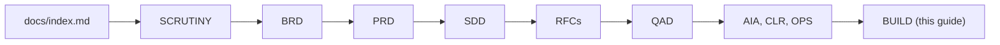

> Materialized from `docs/build-silverbot.md`. Do not edit this file directly; edit the canonical doc and re-materialize.

# Project Build Guide (BUILD)

**Project:** Silver Bot (ICT Silver Bullet trading bot)
**Version:** 0.1
**Owner:** Cian Jake Francisco
**Status:** Draft
**Last updated:** 2026-10-08
**Last reconciled:** 2026-10-08 against code at commit `62037d1`

This guide tells a coding agent or a human how to build Silver Bot from the canonical docs. It is materialized to the root `AGENTS.md`, which every future session reads first. Safety rules in section 5 are carried over from the previous `AGENTS.md` and must not be weakened.

## 1. How to Build From These Docs

Read in this order. Start at `docs/index.md` (created in a later task; plain-text reference only), then:



1. [scrutiny-silverbot.md](docs/scrutiny-silverbot.md): gaps (`G-#`) and what is known to be wrong.
2. [brd-silverbot.md](docs/brd-silverbot.md): business goals, metrics, owner-input register.
3. [prd-silverbot.md](docs/prd-silverbot.md): features `PRD-F1`..`PRD-F12`, stories, status, task checkboxes (section 9).
4. [sdd-silverbot.md](docs/sdd-silverbot.md): architecture and module design.
5. RFCs: [signal engine](docs/rfc-silverbot-signal-engine.md), [risk and kill switch](docs/rfc-silverbot-risk-kill-switch.md), [ML filter gate](docs/rfc-silverbot-ml-filter-gate.md), [readiness gates](docs/rfc-silverbot-readiness-gates.md).
6. [qad-silverbot.md](docs/qad-silverbot.md): test scenarios `QAD-T#`.
7. [aia-silverbot.md](docs/aia-silverbot.md), [clr-silverbot.md](docs/clr-silverbot.md), [ops-silverbot.md](docs/ops-silverbot.md): AI risks, compliance rows, runbooks.
8. This guide. Supporting: [idea-silverbot.md](docs/idea-silverbot.md), [val-silverbot.md](docs/val-silverbot.md), [ues-silverbot.md](docs/ues-silverbot.md), [sad-silverbot.md](docs/sad-silverbot.md), [voice-silverbot.md](docs/voice-silverbot.md), [audit-docs-drift.md](docs/audit-docs-drift.md), [README.md](README.md).

Build only against Locked docs. While every doc is Draft, flag the ambiguity to the owner instead of guessing. Code wins over any doc; a disagreement is recorded in [audit-docs-drift.md](docs/audit-docs-drift.md).

Re-ground (re-read the relevant doc and the code) when:

- a task touches `risk/`, `execution/`, `exchange/`, `config/`, `readiness.py` or `demo_readiness.py`;
- a doc and the code disagree, or a doc says `Open` or `Owner input required`;
- the pinned stack in section 3 may have changed;
- more than one task has passed since you last read the index.

### Traceability map

| To build | Read | Verify against |
|----------|------|----------------|
| Signal engine (PRD-F1) | [rfc-silverbot-signal-engine.md](docs/rfc-silverbot-signal-engine.md), SDD strategy section | `tests/` strategy tests, QAD strategy scenarios |
| Backtester and validation (PRD-F2) | SDD backtest section, [qad-silverbot.md](docs/qad-silverbot.md) | backtest tests; evidence reports must be non-empty before any performance claim |
| Risk engine and kill switch (PRD-F3) | [rfc-silverbot-risk-kill-switch.md](docs/rfc-silverbot-risk-kill-switch.md) | risk tests, [clr-silverbot.md](docs/clr-silverbot.md), subagent SAD-A2 |
| Paper trading (PRD-F4) | SDD execution section | paper trading tests with mocked exchange |
| Demo mode (PRD-F5) and readiness (PRD-F8) | [rfc-silverbot-readiness-gates.md](docs/rfc-silverbot-readiness-gates.md) | readiness tests, subagent SAD-A1 |
| ML filter (PRD-F6) | [rfc-silverbot-ml-filter-gate.md](docs/rfc-silverbot-ml-filter-gate.md), [aia-silverbot.md](docs/aia-silverbot.md) | ML tests, subagent SAD-A3 |
| Monitoring (PRD-F7), deployment (PRD-F11) | [ops-silverbot.md](docs/ops-silverbot.md) | monitoring tests, runbook steps |
| Config (PRD-F9), data and storage (PRD-F10) | SDD config and data sections | config tests, `.env.example` loads |

## 2. Subagents

Four safety reviewers run before merge on the paths each guards. The roster, trigger rules and orchestration are in [sad-silverbot.md](docs/sad-silverbot.md) section 4. The generated cards live in `.claude/agents/`. Do not edit them by hand.

## 3. Stack Currency & Deprecations

**Verified 2026-10-08** against `pyproject.toml`, `Dockerfile` and the code at commit `62037d1`.

| Component | Pinned value | Source |
|-----------|--------------|--------|
| Python | `requires-python = ">=3.11"` | `pyproject.toml` |
| Runtime dependencies | `dependencies = []` (none declared; standard library only) | `pyproject.toml` |
| Dev dependency | `pytest>=8.0` (optional extra `dev`) | `pyproject.toml` |
| Build backend | `setuptools>=68` | `pyproject.toml` |
| scikit-learn | Optional and undeclared; used only for the RandomForest and GradientBoosting models if it imports | [aia-silverbot.md](docs/aia-silverbot.md) section 1.2 |
| Docker base image | `python:3.11-slim` | `Dockerfile` line 1 |
| Binance Futures REST and WebSocket | Versionless public API; no pinned version | https://binance-docs.github.io/apidocs/futures/en/ |

No version in this table is invented. If `pyproject.toml` or the `Dockerfile` changes, update the table and its date.

### Deprecations register

| ID | Old convention (in old docs) | Current code | Use instead |
|----|------------------------------|--------------|-------------|
| D-4 | `ML_FILTER_ENABLED` and `ML_ENABLED` turn the ML filter on | Keys parse but have no runtime effect | Treat ML as not wired; see [rfc-silverbot-ml-filter-gate.md](docs/rfc-silverbot-ml-filter-gate.md) |
| D-11 | `MAX_RISK_PER_TRADE`, `MAX_DAILY_LOSS`, `MAX_LEVERAGE` env keys set risk caps | Keys validate in demo mode but are not wired to `RiskConfig` | Caps live in `RiskConfig` defaults; see [rfc-silverbot-risk-kill-switch.md](docs/rfc-silverbot-risk-kill-switch.md) |
| D-10 | Live trading is gated by `LIVE_TRADING` plus readiness | `LIVE_TRADING=true` is rejected at load; readiness is never consulted by the entrypoint | Live is `Planned, blocked`; see [rfc-silverbot-readiness-gates.md](docs/rfc-silverbot-readiness-gates.md) |

The full list is in [audit-docs-drift.md](docs/audit-docs-drift.md).

## 4. Golden-Path Patterns

Excerpted from real code, verified 2026-10-08 against commit `62037d1`. Copy the shape, not the line numbers.

### (a) A strategy rejection returns NO_TRADE with a reason

`src/silver_bot/strategy/silver_bullet.py:67-73` and `:258-267`:

```python
        if len(candles) < max(5, self.config.swing_lookback + 3):
            return self._reject(candles, "Not enough candles to evaluate Silver Bullet setup")

        latest = candles[-1]
        session = self.sessions.evaluate(latest.open_time)
        if not session.is_active:
            return self._reject(candles, "Outside enabled Silver Bullet session")
...
    def _reject(self, candles: Sequence[Candle], reason: str) -> SilverBulletSignal:
        latest = candles[-1] if candles else None
        return SilverBulletSignal(
            direction=SignalDirection.NO_TRADE,
            symbol=latest.symbol if latest else "UNKNOWN",
            timeframe=latest.timeframe if latest else "UNKNOWN",
            generated_at=self._signal_timestamp(latest) if latest else datetime.now(timezone.utc),
            reason=reason,
            explanation=f"NO_TRADE: {reason}",
        )
```

`strategy/models.py:191-192` enforces it: a `NO_TRADE` signal without a reason raises `ValueError`.

### (b) An order request passes through the risk engine and kill switch

`src/silver_bot/risk/engine.py:25-36` (kill switch is the first check) and `src/silver_bot/execution/paper_trading.py:207-216` (the caller must ask the risk engine before any fill):

```python
    def evaluate(self, request: RiskRequest) -> RiskDecision:
        """Return a risk decision with an explicit approval or rejection reason."""

        self.state.roll_day(request.signal_day)

        if self.kill_switch.is_active():
            return self._reject("Kill switch is active")
        if request.equity <= 0:
            return self._reject("Account equity must be positive")
        if request.entry_price is None:
            return self._reject("Entry price is required")
        if request.stop_loss is None:
            return self._reject("Stop loss is required")
```

```python
        decision = self.risk.evaluate(
            RiskRequest(
                equity=self.equity,
                entry_price=signal.entry_price,
                stop_loss=signal.stop_loss,
                take_profit=signal.take_profit,
                direction=signal.direction.value,
                signal_day=signal.generated_at.date(),
            )
        )
        if not decision.approved:
            ...
            return
```

The `...` elides the lines after 216 (the rejection event, audit log and alert).

A rejected decision is recorded and the function returns before any position is opened.

### (c) Fail-closed config validation rejects live mode

`src/silver_bot/config/settings.py:104-107`:

```python
    if live_trading:
        raise ConfigError("LIVE_TRADING=true is rejected in Phase 1")
    if raw.get("TRADING_MODE", "").strip().lower() == "live":
        raise ConfigError("TRADING_MODE=live is not supported in Phase 1")
```

Any new mode or flag must follow the same rule: invalid or unsafe input raises `ConfigError`; it never degrades to a permissive default.

## 5. Conventions & Guardrails

### Non-Negotiable Safety Rules

Never:

```text
enable live trading by default
place real orders unless LIVE_TRADING=true
hardcode API keys
commit .env files
use martingale
average down
trade without stop loss
let ML generate trades directly
bypass the risk engine
bypass the kill switch
optimize on the final test set
```

### Default Mode

Default mode must be:

```text
paper or backtest
```

Live trading must be blocked unless explicitly enabled and readiness checks pass.

### Development Style

Use:

```text
Python 3.11+
type hints
docstrings
modular files
pytest tests
clear error handling
structured logging
```

Prefer simple, understandable code over clever code.

### Expected Repository Layout

Use this structure unless there is a strong reason to change it:

```text
src/silver_bot/
  config/
  data/
  exchange/
  strategy/
  risk/
  execution/
  backtest/
  ml/
  monitoring/
  storage/
  utils/

tests/
data/
models/
logs/
reports/
```

### Implementation Rules

For every task:

1. Read the relevant documentation.
2. Implement only the requested phase or task.
3. Add or update tests.
4. Do not introduce live trading unless explicitly requested.
5. Update `PROGRESS.md`.
6. Update `TODO.md` checkboxes if tasks are completed.
7. Summarize changed files.
8. Explain how to run tests.

Note: `PROGRESS.md` and `TODO.md` were retired by the documentation suite. Read steps 5 and 6 as: update `docs/index.md` and the LOG (`docs/log-silverbot.md`), and update the PRD section 9 checkboxes.

### Strategy Rules

The strategy is ICT Silver Bullet.

The bot should look for:

```text
session window
liquidity sweep
displacement
market structure shift
Fair Value Gap
retracement into FVG
defined stop loss
liquidity-based take profit
```

The strategy engine should output:

```text
LONG
SHORT
NO_TRADE
```

Every rejected setup must include a reason.

### ML Rules

ML is optional.

ML can only:

```text
approve a rule-based signal
reject a rule-based signal
reduce risk
```

ML cannot:

```text
generate trades
place orders
increase risk beyond maximum
bypass stop loss
bypass kill switch
```

### Risk Rules

The risk engine is mandatory.

Every trade must pass:

```text
position sizing
stop-loss validation
reward-to-risk validation
daily loss validation
consecutive loss validation
max trades validation
kill switch validation
```

### Testing Requirements

When adding code, add tests for:

```text
normal cases
edge cases
unsafe cases
invalid config
risk rejection
```

Use mocks for exchange calls.

Do not require real API keys for tests.

### Documentation Updates

When completing a task:

- update `docs/index.md` and the LOG (`docs/log-silverbot.md`) every task;
- update the PRD section 9 checkboxes ([prd-silverbot.md](docs/prd-silverbot.md));
- if architecture, strategy, risk or ML changes, update the SDD, RFC-001 (signal engine), RFC-002 (risk and kill switch) or the AIA respectively;
- a change to a Locked doc requires a Change Record (section 5.1).

`docs/index.md` and `docs/log-silverbot.md` are referenced as plain paths because they are created in a later task.

### Diagrams

Every diagram in the docs is a fenced `mermaid` block (flowchart, sequenceDiagram, stateDiagram-v2 or erDiagram) so it renders on GitHub. Validate with `npx -y @mermaid-js/mermaid-cli@11.4.2` run in a scratch directory outside the repo.

### Restraint ladder

Add only what the task needs. Climb one rung at a time:

1. Do nothing: the existing code or doc already answers it.
2. Reuse: call or extend what exists.
3. Configure: change a value, not code.
4. Add the smallest new function or doc paragraph.
5. Add a new module or doc only when rungs 1 to 4 fail.

Never cut: validation, risk gates, the kill switch, stop loss, tests or secret hygiene. YAGNI applies to features, not to safety.

### 5.1 Change Workflow

1. Propose a Change Record `docs/cr-silverbot-<slug>.md` with sections: Why, Divergences, Changes, Verification, Pre-merge gate runs, Deferred.
2. Apply the change (code, tests, docs).
3. Verify: run the tests and the doc checks; run the subagent reviewers that SAD section 4 requires.
4. Register the Change Record in the index section 2 (`docs/index.md`).

### Definition of Done

- Tests added and passing (`python -m pytest`); no real API key needed.
- No safety rule in section 5 weakened; risk engine and kill switch still on every order path.
- Docs updated per "Documentation Updates"; no em dashes; links resolve.
- Required subagent reviewers returned PASS or the owner recorded why a FAIL is accepted.
- Final response given in the format below.

### Code review checklist

- [ ] Any path to a real order without the risk engine, kill switch or stop loss?
- [ ] Any default that is permissive (live, ML, kill switch off)?
- [ ] Any secret, `.env` content or API key in code, tests or logs?
- [ ] Any lookahead or leakage, or use of the final test set for tuning?
- [ ] Every rejected setup carries a reason?
- [ ] Tests cover normal, edge, unsafe, invalid config and risk rejection?
- [ ] Performance claims backed by a non-empty evidence report?

### Final Response After Each Task

After completing a task, provide:

```text
Summary
Files changed
Tests added
How to run
Remaining risks
Next recommended task
```

## 6. Public Surface

None. The bot has no public web surface; crawler policy is not applicable.

## 7. Materialization

| Target | Source | Mode |
|--------|--------|------|
| `AGENTS.md` | this doc (with a banner; links rewritten to `docs/...`) | generated |
| `CLAUDE.md` | hand-maintained pointer to `AGENTS.md` | hand |
| `MODEL_CARD.md` | [aia-silverbot.md](docs/aia-silverbot.md) section 1 | generated |
| `.claude/agents/*` | [sad-silverbot.md](docs/sad-silverbot.md) section 3 | generated |

The generator lives outside the repository, so a stale or hand-edited generated file is caught in review, not by CI. Never edit generated files directly; edit the source doc and re-materialize.

## 8. Self-Check

- [x] Read order covers every committed suite doc and RFC.
- [x] Section 5 carries every rule line of the previous `AGENTS.md`.
- [x] Pinned stack values match `pyproject.toml` and `Dockerfile`; none invented.
- [x] Golden-path excerpts are copied from real files with `file:line` and the commit.
- [x] `docs/index.md` and LOG are referenced as plain text, not links.
- [x] No em dashes.
- [ ] Locked: not yet; every doc is Draft in this pass.
