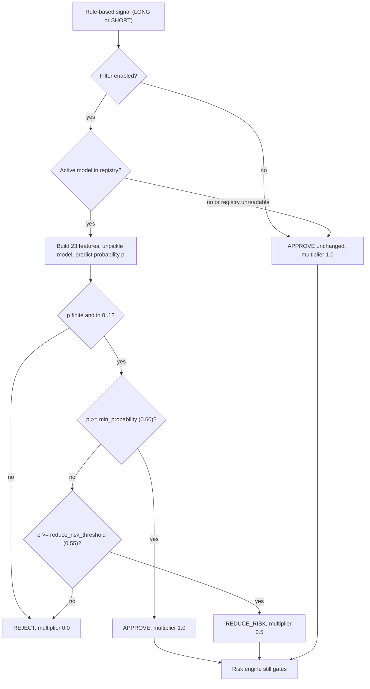

> Materialized from `docs/aia-silverbot.md §1`. Do not edit this file directly; edit the canonical doc and re-materialize with `python tools/materialize_docs.py`.

# Model Card: Silver Bot ML Filter

## 1. Model / System Card

This section stands alone: it is the source of the root `MODEL_CARD.md`. Evidence for every statement is cited to code at commit `70ccaec`. Related documents: [sdd-silverbot.md](docs/sdd-silverbot.md) (design, section 8), [rfc-silverbot-ml-filter-gate.md](docs/rfc-silverbot-ml-filter-gate.md), the Risk Register in [aia-silverbot.md](docs/aia-silverbot.md), [scrutiny-silverbot.md](docs/scrutiny-silverbot.md) (gaps, `G-n`), [audit-docs-drift.md](docs/audit-docs-drift.md) (drift findings `D-n` and hazards `H-n`; open questions `U-n`), [qad-silverbot.md](docs/qad-silverbot.md) (test scenarios, `QAD-Tn`) and [brd-silverbot.md](docs/brd-silverbot.md) (owner-input rows, `OI-n`).

| Field | Value |
|---|---|
| System | Silver Bot ML probability filter (optional) |
| Owner | Cian Jake Francisco |
| Status | Draft; not deployed; no trained model exists in `models/` (the directory is empty) |
| Task | Binary classification: probability that a rule-based ICT Silver Bullet setup reaches take profit before stop loss |
| Position in system | After the rule-based strategy, before the risk engine |
| Default | Off (`ML_FILTER_ENABLED=false`, `MLFilterConfig.enabled=False`) |
| Performance claim | None. No trained model, and no evidence report with content |

### 1.1 Intended use and forbidden use

**Intended use.** An offline-trained classifier, run by the owner, scores each rule-based `LONG` or `SHORT` signal. The filter then applies the decision rule below. The only intended user is the owner-operator. The filter is a research aid for paper and backtest modes.

The thresholds are code defaults (`ml/filter.py:27-44,148-159`). A NaN, infinite, negative or above-1 probability rejects with multiplier 0.0, probability None and reason `ML model returned an invalid probability` (`ml/filter.py:134-146`). The disabled, no-model and `NO_TRADE` paths approve the unchanged signal (`filter.py:87-124`).

**Permitted effects.** Approve a rule-based signal; reject it; reduce its risk (position size, risk amount and leverage multiplied by the multiplier after the risk engine approved, `backtest/engine.py:492-506`, `execution/paper_trading.py:252-259`).

**Forbidden use.** The following are never allowed, matching the project rules and the package contract (`ml/__init__.py:1-5`):

- generating a trade or a signal from a model alone;
- placing, modifying or cancelling an order;
- increasing risk, position size or leverage above what the risk engine approved;
- widening, moving or removing a stop loss;
- bypassing the risk engine or the kill switch;
- optimising on the final test set;
- enabling or supporting live trading; the filter has no role in the live gate (RFC-004);
- loading a model artifact or registry file from an untrusted source (artifacts are pickle files, see §1.3);
- treating any output as a prediction of profit or as financial advice.

### 1.2 Model(s) and data

**Models implemented** (`ml/training.py`):

| Model | When trained | Detail | Source |
|---|---|---|---|
| `SimpleLogisticRegressionModel` | Always | Pure-Python (no numpy) batch gradient-descent logistic regression: z-score normalisation (zero standard deviation gives scale 1.0), weights start at 0, bias is the log-odds of the train positive rate clamped to [0.01, 0.99], learning rate 0.1, 500 iterations, no regularisation | `training.py:27-77,272-291` |
| `RandomForestClassifier` | Only if scikit-learn imports and train labels have both classes | `n_estimators=50`, `random_state=0` | `training.py:157-199` |
| `GradientBoostingClassifier` | Same condition | `random_state=0` | `training.py:157-199` |

scikit-learn is not a declared dependency (`pyproject.toml:10-15`, `dependencies = []`); an `ImportError` silently skips the two sklearn models. XGBoost, LightGBM and deep models are not implemented (`training.py:171`). Training does not choose a best model and does not register or activate anything (`training.py:89-154`).

**Dataset.** One row per rule-based setup (`MLSetupRow`, `ml/dataset.py:14-25`). The builder sorts candles by open time, requires at least `max(5, swing_lookback+3)` candles, and for each candle re-runs `strategy.evaluate` on the prefix up to that candle, skipping `NO_TRADE` (`dataset.py:80-92`). Label 1 means take profit was reached before stop loss within `max_lookahead_candles` (default 100); label 0 means stop loss first, or both touched in the same candle (conservative); unresolved setups are dropped and counted (`dataset.py:66-70,94-98,125-153`). Labelling does not require the entry to be filled, and overlapping setups on consecutive candles are not de-duplicated (`dataset.py:85-116,140-153`).

**Features.** 23 features in fixed order (`ml/features.py:35-59`): direction_long, direction_short, entry_price, stop_distance, target_distance, reward_to_risk, setup_quality_score, session_london, session_new_york_am, session_new_york_pm, session_unknown, minutes_from_session_open, minutes_until_session_close, day_of_week, hour_new_york, atr, atr_percent, recent_range, recent_body, recent_volume, recent_return_1, recent_return_3, close_position_in_candle. Defaults: ATR period 5, recent window 5, timezone America/New_York (`features.py:66-68`). Features are computed from the candle prefix at the signal and the signal only; outcome data lives only in labels (`features.py:1-5,91-93`). Liquidity, FVG, displacement, market-structure and higher-timeframe-bias features are not implemented. The leakage check is a keyword test on feature names (`future`, `label`, `outcome`, `tp_hit`, `sl_hit`, `exit`, `pnl`, `realized`, `mfe`, `mae`) (`features.py:21-32,148-157`).

**Split.** `time_based_split` sorts by `signal_time`, never shuffles, and defaults to 0.6 train, 0.2 validation, remainder test (`dataset.py:156-183`). There is no purge or embargo, so a training label can resolve inside the validation window. The test split is created but never scored by training and is documented as held out (`training.py:96-100,119-126`).

**Evaluation.** Validation metrics at a fixed 0.5 threshold: sample count, accuracy, precision, recall, F1, positive rate, ROC AUC (`training.py:234-269`). A separate calibration report gives the Brier score and Expected Calibration Error over equal-width bins, as a report only; no calibrator is fitted (`calibration.py:59-185`). No trading metrics (profit factor, expectancy, drawdown) are computed in `ml/`. An advisory promotion policy rejects a candidate that used the final test set, lacks metrics, has Brier above 0.25, has fewer than 30 samples, is not better than the active model on validation, or degrades test score by more than 0.02 (`promotion.py:22-182`); it is not enforced on registry activation (D-37).

**Registry and inference.** One JSON registry file (default `models/model_registry.json`); rollback is `set_active(model_id)`; entries are never deleted (`registry.py:40-159`). At inference the artifact is loaded with `pickle.load` (`registry.py:126-131`). Each decision is written to the audit log and to the SQLite `ml_predictions` table by the paper loop (`execution/paper_trading.py:140-160`).

**Data source.** None is connected. Historical market data fetching is not implemented (G-13); the dataset builder takes candles from the caller. No training data, trained model or registry is shipped.

### 1.3 Limitations and performance caveats

- **No model, no performance claim.** `models/` is empty. No accuracy, AUC, calibration or trading result exists to cite, and none may be inferred from the code. Test fixtures use stand-in probabilities (for example 0.72, 0.57, 0.40) that say nothing about real behaviour.
- **Wired for backtests and paper and demo sessions.** The ML environment settings reach the filter in CLI backtests (`f84557e`) and in the paper and demo runtime (`973cd82`) (D-4, G-9 partial). There is no command for the offline pipeline (G-22).
- **Invalid probability rejects (H-1, G-8 fixed in `8e66054`).** The raw `predict_proba` value is no longer clamped (`ml/filter.py:193`); NaN, infinite or out-of-[0, 1] output rejects the signal (`ml/filter.py:134-146`). Before the fix NaN became 1.0 and approved. Pinned by `tests/test_ml_probability_filter.py:197,210` (QAD-T145).
- **Errors propagate.** A corrupt artifact, a feature-build error or a row-length mismatch is not caught by `evaluate` (`filter.py:126-133`). Only registry read errors fall back (`filter.py:112-124,174-178`).
- **Fail-open when no model.** A missing registry silently returns the unchanged rule-based signal, so an enabled filter with no model is indistinguishable from a disabled one except by the reason string.
- **Pickle.** Loading a registered artifact executes code if the registry or artifact file is untrusted (`registry.py:126-131`, H-8, G-23). Artifacts are expected to be self-generated and local.
- **No staleness or drift handling.** Model age, training window and live feature drift are not checked; there is no retraining schedule (`filter.py:112-133`).
- **Leakage controls are weak.** The check is a keyword test on names only; higher-timeframe candles are passed to every strategy call unsliced in the dataset builder, and whether the strategy uses only candles up to the signal time is `Open` (`dataset.py:87-90`, U-6, G-22); there is no purge or embargo.
- **Promotion not enforced.** An unpromoted model can be made active; it can still only approve, reject or reduce (D-37).
- **Small and noisy labels.** Overlapping setups are not de-duplicated, entry fill is not required, the label window is a fixed 100 candles, and the policy minimum of 30 samples is far below what a reliable classifier needs. The minimum the owner accepts is `Owner input required` (BRD OI-9).
- **Environment dependence.** Results differ if scikit-learn is or is not installed, because the sklearn models are trained only when it imports.
- **Training output is not promotion-ready.** It has no `test_metrics`, calibration block or top-level `sample_count`; the caller must build them (`training.py:218-223`).
- **Unclamped multiplier in paper mode.** Bounded only by `MLFilterConfig` validation (`execution/paper_trading.py:252-259`).
- **Scope.** Single owner, paper and backtest only. No fairness or personal-data analysis applies because the inputs are market candles and the owner's own setups.
