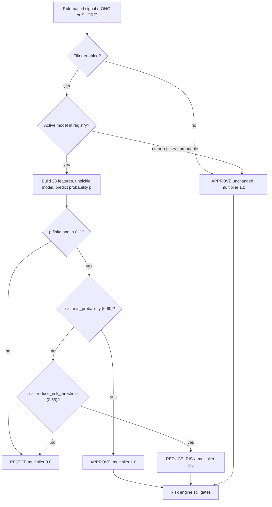

# AI Assurance Dossier (AIA)

**Project:** Silver Bot (ICT Silver Bullet trading bot)
**Version:** 0.1
**Owner:** Cian Jake Francisco
**Status:** Draft
**Last updated:** 2026-10-09
**Last reconciled:** 2026-10-09 against code at commit `70ccaec` (the G-8 fix `8e66054`; the rest of `ml/` is unchanged since `62037d1`)

This dossier assures the one machine-learning component in Silver Bot: the optional ML probability filter (PRD-F6). It absorbs the assurance content of the old `ML_MODEL.md`. Architecture is in [sdd-silverbot.md](sdd-silverbot.md) §8 and §8.1; the decision record is [rfc-silverbot-ml-filter-gate.md](rfc-silverbot-ml-filter-gate.md) (RFC-003); the product requirement is PRD-F6 in [prd-silverbot.md](prd-silverbot.md). Test scenarios are `QAD-T#` in [qad-silverbot.md](qad-silverbot.md) §3.5; gaps are `G-#` in [scrutiny-silverbot.md](scrutiny-silverbot.md); drift and hazards (`D-#`, `H-#`) are in [audit-docs-drift.md](audit-docs-drift.md). Code wins over old documents. Live trading is `Planned, blocked` (PRD-F12) and nothing here enables it.

No performance claim is made anywhere in this dossier: no trained model exists in the repository, and the evidence reports are empty (G-1).

## 0. Trigger and Scope

**Trigger.** This dossier applies because Silver Bot contains a component that learns from data and influences a trading decision: `ml/` builds a dataset, trains logistic, random forest and gradient boosting classifiers, and `MLProbabilityFilter` turns a model probability into approve, reject or reduce-risk.

**What is in scope.** The offline pipeline (`ml/dataset.py`, `features.py`, `training.py`, `calibration.py`, `promotion.py`, `registry.py`) and the inference filter (`ml/filter.py`) with its two consumers (`backtest/engine.py`, `execution/paper_trading.py`).

**What the filter is, as built.**

- Optional. Off by default: `MLFilterConfig.enabled=False` (`ml/filter.py:30`); the environment key `ML_FILTER_ENABLED` defaults to `false` (`config/settings.py:80,152`) and the Dockerfile and compose force it to `false` (`Dockerfile:11`; compose `research` forces it off).
- Bounded. It receives an existing rule-based signal and may only approve it unchanged, reject it, or reduce its risk with a multiplier in (0, 1] (`ml/filter.py:43-44,148-159`). It cannot create a trade, place an order, raise risk, change a stop loss or bypass the kill switch (SDD §8.1).
- Downstream of the rules and upstream of the risk engine. An approved or reduced signal still passes `risk.evaluate` (`backtest/engine.py:128-196`; `execution/paper_trading.py:176-267`).
- Not wired to settings. The four `ML_*` settings are parsed and validated but never converted to an `MLFilterConfig`; the paper loop builds `MLProbabilityFilter()` with defaults, which is disabled (`execution/paper_trading.py:53`, D-4, G-9). In the built system the filter is therefore always off unless a caller injects a configured filter in code.
- Not exposed. No command runs the offline pipeline (`ml/__init__.py:7-46`, S-21, G-22).

**Out of scope.** Strategy rules (RFC-001), the risk engine (RFC-002) and readiness gates (RFC-004). ML never replaces them.

## 1. Model / System Card

This section stands alone: it is the source of the root `MODEL_CARD.md`. Evidence for every statement is cited to code at commit `70ccaec`. Related documents: [sdd-silverbot.md](sdd-silverbot.md) (design, section 8), [rfc-silverbot-ml-filter-gate.md](rfc-silverbot-ml-filter-gate.md), the Risk Register in [aia-silverbot.md](aia-silverbot.md), [scrutiny-silverbot.md](scrutiny-silverbot.md) (gaps, `G-n`), [audit-docs-drift.md](audit-docs-drift.md) (drift findings `D-n` and hazards `H-n`; open questions `U-n`), [qad-silverbot.md](qad-silverbot.md) (test scenarios, `QAD-Tn`) and [brd-silverbot.md](brd-silverbot.md) (owner-input rows, `OI-n`).

| Field | Value |
|---|---|
| System | Silver Bot ML probability filter (optional) |
| Owner | Cian Jake Francisco |
| Status | Draft; not deployed; no trained model exists in `models/` (the directory is empty) |
| Task | Binary classification: probability that a rule-based ICT Silver Bullet setup reaches take profit before stop loss |
| Position in system | After the rule-based strategy, before the risk engine |
| Default | Off (`ML_FILTER_ENABLED=false`, `MLFilterConfig.enabled=False`) |
| Performance claim | None. No trained model, and no evidence report with content |

### 1.1 Intended use and forbidden use

**Intended use.** An offline-trained classifier, run by the owner, scores each rule-based `LONG` or `SHORT` signal. The filter then applies the decision rule below. The only intended user is the owner-operator. The filter is a research aid for paper and backtest modes.

The thresholds are code defaults (`ml/filter.py:27-44,148-159`). A NaN, infinite, negative or above-1 probability rejects with multiplier 0.0, probability None and reason `ML model returned an invalid probability` (`ml/filter.py:134-146`). The disabled, no-model and `NO_TRADE` paths approve the unchanged signal (`filter.py:87-124`).

**Permitted effects.** Approve a rule-based signal; reject it; reduce its risk (position size, risk amount and leverage multiplied by the multiplier after the risk engine approved, `backtest/engine.py:492-506`, `execution/paper_trading.py:252-259`).

**Forbidden use.** The following are never allowed, matching the project rules and the package contract (`ml/__init__.py:1-5`):

- generating a trade or a signal from a model alone;
- placing, modifying or cancelling an order;
- increasing risk, position size or leverage above what the risk engine approved;
- widening, moving or removing a stop loss;
- bypassing the risk engine or the kill switch;
- optimising on the final test set;
- enabling or supporting live trading; the filter has no role in the live gate (RFC-004);
- loading a model artifact or registry file from an untrusted source (artifacts are pickle files, see §1.3);
- treating any output as a prediction of profit or as financial advice.

### 1.2 Model(s) and data

**Models implemented** (`ml/training.py`):

| Model | When trained | Detail | Source |
|---|---|---|---|
| `SimpleLogisticRegressionModel` | Always | Pure-Python (no numpy) batch gradient-descent logistic regression: z-score normalisation (zero standard deviation gives scale 1.0), weights start at 0, bias is the log-odds of the train positive rate clamped to [0.01, 0.99], learning rate 0.1, 500 iterations, no regularisation | `training.py:27-77,272-291` |
| `RandomForestClassifier` | Only if scikit-learn imports and train labels have both classes | `n_estimators=50`, `random_state=0` | `training.py:157-199` |
| `GradientBoostingClassifier` | Same condition | `random_state=0` | `training.py:157-199` |

scikit-learn is not a declared dependency (`pyproject.toml:10-15`, `dependencies = []`); an `ImportError` silently skips the two sklearn models. XGBoost, LightGBM and deep models are not implemented (`training.py:171`). Training does not choose a best model and does not register or activate anything (`training.py:89-154`).

**Dataset.** One row per rule-based setup (`MLSetupRow`, `ml/dataset.py:14-25`). The builder sorts candles by open time, requires at least `max(5, swing_lookback+3)` candles, and for each candle re-runs `strategy.evaluate` on the prefix up to that candle, skipping `NO_TRADE` (`dataset.py:80-92`). Label 1 means take profit was reached before stop loss within `max_lookahead_candles` (default 100); label 0 means stop loss first, or both touched in the same candle (conservative); unresolved setups are dropped and counted (`dataset.py:66-70,94-98,125-153`). Labelling does not require the entry to be filled, and overlapping setups on consecutive candles are not de-duplicated (`dataset.py:85-116,140-153`).

**Features.** 23 features in fixed order (`ml/features.py:35-59`): direction_long, direction_short, entry_price, stop_distance, target_distance, reward_to_risk, setup_quality_score, session_london, session_new_york_am, session_new_york_pm, session_unknown, minutes_from_session_open, minutes_until_session_close, day_of_week, hour_new_york, atr, atr_percent, recent_range, recent_body, recent_volume, recent_return_1, recent_return_3, close_position_in_candle. Defaults: ATR period 5, recent window 5, timezone America/New_York (`features.py:66-68`). Features are computed from the candle prefix at the signal and the signal only; outcome data lives only in labels (`features.py:1-5,91-93`). Liquidity, FVG, displacement, market-structure and higher-timeframe-bias features are not implemented. The leakage check is a keyword test on feature names (`future`, `label`, `outcome`, `tp_hit`, `sl_hit`, `exit`, `pnl`, `realized`, `mfe`, `mae`) (`features.py:21-32,148-157`).

**Split.** `time_based_split` sorts by `signal_time`, never shuffles, and defaults to 0.6 train, 0.2 validation, remainder test (`dataset.py:156-183`). There is no purge or embargo, so a training label can resolve inside the validation window. The test split is created but never scored by training and is documented as held out (`training.py:96-100,119-126`).

**Evaluation.** Validation metrics at a fixed 0.5 threshold: sample count, accuracy, precision, recall, F1, positive rate, ROC AUC (`training.py:234-269`). A separate calibration report gives the Brier score and Expected Calibration Error over equal-width bins, as a report only; no calibrator is fitted (`calibration.py:59-185`). No trading metrics (profit factor, expectancy, drawdown) are computed in `ml/`. An advisory promotion policy rejects a candidate that used the final test set, lacks metrics, has Brier above 0.25, has fewer than 30 samples, is not better than the active model on validation, or degrades test score by more than 0.02 (`promotion.py:22-182`); it is not enforced on registry activation (D-37).

**Registry and inference.** One JSON registry file (default `models/model_registry.json`); rollback is `set_active(model_id)`; entries are never deleted (`registry.py:40-159`). At inference the artifact is loaded with `pickle.load` (`registry.py:126-131`). Each decision is written to the audit log and to the SQLite `ml_predictions` table by the paper loop (`execution/paper_trading.py:140-160`).

**Data source.** None is connected. Historical market data fetching is not implemented (G-13); the dataset builder takes candles from the caller. No training data, trained model or registry is shipped.

### 1.3 Limitations and performance caveats

- **No model, no performance claim.** `models/` is empty. No accuracy, AUC, calibration or trading result exists to cite, and none may be inferred from the code. Test fixtures use stand-in probabilities (for example 0.72, 0.57, 0.40) that say nothing about real behaviour.
- **Not wired.** The ML environment settings have no runtime effect (D-4, G-9). There is no command for the offline pipeline (G-22).
- **Invalid probability rejects (H-1, G-8 fixed in `8e66054`).** The raw `predict_proba` value is no longer clamped (`ml/filter.py:193`); NaN, infinite or out-of-[0, 1] output rejects the signal (`ml/filter.py:134-146`). Before the fix NaN became 1.0 and approved. Pinned by `tests/test_ml_probability_filter.py:197,210` (QAD-T145).
- **Errors propagate.** A corrupt artifact, a feature-build error or a row-length mismatch is not caught by `evaluate` (`filter.py:126-133`). Only registry read errors fall back (`filter.py:112-124,174-178`).
- **Fail-open when no model.** A missing registry silently returns the unchanged rule-based signal, so an enabled filter with no model is indistinguishable from a disabled one except by the reason string.
- **Pickle.** Loading a registered artifact executes code if the registry or artifact file is untrusted (`registry.py:126-131`, H-8, G-23). Artifacts are expected to be self-generated and local.
- **No staleness or drift handling.** Model age, training window and live feature drift are not checked; there is no retraining schedule (`filter.py:112-133`).
- **Leakage controls are weak.** The check is a keyword test on names only; higher-timeframe candles are passed to every strategy call unsliced in the dataset builder, and whether the strategy uses only candles up to the signal time is `Open` (`dataset.py:87-90`, U-6, G-22); there is no purge or embargo.
- **Promotion not enforced.** An unpromoted model can be made active; it can still only approve, reject or reduce (D-37).
- **Small and noisy labels.** Overlapping setups are not de-duplicated, entry fill is not required, the label window is a fixed 100 candles, and the policy minimum of 30 samples is far below what a reliable classifier needs. The minimum the owner accepts is `Owner input required` (BRD OI-9).
- **Environment dependence.** Results differ if scikit-learn is or is not installed, because the sklearn models are trained only when it imports.
- **Training output is not promotion-ready.** It has no `test_metrics`, calibration block or top-level `sample_count`; the caller must build them (`training.py:218-223`).
- **Unclamped multiplier in paper mode.** Bounded only by `MLFilterConfig` validation (`execution/paper_trading.py:252-259`).
- **Scope.** Single owner, paper and backtest only. No fairness or personal-data analysis applies because the inputs are market candles and the owner's own setups.

## 2. Risk Register

Likelihood and Impact are owner-assessed qualitative ratings for the built system (Low, Medium, High); no probability is claimed. Status: `Mitigated` (control exists and is tested), `Partial` (control exists with a stated gap), `Open` (no control), `Planned` (specified in RFC-003, not built).

| AIA-R# | Risk | Likelihood | Impact | Control (file:line) | Status |
|---|---|---|---|---|---|
| AIA-R1 | Feature or label leakage: a feature uses information after the signal, or higher-timeframe data from the future | Medium | High | Prefix slicing and signal-only features `ml/features.py:1-5,91-93`; keyword check `features.py:21-32,148-157` (test `test_feature_names_do_not_include_future_leakage_columns`, QAD-T141). Gap: HTF candles unsliced `dataset.py:87-90` (U-6, G-22, QAD-T151) | Partial |
| AIA-R2 | Split leakage: training labels resolve inside the validation or test window | Medium | Medium | Chronological split without shuffling `dataset.py:156-183` (QAD-T35). Gap: no purge or embargo, `outcome_time` unused (D-73) | Partial |
| AIA-R3 | Overfitting: the model fits noise from few, overlapping setups and the owner trusts the validation score | High | Medium | Validation metrics only `training.py:234-269`; test split held out `training.py:96-100`; promotion needs 30 samples and Brier at most 0.25 `promotion.py:22-42`. Gap: test split never scored, no regularisation, no walk-forward (G-12, G-22) | Partial |
| AIA-R4 | Miscalibration: probabilities do not match outcomes, so the 0.60 and 0.55 thresholds mean little | Medium | Medium | Brier and ECE report `calibration.py:59-185` (QAD-T36); promotion Brier limit `promotion.py:111-114`. Gap: report only, no calibrator, not run by any pipeline | Partial |
| AIA-R5 | Model drift: market behaviour changes and the model degrades unnoticed | Medium | Medium | None in code. Predictions are stored for later review in `ml_predictions` (`storage/sqlite.py:103-116`, `paper_trading.py:140-160`); no drift metric, retrain schedule or alert exists | Open |
| AIA-R6 | A stale or wrong model is loaded: an old, mismatched or unpromoted artifact is active | Medium | Medium | Registry requires artifact, feature list and metrics files `registry.py:57-67`; one active model, rollback by `set_active` `registry.py:104-116`; row ordered by the model's own `features_used` `filter.py:126-132`. Gap: no age or training-window check `filter.py:112-133` (QAD-T147), promotion not enforced (D-37, QAD-T152) | Partial |
| AIA-R7 | Filter increases risk: a multiplier above 1 or a larger size | Low | High | Multiplier is 1.0, a validated value in (0, 1], or 0.0 `filter.py:43-44,150-158`; backtest clamps to [0, 1] and applies after risk approval `backtest/engine.py:492-506`; risk engine caps size and leverage downstream (RFC-002). Gap: paper path unclamped `paper_trading.py:252-259` (D-62) | Mitigated |
| AIA-R8 | Filter becomes a trade generator: ML creates or triggers an order | Low | High | `evaluate` takes an existing `SilverBulletSignal`; `NO_TRADE` approves with no probability and both consumers return before ML on `NO_TRADE` `filter.py:99-110`, `backtest/engine.py:110-115`, `paper_trading.py:127-138`; `ml/` has no exchange import or order method `ml/__init__.py:1-5`; exchange order methods raise `OrderPlacementDisabled` `exchange/base.py:44-52` | Mitigated |
| AIA-R9 | NaN or broken model output approves a signal | Low | High | Non-finite or out-of-[0, 1] probability rejects (`filter.py:134-146`, `8e66054`; H-1, G-8); tested (QAD-T145, `tests/test_ml_probability_filter.py:197,210`). An exception from the model still propagates (`filter.py:126-133`); the risk engine still gates the signal | Mitigated |
| AIA-R10 | Pickle artifact or registry is tampered with and executes code on load | Low | High | Registry path checks reject `..` and directories `config/settings.py:153-159`; artifacts are self-generated. Gap: `pickle.load` itself `registry.py:126-131` (H-8, G-23, QAD-T150) | Open |
| AIA-R11 | False assurance: the owner believes the filter is active (or inactive) because the `ML_*` settings do not reach it | High | Medium | Default-off everywhere `filter.py:30`, `Dockerfile:11`; decisions logged with a reason `filter.py:87-124`. Gap: settings never build `MLFilterConfig` `paper_trading.py:53` (D-4, G-9, QAD-T153) | Open |
| AIA-R12 | Corrupt artifact or feature error crashes the paper loop | Low | Medium | Registry read errors fall back to the unchanged signal `filter.py:174-178`. Gap: other errors propagate out of `evaluate` `filter.py:126-133` (QAD-T148) | Open |
| AIA-R13 | An unpromoted model is activated by any route | Medium | Medium | Promotion policy exists and is advisory `promotion.py:73-190` (QAD-T45, QAD-T142). Gap: `register_model(active_status=True)` and `set_active` need no promotion result `registry.py:40-116` (D-37, QAD-T152). Effect is bounded by AIA-R7 and AIA-R8 | Open |
| AIA-R14 | Results vary by environment: scikit-learn present or absent changes which models exist | Medium | Low | Logistic model always trains `training.py:272-291`. Gap: scikit-learn undeclared `pyproject.toml:10-15` (G-25) | Open |

RFC-003 holds the intended controls (`Planned`): wiring settings to the filter, treating non-finite probabilities as reject, staleness checks, and coupling promotion to activation. See [rfc-silverbot-ml-filter-gate.md](rfc-silverbot-ml-filter-gate.md).

## 3. Self-Audit Checklist

Run this before any model is enabled outside a backtest, and again after any change to `ml/`. Items marked `[ ]` cannot be satisfied today.

- [ ] A trained model exists, with a non-empty validation metrics file and a registry entry. (`models/` is empty.)
- [ ] The model was trained and validated only on data earlier than the test period; the test split was scored once, after all choices were frozen.
- [ ] `used_final_test_for_optimization` is false in the candidate metadata, and the promotion decision JSON shows `promote`.
- [ ] A calibration report exists for the candidate, Brier is at most 0.25, and the owner has read the bin table.
- [ ] The feature list matches the registry's `features_used`; no feature name contains a leakage keyword; HTF look-ahead (U-6) is closed or ruled out.
- [ ] The sample count meets the owner's minimum (`Owner input required`, OI-9).
- [ ] The artifact and registry were produced locally by the owner (pickle trust).
- [ ] The `ML_*` settings reach the filter (D-4 closed) and a startup log or audit event states whether the filter is on.
- [x] A NaN probability is rejected (H-1 closed in `8e66054`) and a test pins it (`tests/test_ml_probability_filter.py:197`).
- [ ] A backtest with the filter on versus off, on the same data, shows the filter never increased risk and never added a trade.
- [ ] Rollback was exercised: `set_active` to the previous model, decisions confirmed.
- [ ] The BUILD log and this register were updated.

## 4. Cross-links and Escalation

- Decision record: [rfc-silverbot-ml-filter-gate.md](rfc-silverbot-ml-filter-gate.md). Risk engine and kill switch: [rfc-silverbot-risk-kill-switch.md](rfc-silverbot-risk-kill-switch.md). Readiness gates: [rfc-silverbot-readiness-gates.md](rfc-silverbot-readiness-gates.md).
- Architecture: [sdd-silverbot.md](sdd-silverbot.md) §8, §8.1, §5.7. Requirement: PRD-F6 in [prd-silverbot.md](prd-silverbot.md). Tests: QAD-T33 to QAD-T46 and QAD-T141 to QAD-T153 in [qad-silverbot.md](qad-silverbot.md).
- Gaps: G-8, G-9, G-12, G-22, G-23, G-25, G-28 in [scrutiny-silverbot.md](scrutiny-silverbot.md). Drift and hazards: D-4, D-36, D-37, D-39, D-62, D-73, H-1, H-8, H-13 in [audit-docs-drift.md](audit-docs-drift.md).
- Operations when the filter misbehaves: [ops-silverbot.md](ops-silverbot.md) §4. Compliance and licensing: [clr-silverbot.md](clr-silverbot.md).

**Escalate to the owner and stop using the filter (set `ML_FILTER_ENABLED=false`, or deactivate the registry entry) when any of these occurs:**

1. A decision shows probability 1.0 where the model should not be confident, or a non-finite value appears in `ml_predictions` (AIA-R9).
2. The registry or an artifact file changed and the owner did not change it (AIA-R10).
3. A backtest or paper run shows a trade that exists only because of ML, or a position size larger than the risk engine approved (AIA-R7, AIA-R8). This is a defect: stop and open a Change Record.
4. The paper loop raises from `MLProbabilityFilter.evaluate` (AIA-R12).
5. A candidate is activated without a `promote` decision (AIA-R13).

Changes to `ml/` follow the project rule that ML cannot generate trades, place orders, raise risk or bypass the risk engine or kill switch; a change that weakens any of these is rejected.

## 5. Regulatory Awareness

Generic, by owner decision: the project is a personal research and paper-trading tool and the jurisdiction is not set (BRD OI-6). Obligations are described in [clr-silverbot.md](clr-silverbot.md).

| Topic | Generic awareness | Status |
|---|---|---|
| Automated or algorithmic trading rules for individuals | Some venues and regulators set rules for automated order flow, testing and kill functions. None applies while the bot cannot place real orders | Open (OI-6) |
| AI-specific regulation (risk classification, transparency, record-keeping) | Rules for automated decision systems vary by place. This filter makes no decision about a person and scores market setups only | Open (OI-6) |
| Model documentation | This dossier and the model card record intended use, data, limits and controls | Done (this document) |
| Human oversight | The owner approves every model before use and can disable it with one setting; no model acts on its own | Done in design; the setting is not yet wired (AIA-R11) |
| Record-keeping | Decisions are written to `logs/audit.jsonl` and `ml_predictions` when the paper loop runs | Partial (G-16) |
| Marketing or advice | The project makes no claim of returns and gives no advice to third parties | Done |

Nothing here is legal advice.

## 6. Materialization

`MODEL_CARD.md` at the repository root is generated from §1 of this file by `python tools/materialize_docs.py`. §1 is the single source; do not edit `MODEL_CARD.md` by hand. §1 starts at the exact heading `## 1. Model / System Card` and ends before `## 2. Risk Register`. Only relative links inside §1 are rewritten for the root location; `§N` references are not rewritten, so §1 avoids pointing at other sections of this file. If §1 changes, run that command and commit both files together.

## 7. Self-Check

- [x] Section 1 has the exact heading `## 1. Model / System Card` and stands alone (own summary table, intended and forbidden use, data, limits).
- [x] The risk register covers leakage, overfitting, miscalibration, drift, a stale model, the filter increasing risk and the filter becoming a trade generator, each with a `file:line` control.
- [x] No performance figure is stated; the absence of a trained model is stated in §1 and §1.3.
- [x] Every `AIA-R#` row cites code or a `D-#`, `H-#`, `G-#` or `QAD-T#` that exists in the committed documents.
- [x] Jurisdiction-dependent items are marked `Open (OI-6)`.
- [ ] The §3 self-audit checklist can be fully ticked; it cannot today because no model exists and D-4 and D-37 are open (H-1 closed in `8e66054`).
