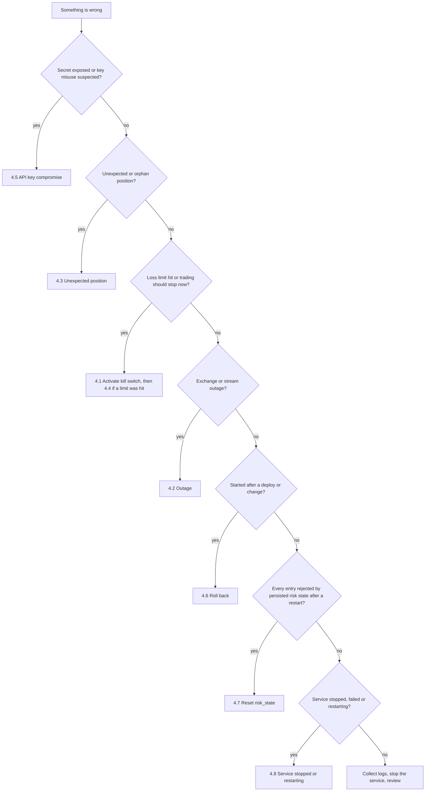

# Operations & Observability Runbook (OPS)

**Project:** Silver Bot (ICT Silver Bullet trading bot)
**Version:** 0.1
**Owner:** Cian Jake Francisco
**Status:** Draft
**Last updated:** 2026-10-14
**Last reconciled:** 2026-10-08 against code at commit `62037d1`; section 5.6 added 2026-10-09 at the `feat/operator-dashboard` head (silverbot-cr-001) and extended 2026-10-14 at `c9b410f` (silverbot-cr-002: ladder, Next strip, 24-hour stale rule, degraded line, font routes, CSP); sections 4.1, 4.4 and 4.7 and the kill-switch and risk-state statements re-checked 2026-10-09 against `70ccaec`; the opening notes, sections 0 to 2, 4.1, 4.4, 4.6 to 4.8, 5.1, 5.4, 5.5 and 6 re-checked 2026-10-09 against `099085b` (exit 78, supervisors, backtest in the container); the opening notes, sections 2.2, 4.6, 4.8 and 5.5 re-checked 2026-10-09 against `5c781fc` (exit 2 not restarted, `bot_stopped` on a crash, `.env.example` `MODE`); the opening notes, sections 0, 1, 2.1, 2.2, 4.1 to 4.4, 4.6 to 4.8, 5.1, 5.4, 6 and 7 re-checked 2026-10-14 against `40ea0b1` (PRD-F2 to PRD-F5 batch: paper and demo runtime `973cd82`, paper flatten `cf8d41f`, exit 78 removed)

This runbook says how to run, watch and stop Silver Bot, and what to do when something goes wrong. It absorbs the operational parts of the old `DEPLOYMENT.md` (VPS setup, emergency commands, security checklist). Only commands that work with the code as built are given as steps. Where the intended action is not supported by the code, the runbook says so and gives the manual alternative.

Related documents: [sdd-silverbot.md](sdd-silverbot.md) §5 (safety), §6 (infrastructure) and §3.3 (file artifacts); [rfc-silverbot-risk-kill-switch.md](rfc-silverbot-risk-kill-switch.md) (RFC-002); [rfc-silverbot-readiness-gates.md](rfc-silverbot-readiness-gates.md) (RFC-004); [qad-silverbot.md](qad-silverbot.md) §6 (mode gates); [clr-silverbot.md](clr-silverbot.md) (key hygiene); [aia-silverbot.md](aia-silverbot.md) (ML filter); [scrutiny-silverbot.md](scrutiny-silverbot.md) and [audit-docs-drift.md](audit-docs-drift.md) for `G-#`, `D-#`, `H-#`.

**Read this first: what the deployed bot actually does today.**

- The container and systemd entry point `python -m silver_bot` runs `main()`: it loads configuration, initialises SQLite, writes `bot_started`, runs the configured mode and writes `bot_stopped` with the exit code to `logs/audit.jsonl` (`main.py:62-91`). In paper and demo mode (`973cd82`) it builds the Binance adapter from settings and runs `run_paper_session`: it fetches up to 500 recent closed candles to warm up, then polls the public klines endpoint every 10 s (production market data in paper mode, the testnet in demo mode) and runs the paper engine on each new closed candle with simulated fills (`main.py:114-148`, `execution/runtime.py:37-38,42-110`). It sends no order, no API key and no signed request to any exchange, and no Telegram message (D-3). It runs until stopped: SIGTERM or Ctrl+C exits 0, and so does `--max-candles N` after N new candles. If market data stays unreachable after 5 reconnects 10 s apart it logs `market data unavailable: ...`, audits `market_data_unavailable` and exits 1 (`main.py:139-145`). Exit 78 no longer exists. No paper or demo run against the real network is recorded yet (G-3 partial).
- Supervisors (H-4 fixed, `f6bc017`): the systemd unit runs `docker compose ... up bot --exit-code-from bot` with `Restart=always` and `RestartPreventExitStatus=2 78`, and the compose `bot` service has `restart: "no"` (`deploy/systemd/silver-bot.service:11,13,15`, `docker-compose.yaml:32`). Since `973cd82` the `bot` service is a long-running paper bot. Exit 2 (rejected arguments, configuration, base URL or candle data) is not restarted (`5c781fc`); exit 1 (market data unavailable or a crash) is restarted every 10 s, and each restart reloads the persisted risk state (§4.7, §4.8). The code no longer exits 78; the unit still lists it, which is harmless.
- Backtest mode runs from the CLI and in the compose `backtest` and `research` services on Binance kline CSV files in `./data/candles` (§5.5, [runbook-backtest.md](runbook-backtest.md)). Paper and demo runs are driven by the container and the CLI on public klines (QAD-T73, QAD-T294); the container behaviour itself has not been exercised (QAD-T83).
- Live trading is `Planned, blocked`: the configuration loader rejects `LIVE_TRADING=true` and the adapter cannot place orders (SDD §5.1).

Everything below that mentions alerts or reports marks what is not wired. Positions are paper positions only.

## 0. Operating Posture per Mode

| Mode | How it is started (compose) | What runs today | Watched by | Stop with |
|---|---|---|---|---|
| Backtest | `docker compose --profile backtest run --rm backtest` (§5.5) | A backtest on `/app/data/candles` (host `./data/candles`); seven reports in `./reports`; exit 0, or 2 on bad data or configuration | Command output; `logs/audit.jsonl`; `reports/` | The container exits by itself |
| Research | `docker compose --profile research run --rm research` (backtest mode, ML forced off) | Same as Backtest with ML off | Same | Exits by itself |
| Paper (one-off) | `docker compose --profile paper run --rm paper` (`restart: "no"`); add `python -m silver_bot --max-candles N` for a bounded smoke run | Paper session on production public klines with simulated fills; `reports/paper_trading_report.json` rewritten after each closed trade and at the end | Same | Ctrl+C or `docker compose stop` (exit 0), or `--max-candles` |
| Paper (service) | `docker compose up bot` (container `silver-bot-paper`), or systemd `silver-bot` | Long-running paper session as above; exit 1 on lost market data is restarted every 10 s, exit 2 is not (§4.8) | `docker compose logs`, `journalctl`, audit file, paper report | `sudo systemctl stop silver-bot` (see §4.1) |
| Demo (testnet) | `docker compose --profile demo run --rm demo` | Paper session on testnet public klines with simulated fills; no testnet order is placed ([runbook-demo-testnet.md](runbook-demo-testnet.md)); demo readiness check: `docker compose --profile demo run --rm demo python -m silver_bot.demo_readiness` | Same | Ctrl+C or `docker compose stop` (exit 0), or `--max-candles` |
| Live | None. `Planned, blocked` | Cannot start: the configuration is refused | n/a | n/a |

Safe defaults hold in every mode: `LIVE_TRADING=false` is forced by the Dockerfile and by compose (`Dockerfile:6`, `docker-compose.yaml:4`), the image runs as the non-root `silverbot` user, the ML filter and Telegram default to off, and the compose file defines no live service. Prepare the host first with `sh deploy/scripts/prepare-host.sh` from the repository directory (creates `data logs models reports`, copies `.env.example` to `.env` with mode 600 if absent, sets the directories to mode 700; `deploy/scripts/prepare-host.sh:2-13`). Copying `.env.example` unchanged does not load (D-2, H-14, G-4): review the file and set the values for the mode you intend.

Now that a paper and demo runtime exists (`973cd82`): paper runs unattended only if the owner accepts the kill-switch and restart limits in §4; demo runs under daily owner review; live is not operated until RFC-004 gates exist and the owner approves.

## 1. SLOs & SLIs

Targets are the owner's to set (BRD OI-5, monitoring hours per day). The code measures very little; an unmeasured indicator is `Open` and is not given a number.

| SLI | Definition | Measured by the code today? | Source | Target |
|---|---|---|---|---|
| Container health | `python -m silver_bot.health` returns 0 (configuration loads and `live_trading` is false) every 60 s | Yes, configuration only: exit 2 if the config is rejected, exit 3 if live is true, else 0. It does not test the stream, the exchange or the loop (G-27) | `health.py:8-17`; `Dockerfile:28-29` | Open |
| Process uptime | Time the bot runs without exit | No metric. Paper and demo run until stopped (`973cd82`); the only signals are `bot_started` and `bot_stopped` with `exit_code` in the audit file and the unit state (G-3, G-27) | `main.py:62-91,114-148` | Open |
| Market stream uptime | Share of time the candle stream delivers closed candles | No metric. The paper runtime polls klines through a reconnect wrapper (5 reconnects, 10 s apart, budget reset after each delivered candle); a give-up is audited as `market_data_unavailable` with exit 1 (G-13, H-12) | `data/stream.py:46-122`; `execution/runtime.py:38` | Open |
| Alert delivery | Time from an alert-worthy event to a message reaching the owner | No. Telegram has no network transport, so delivery is never achieved (D-3, G-15, QAD-T69) | `monitoring/telegram.py:96-103` | Open |
| Kill-switch reaction | Time from the kill file appearing to the next entry being rejected | In library code only: checked on every `evaluate`, so reaction is at most one candle interval; the first rejection is recorded as a `KILL_SWITCH_ACTIVE` event. The file is read only when `KILL_SWITCH_ENABLED=true` with a path (demo forces it; paper defaults to off), through `build_risk_engine` in the paper and demo runtime (`973cd82`); otherwise the switch is armed in memory only (`cf8d41f`). An active switch also flattens paper exposure on the same candle. CLI backtests run a simulated per-run switch that never reads `KILL_SWITCH_PATH` (D-12, G-6) | `risk/engine.py:48-49`; `execution/paper_trading.py:88-101`; `execution/runtime.py:76` | Open |
| Audit completeness | Every decision has an `audit.jsonl` line | Partially: engines write when given a logger; `main()` writes `bot_started`, `market_data_unavailable` when paper or demo loses market data, and `bot_stopped` with `exit_code`. A failed write raises into the caller (QAD-T67) | `monitoring/audit.py:72-75` | Open |
| Report freshness | Daily and weekly reports produced on time | No. The builders have no caller and no schedule (S-31, G-16, QAD-T70) | `monitoring/reports.py:18,52,92` | Open |

A starting point the owner may adopt once a runtime exists: no unobserved period longer than the owner's monitoring gap, every kill-switch event acknowledged within that gap, and one report per day. These are suggestions, not commitments, until OI-5 is answered.

## 2. Observability

### 2.1 Logs

- **Application log.** `get_logger` configures plain text, not JSON: `%(asctime)s %(levelname)s %(name)s %(message)s` at INFO (`utils/logging.py:11-15`). `main()` writes its outcome here: the report paths and `backtest complete: N candles, G gaps` for a backtest, `<mode> session stopped by signal` or `market data unavailable: ...` for paper and demo, and the rejection reason for bad arguments, configuration, base URL or candle data (`main.py:69,102,106,109,125,140,143,157,162,170-172`). Read it with `docker compose logs`, `journalctl -u silver-bot` or the container's stdout.
- **Audit log.** `logs/audit.jsonl` is the machine-readable log: one JSON object per line, appended, with keys sorted. Fields are exactly `created_at` (ISO-8601, UTC), `level` (default `INFO`), `event_type`, `message` and `context` (`monitoring/audit.py:34-43,72-75`). The path is hard-coded in `main()` and cannot be changed (`main.py:74`).
- **Redaction.** A context value is replaced by `[REDACTED]` when its lower-cased key contains `api_key`, `apikey`, `secret`, `token`, `password`, `passphrase`, `private_key` or `chat_id`. Keys are matched, values are never scanned (`monitoring/audit.py:12-21,79-103`). Do not put a secret in a free-text `message`.
- **Write errors** are not handled: an I/O error in the audit logger propagates to the caller (`audit.py:72-75`).

Useful reads (all work with a standard shell on the host):

```bash
tail -n 50 logs/audit.jsonl
grep '"event_type": "kill_switch_active"' logs/audit.jsonl
grep -c '"event_type": "bot_started"' logs/audit.jsonl
grep '"event_type": "market_data_unavailable"' logs/audit.jsonl
```

The third command counts starts. Before `f6bc017` a large number meant the restart loop (H-4); now a start beyond the manual or boot starts is a systemd restart after exit 1. The fourth lists paper and demo sessions that stopped because market data stayed unreachable.

### 2.2 `audit.jsonl` event types

| `event_type` | Emitted by | When |
|---|---|---|
| `bot_started`, `bot_stopped` | `main()`; backtest engine; paper engine | Start and stop. From `main()` the start context has mode, `paper_trading`, database path, `ml_filter_enabled`, `telegram_enabled`, and the stop context has mode and `exit_code` (`main.py:75-91`). `bot_stopped` is written in a `finally`, so an error raised while the mode runs is audited with `exit_code` 1 before it propagates (`main.py:86-90`, `5c781fc`) |
| `market_data_unavailable` | `main()`, level `ERROR` | Paper or demo mode: the klines stream gave up after its reconnects (message is the `ConnectionError` text), context mode; followed by `bot_stopped` with `exit_code` 1 (`main.py:144`, `973cd82`). `mode_unavailable` and exit 78 were removed in `973cd82` |
| `paper_order_cancelled`, `order_cancelled` | Paper engine; backtest engine | A pending order expired unfilled at the end of its Silver Bullet window, or (paper) the kill switch cancelled it; its risk reservation is released (`execution/paper_executor.py:151-162`, `backtest/engine.py:85-92`) |
| `strategy_decision` | Backtest and paper engines | Every evaluation, with symbol, direction, reason, entry, stop, target, reward-to-risk, session, quality score (`execution/paper_trading.py:313-328`) |
| `signal_rejected` | Backtest and paper engines | Strategy `NO_TRADE`, or ML reject (adds `ml_probability`, `ml_decision`) |
| `ml_decision` | Backtest and paper engines | Each ML filter result (decision, probability, thresholds, multiplier, model id, reason) |
| `risk_rejected` | Backtest and paper engines | A risk gate refused the trade |
| `kill_switch_active` | Backtest and paper engines | The risk rejection reason equals `Kill switch is active` (and once per run when the file is first seen in the paper loop) |
| `signal_detected`, `paper_order_created`, `paper_trade_opened`, `paper_trade_closed`, `error` | Paper engine lifecycle events | As named; no code path creates `error` (`execution/models.py:14-24`) |

### 2.3 Other records

- **SQLite** `data/silver_bot.sqlite3` (WAL mode): `paper_trades`, `paper_events`, `ml_predictions`, plus `candles`, `signals`, `trades`, `logs` which nothing fills today (G-14). Query with the Python standard library; the container has no `sqlite3` command.
- **Trade journal** (CSV) per trade: ids, symbol, timeframe, session, direction, entry and exit times and prices, stop, target, size, risk amount, realized pnl and R, fees, slippage, exit reason, quality score, ML probability and decision, notes (`monitoring/reports.py:244-272`). The exporter has no caller.
- **Daily report** keys: date, trades taken, rejected setups, pnl, drawdown, win rate, average R, best and worst trade, rule failures, ML decisions (`reports.py:77-89`). **Weekly report** keys: week start and end, total trades, net pnl, win rate, profit factor, average R, max drawdown, best and worst session, repeated rejection reasons (`reports.py:119-131`). The window starts at the first trade, not at a calendar week. Neither is produced automatically.
- **Dashboard JSON** has four keys: `daily`, `weekly`, `recent_trades`, `recent_rejections`. It is a JSON export only: no web page, server or redaction (`monitoring/dashboard.py:19-33`); the status page in §5.6 does not use it.
- **Readiness reports**: `python -m silver_bot.demo_readiness` and `python -m silver_bot.readiness` write JSON under `reports/`. They are advisory; nothing reads them (D-10). The three report checks fail an empty, non-JSON or non-object file (`readiness.py:150-177`, H-2 fixed), so empty local reports fail live readiness.
- **Backtest reports**: a CLI backtest writes `backtest_report.json`, `trades.csv`, `equity_curve.csv`, `rejected_signals.csv`, `daily_summary.csv` (`78f8dca`), `out_of_sample_validation_report.json` and `backtest_run.json` into `--output-dir` (default `reports/`, git-ignored). `backtest_run.json` records the inputs, costs and the simulated kill switch (`kill_switch.mode` is `simulated_per_run`); see [runbook-backtest.md](runbook-backtest.md). Never commit them and never quote their numbers as a performance claim.
- **Container health**: `docker inspect --format '{{.State.Health.Status}}' silver-bot-paper` shows the Dockerfile health check state (`starting`, `healthy`, `unhealthy`) for the `bot` service. Compose defines no check of its own (D-82).

## 3. Alerting

Alerts go through `TelegramAlerter`, which is disabled by default and silently does nothing when disabled, when no client is set, or when the chat id is empty (`monitoring/telegram.py:96-103`). There is no real transport: only the `TelegramClient` protocol and an in-memory client exist, `bot_token` is stored but never used, and neither `main()` nor `run_paper_session` builds an alerter, so the paper engine uses a disabled default (D-3, G-15). **No alert can reach the owner today.** If a client raised, the exception would propagate into the paper engine (no try/except). Treat the table as the intended behaviour once a transport exists.

| Alert text | Method | Fires when (paper engine) | Called today |
|---|---|---|---|
| `[bot_started] Paper bot started` | `bot_started` | Run start | Called in paper and demo runs; the default alerter is disabled, so nothing is sent |
| `[bot_stopped] Paper bot stopped` | `bot_stopped` | Run end | Called in paper and demo runs; the default alerter is disabled, so nothing is sent |
| `Signal detected: {symbol} {direction}` | `signal_detected` | A trade signal is produced | Called in paper and demo runs; the default alerter is disabled, so nothing is sent |
| `Signal rejected: {symbol} {reason}` | `signal_rejected` | Strategy `NO_TRADE` | Called in paper and demo runs; the default alerter is disabled, so nothing is sent |
| `Risk rejected: {symbol} {reason}` | `risk_rejection` | A risk gate refuses (not the kill switch) | Called in paper and demo runs; the default alerter is disabled, so nothing is sent |
| `ML approved: {symbol} probability=p` | `ml_approval` | ML approves (only with an active model) | Called in paper and demo runs; the default alerter is disabled, so nothing is sent |
| `ML rejected: {symbol} probability=p {reason}` | `ml_rejection` | ML rejects | Called in paper and demo runs; the default alerter is disabled, so nothing is sent |
| `Paper trade opened: {symbol} {direction}` | `paper_trade_opened` | A paper position opens | Called in paper and demo runs; the default alerter is disabled, so nothing is sent |
| `Paper trade closed: {symbol} PnL=x.xx` | `paper_trade_closed` | A paper position closes | Called in paper and demo runs; the default alerter is disabled, so nothing is sent |
| `Kill switch active` | `kill_switch_active` | Once per run when the switch is first seen active, and again on a risk rejection with reason `Kill switch is active` | Called in paper and demo runs; the default alerter is disabled, so nothing is sent |
| `Daily report: trades=... PnL=... win_rate=...` | `daily_report` | Never invoked by any code | No |
| `Error: {message}` | `error` | Never invoked; no code creates an error event | No |

Source: `monitoring/telegram.py:51-94`, `execution/paper_trading.py:75,97,120,127,141,159,197-201,270-272`. Because the alert path is dead, the owner must watch the audit file or the process directly (OI-5), and the kill-switch alert cannot be relied on.

## 4. Incident Response

Severity guide: an incident that could place or hold real exposure is highest; with live trading blocked and no order surface, current incidents are about configuration, data and secrets. The owner is the only responder.



Common first moves, in order of safety:

1. Stop the service so nothing new starts: `sudo systemctl stop silver-bot` (systemd) or `docker compose down` (compose only, see warning in 4.1).
2. Preserve evidence: copy `logs/audit.jsonl` and the SQLite file before any change (see §5.3).
3. Do not edit `.env` to set `LIVE_TRADING=true` for any reason; the configuration refuses it.

### 4.1 Activate the kill switch

**Trigger.** Anything that says trading must stop now: a loss limit reached, an unexplained trade, a bad signal stream, a suspected compromise, a deploy gone wrong.

**What the kill switch is, as built.** A file at `KILL_SWITCH_PATH` that blocks new entries. It fails closed: a file with any content, a directory, a path that cannot be checked (`OSError`), or a path whose nearest existing parent is a file all count as active (`risk/kill_switch.py:24-53`). The risk engine writes it itself when it rejects on the daily-loss or consecutive-loss limit, as JSON `{"reason": ..., "tripped_at": ...}`, and keeps the first reason if it trips again (`risk/kill_switch.py:55-68`, `risk/engine.py:83,86,129`). When active it rejects every new entry and, in the paper loop, closes an open paper position at the candle close (exit reason `KILL_SWITCH`) and cancels a pending paper order (`execution/paper_trading.py:88-101`, `execution/paper_executor.py:126-162`, `cf8d41f`). It does not stop the process (G-6, G-21). The file is read only when the engine is built from `build_risk_config` (directly or through `build_risk_engine`) with `KILL_SWITCH_ENABLED=true` (`risk/factory.py:22`); `load_config` rejects `KILL_SWITCH_ENABLED=true` without a path in every mode (`config/settings.py:174-175`). The paper and demo runtime builds its engine with `build_risk_engine(config, storage)` (`execution/runtime.py:76`, `973cd82`). The compose `demo` service sets `KILL_SWITCH_ENABLED=true` and `KILL_SWITCH_PATH=/app/data/KILL_SWITCH`, so demo reads `./data/KILL_SWITCH`. Paper defaults to `KILL_SWITCH_ENABLED=false` (`.env.example`); then the switch is armed in memory only (`cf8d41f`): a loss-limit trip halts that process but is lost on restart, and a file you create is not read. For paper, set `KILL_SWITCH_ENABLED=true` and `KILL_SWITCH_PATH=/app/data/KILL_SWITCH` in `.env`. A CLI backtest never reads or writes this file; it uses its own simulated switch per run (ED-5, `backtest/runner.py:159-174`). The reliable stop is still stopping the process.

**Immediate steps.**

1. Stop the process (this works today): `sudo systemctl stop silver-bot`. If you are running compose by hand without systemd: `docker compose down`.
   - Warning: when the systemd unit is enabled, do not use `docker compose down` or `docker stop silver-bot-paper` alone. The unit has `Restart=always` with `RestartSec=10`, so systemd starts the container again about 10 seconds later (`deploy/systemd/silver-bot.service:13-14`). Stop through `systemctl stop`.
2. Create the lock file as the standing intent, for any code path that has a configured path: `touch data/KILL_SWITCH` from the repository directory (the path used by compose `demo`, `/app/data/KILL_SWITCH`, maps to `./data/KILL_SWITCH`). A running paper or demo engine with the path configured reads it on the next candle, rejects entries and flattens paper exposure. Do this anyway so that the readiness checkers also see an active switch and block (`readiness.py:202-239`, `demo_readiness.py:160-178`).
3. If positions exist on an exchange account, close them in the exchange's own interface. The bot cannot: it never sends an order, and its flatten acts on paper positions only (D-22).

**Verification.**

- `sudo systemctl status silver-bot` shows `inactive (dead)`; `docker compose ps` shows no running `bot` container.
- `ls data/KILL_SWITCH` shows the file.
- `tail -n 5 logs/audit.jsonl` shows no new lines after the stop time.
- In a paper or demo run with the path configured, the next candle records a `kill_switch_active` event and, if exposure existed, a `paper_trade_closed` with exit reason `KILL_SWITCH` or a `paper_order_cancelled`; an entry attempt records `risk_rejected` with reason `Kill switch is active`.

**Clear a tripped kill switch.** No command exists; the switch re-reads the file on every check and has no reset logic beyond the file (`risk/kill_switch.py:24-35`). Do not clear it until the cause is understood.

1. Stop the process (§4.1 step 1). Expected: `sudo systemctl status silver-bot` shows `inactive (dead)`.
2. Read the reason: `cat data/KILL_SWITCH`. Expected: an automatic trip shows one line such as `{"reason": "Max daily loss limit reached", "tripped_at": "2026-10-09T14:00:00+00:00"}`; a file created with `touch` is empty. A directory at the path also counts as active: `ls -ld data/KILL_SWITCH`.
3. Check that the limit that tripped it is no longer breached, or the engine trips it again on the next request:
   - `Max daily loss limit reached`: the daily PnL resets only when the trading day changes. Clear it on a later day, not the same day.
   - `Max consecutive losses limit reached`: the streak resets only on a winning trade, and a store-backed engine reloads it from `risk_state` after a restart (gate 11 then trips the switch again). Reset `risk_state` first (§4.7).
4. Delete the file: `rm data/KILL_SWITCH` (or `rmdir` for a directory). Expected: `ls data/KILL_SWITCH` reports no such file.
5. Start the service: `sudo systemctl start silver-bot`. Expected: `systemctl status` shows `active (running)` and the audit file gets a new `bot_started`.

**Follow-up.** Record a postmortem (§6) with the JSON reason and `tripped_at`. Paper position close on trip is built (`cf8d41f`); a reset command and a process stop on trip are `Planned` (RFC-002, G-6, G-21).

### 4.2 Exchange or stream outage

**Trigger.** No candles arriving, repeated reconnect attempts, venue maintenance, or network loss.

**What exists.** Paper and demo poll the public klines endpoint every 10 s through a reconnecting wrapper (`973cd82`). Transport errors, timeouts and HTTP 429 or 5xx raise `ConnectionError` and are retried 5 times 10 s apart; the budget refills after each delivered candle, and the polling stream resumes after the last candle it yielded, so candles missed while down are caught up (`data/stream.py:46-122`, `exchange/binance_futures.py:139-147`). Other HTTP errors and malformed rows raise `ValueError`, which is not retried and ends the process with exit 1 and a traceback. When the retries run out the bot audits `market_data_unavailable` and exits 1, and systemd restarts it every 10 s. Exchange order calls are not implemented (`OrderPlacementDisabled`) (G-13, G-17, H-12).

**Immediate steps.**

1. Check the venue's status page and your own network from the host.
2. Look for the symptom in the log: `docker compose logs --tail 100 bot` or `sudo journalctl -u silver-bot -n 100` (`market data unavailable: ...`), and `grep '"event_type": "market_data_unavailable"' logs/audit.jsonl`.
3. For a long outage, stop the service (§4.1 step 1) rather than let it restart every 10 s; an open paper position is lost on each restart (§4.7). Never switch to a different endpoint in `.env` to "work around" an outage; demo mode accepts only `https` with host exactly `testnet.binancefuture.com` (`config/settings.py:348-365`, D-13 fixed).

**Verification.** Candles resume with increasing timestamps; the audit log shows `strategy_decision` lines again; `docker inspect --format '{{.State.Health.Status}}' silver-bot-paper` is `healthy` (configuration check only).

**Follow-up.** Note the outage length and whether any candle gap affected decisions; the polling stream catches up after a reconnect, but a gap in the exchange's own data is not detected (G-13). Raise a Change Record if the wrapper needs a wider exception set (H-12).

### 4.3 Unexpected or orphan position

**Trigger.** A position, order or fill the owner did not expect, or a pending order that never filled and still holds risk capacity.

**What exists.** No real order can be placed, so a real orphan position cannot come from this code. In paper mode, a pending order that has not filled by the end of its Silver Bullet window is cancelled and its risk reservation released (H-10 fixed in `973cd82`, QAD-T71). Entries and exits in paper mode are stop and take profit only.

**Immediate steps.**

1. Stop the process (§4.1 step 1).
2. If the position is on a real exchange account, it was not created by this bot: treat it as a possible key compromise and go to §4.5, then close or reduce it in the exchange interface.
3. If it is a paper position, list recent events from the database (host Python, standard library):

   ```bash
   python -c "import sqlite3; c=sqlite3.connect('data/silver_bot.sqlite3'); print(c.execute('select * from paper_events order by rowid desc limit 20').fetchall())"
   ```

**Verification.** The event history explains the position (signal, risk approval, order, fill). `grep '"event_type": "paper_trade_opened"' logs/audit.jsonl` shows the opening and the matching entry in `strategy_decision`.

**Follow-up.** If no signal explains it, treat it as a defect: preserve the files, open a Change Record, add a test scenario (QAD-T register). An engine without a store keeps risk state in memory and loses it on restart. The paper and demo runtime is store-backed (`build_risk_engine` with storage, `973cd82`) and keeps `open_positions` in `risk_state` while paper positions are lost on restart, so after a crash with an open paper trade it rejects every entry with `Max open positions limit reached` until `risk_state` is reset (§4.7, H-11, G-7).

### 4.4 Daily-loss or consecutive-loss limit hit

**Trigger.** A risk rejection with reason `Max daily loss limit reached` (2% of current equity by default) or `Max consecutive losses limit reached` (3 by default); a `risk_rejected` audit event (`risk/engine.py:81-84`).

**What exists.** Either rejection also trips the kill switch when the engine has a path: it writes `data/KILL_SWITCH` with the reason, so the halt outlasts the day roll and a restart (`risk/engine.py:81-87`, `08c81ad`). In the paper loop an active switch closes the open paper position and cancels a pending paper order (`cf8d41f`); no alert is delivered (G-6, G-15, G-21). An engine built with SQLite storage persists the counters in `risk_state`, so a restart does not clear them; an engine without a store keeps them in memory and a restart clears them (H-11, G-7). Settings limits reach an engine only through `build_risk_config`: CLI backtests use it, with a simulated kill switch per run whose trips are reported in `backtest_run.json`; the paper and demo runtime calls `build_risk_engine(config, storage)` (`973cd82`); daily-loss and leverage bounds are checked at load in demo only (G-5).

**Immediate steps.**

1. Do not restart the service or delete `risk_state` to "clear" the block: that removes the protection.
2. Stop the process for the rest of the trading day (§4.1 step 1). Expected: `systemctl status` shows `inactive (dead)`. If `data/KILL_SWITCH` does not exist (the engine had no path, or the switch was armed in memory only), create it as the owner's standing instruction: `touch data/KILL_SWITCH`.
3. Review the day: `grep '"event_type": "paper_trade_closed"' logs/audit.jsonl`.

**Verification.** No new `paper_trade_opened` lines after the stop; the rejection reason is present in the audit log.

**Follow-up.** Decide with the owner's drawdown tolerance (BRD OI-3) whether to resume. Record the cause in a postmortem. Resume only by following "Clear a tripped kill switch" in §4.1.

### 4.5 API key compromise

**Trigger.** A key or secret appears in a log, commit, image, screenshot or message; the exchange reports unexpected activity; the host is compromised; a leaked `.env`.

**Immediate steps (outside the bot, in this order).**

1. In the exchange account, delete or disable the API key at once. Check that withdrawals were never enabled and look for unknown activity.
2. Stop the bot: `sudo systemctl stop silver-bot`.
3. Remove the secret from the place it leaked: rotate it in `.env` (the new key must also have withdrawals off, trade-only scope and an IP allow-list where the venue supports it; CLR-5 to CLR-7). Note that `.env` is git-ignored and `.dockerignore` keeps it out of the image (`.dockerignore:1-3`); if a secret was committed, treat history as exposed.
4. Rotate the Telegram bot token with the bot's creator tool if it leaked (CLR-9).

**Verification.** The old key is rejected by the exchange; `git log -p -S '<first characters of the key>'` and a search of `logs/audit.jsonl` and the database find no copy (do not paste the whole secret into a command); the `.env` file mode is 600 (`ls -l .env`). Audit redaction is key-based, so a secret placed in a free-text message is not hidden.

**Follow-up.** Record the exposure window and what the key could do. Review the host. Note that the adapter keeps the key as a plain attribute (`exchange/binance_futures.py:84-85`).

### 4.6 Bad deploy and rollback

**Trigger.** A new image or configuration misbehaves: health check unhealthy, startup `configuration rejected`, unexpected audit output.

**Immediate steps.**

1. Stop the service: `sudo systemctl stop silver-bot`.
2. Read the cause: `docker compose logs --tail 100 bot` (a rejected configuration logs `configuration rejected: ...` and exits with code 2, `main.py:66-70`; since `5c781fc` systemd does not restart on 2, so the unit shows `failed` with `status=2`, `deploy/systemd/silver-bot.service:15`).
3. Roll back the code: in `/opt/silver-bot`, `git log --oneline` to find the previous commit, then `git checkout <previous-commit>`; rebuild with `docker compose build`.
4. Roll back configuration: restore the previous `.env` from your own backup (§5.3). If the ML model changed, deactivate it by setting `ML_FILTER_ENABLED=false` (note that the setting does not reach the filter today, so the filter is off regardless; D-4) or by `set_active` on the previous registry entry (`ml/registry.py:104-116`).
5. Start again: `sudo systemctl start silver-bot`.

**Verification.** The audit file shows a new `bot_started` at the new time followed by `strategy_decision` lines, and `systemctl status` shows `active (running)`. A rejected configuration exits 2 before `bot_started` is written (`main.py:66-70`), so it shows as `status=2` with no new audit line; a 2 in `bot_stopped` means a `--candles` usage error or rejected candle data (`main.py:101-110,155-163`); a 2 before `bot_started` can also be a base URL the adapter refuses (`main.py:122-126`). `python -m pytest` passes on the rolled-back commit before it goes back to the host. `docker compose ps` shows the `bot` container up and `docker inspect --format '{{.State.Health.Status}}' silver-bot-paper` becomes `healthy` (configuration check only, G-27).

**Follow-up.** Add the failure to the QAD gap register if a test would have caught it; update BUILD notes.

### 4.7 Reset `risk_state`

**Trigger.** A store-backed engine is blocked by persisted state that no longer matches reality. Two cases need it: `open_positions` is 1 or more after a crash or restart with an open paper trade (paper positions are not persisted, so nothing will release it; every entry is rejected with `Max open positions limit reached`), or the row is unreadable and every request is rejected with `Risk state could not be loaded; trading halted` (`risk/engine.py:41-42`, `storage/sqlite.py:283-319`). A consecutive-loss streak the owner has reviewed and accepted (§4.1, clear step 3) is the third case. Do not reset to escape a daily-loss limit on the same day.

**What the reset does.** Deleting row 1 makes the next engine start from a fresh `RiskState`: daily PnL 0, streak 0, trades today 0, open positions 0 (`storage/sqlite.py:297-298`, `risk/engine.py:36`). It removes today's daily-loss record too. A running engine keeps its in-memory state and writes it back on its next save, so the bot must be stopped first. The paper and demo runtime uses the store (`execution/runtime.py:76`, `973cd82`); CLI backtests keep risk state in memory per run and are not affected.

**Steps.**

1. Stop the process (§4.1 step 1). Expected: `sudo systemctl status silver-bot` shows `inactive (dead)`.
2. Back up the database (§5.3): `cp data/silver_bot.sqlite3 data/silver_bot.sqlite3.bak`. Expected: the copy exists.
3. Inspect the row: `sqlite3 data/silver_bot.sqlite3 "SELECT * FROM risk_state;"`. Expected: one row `1|<day>|<pnl>|<losses>|<trades>|<open>|<updated_at>`, or nothing. Without the `sqlite3` CLI: `python -c "import sqlite3; print(sqlite3.connect('data/silver_bot.sqlite3').execute('SELECT * FROM risk_state').fetchall())"`.
4. Delete it: `sqlite3 data/silver_bot.sqlite3 "DELETE FROM risk_state WHERE id = 1;"`. Without the CLI: `python -c "import sqlite3; c=sqlite3.connect('data/silver_bot.sqlite3'); c.execute('DELETE FROM risk_state WHERE id = 1'); c.commit()"`. Expected: step 3 now prints nothing.
5. If `data/KILL_SWITCH` exists, clear it as in §4.1 only once its cause is resolved.
6. Start the service: `sudo systemctl start silver-bot`. Expected: `active (running)`; `risk_state` gets a new row on the engine's next save (a day roll, a reservation or a release).

Use the path in `DATABASE_PATH` if it is not the default `data/silver_bot.sqlite3`.

**Follow-up.** Record the old row values and the reason in a postmortem (§6).

### 4.8 Bot service stopped, failed or restarting

**Trigger.** `sudo systemctl status silver-bot` shows `failed`, `activating (auto-restart)` or `inactive`, or `docker compose up bot` ends with an exit code.

**What it means.** Since `973cd82` the `bot` service is a long-running paper bot; the code no longer exits 78 (`EXIT_MODE_UNAVAILABLE` was removed; `main.py:28-30` has 0, 1 and 2). `--exit-code-from bot` hands the bot's code to systemd, `RestartPreventExitStatus=2 78` blocks a restart on 2 (and on 78, which the code no longer produces), and compose `bot` has `restart: "no"` (`deploy/systemd/silver-bot.service:11,15`, `docker-compose.yaml:32`).

| Exit | Meaning | Supervisor |
|---|---|---|
| 0 | Stopped by SIGTERM or Ctrl+C (`<mode> session stopped by signal`), or `--max-candles` reached (`main.py:139-141,148`) | `systemctl stop` ends the unit; `Restart=always` restarts any other exit 0 |
| 1 | Market data unavailable after 5 reconnects (`market_data_unavailable` audit, `main.py:142-145`), or an uncaught error such as an HTTP 4xx or a malformed kline (traceback in the log; `bot_stopped` has `exit_code` 1, `main.py:86-90`) | Restarted every 10 s |
| 2 | Rejected arguments, configuration, base URL or candle data (`main.py:66-70,101-110,122-126`) | Not restarted (`5c781fc`); the unit shows `failed` with `status=2` |

**Immediate steps.**

1. Read the cause: `sudo journalctl -u silver-bot -n 50` and `tail -n 20 logs/audit.jsonl`. Expected: the last `bot_stopped` line carries the exit code above.
2. For 1 with `market_data_unavailable`, treat it as an outage (§4.2). For 1 with a traceback, stop the unit (§4.1 step 1) and read the traceback. For 2, go to §4.6.
3. After any restart, check `risk_state` for `open_positions` 1 or more with no open paper trade: paper positions are not persisted, so a restart with an open paper trade blocks every entry until §4.7.
4. Do not work around a stop. Do not set `TRADING_MODE=live` or `LIVE_TRADING=true` (rejected at load, exit 2), and do not remove 2 from `RestartPreventExitStatus` (that brings back the restart loop for rejected configuration, H-4).

**Verification.** `systemctl status silver-bot` shows `active (running)` after the fix; `grep -c '"event_type": "bot_started"' logs/audit.jsonl` grows only with your own starts and expected restarts.

**Follow-up.** No paper or demo run against the real network is recorded yet (G-3); record the first one, including any restart, in a postmortem or the log.

## 5. Routine Operations

### 5.1 Daily and weekly

Daily (owner, a few minutes): confirm the service is in the expected state (`sudo systemctl status silver-bot`, `docker compose ps`); read the tail of `logs/audit.jsonl`; check the start count (`grep -c '"event_type": "bot_started"' logs/audit.jsonl`; it grows only with your own starts and restarts after exit 1) and expect an `active (running)` unit (§4.8); check that `reports/paper_trading_report.json` has a recent `updated_at` after any closed trade; note disk use of `logs/` and `data/`.

Weekly: review `risk_rejected` and `signal_rejected` reasons; confirm `.env` mode 600 and no tracked secrets; run the readiness checkers for the mode in use (`python -m silver_bot.demo_readiness` for demo); review dependency and base-image updates.

Reports: the read-only status page (§5.6) shows the current state of the same files. The daily and weekly report builders, journal exporter and dashboard export exist but nothing schedules or calls them (G-16). Until they are wired, produce a report only by calling the functions from a Python session. Do not treat a missing report as a failure of the bot.

### 5.2 Log rotation

`deploy/logrotate/silver-bot` rotates `/opt/silver-bot/logs/*.log` and `*.jsonl` daily, keeps 14, compresses, skips empty files and uses `copytruncate` (`deploy/logrotate/silver-bot:1-8`). The `*.log` glob matches nothing the code writes; only `logs/audit.jsonl` exists (D-85). The path assumes the install directory `/opt/silver-bot`. Install on the VPS:

```bash
sudo cp deploy/logrotate/silver-bot /etc/logrotate.d/silver-bot
sudo logrotate --debug /etc/logrotate.d/silver-bot
```

### 5.3 Backups

Nothing automates backups. Back up by hand, or with the owner's own schedule:

- **SQLite** (WAL mode): use the standard library's online backup so the copy is consistent, from the repository directory. Create the target directory first (`mkdir -p backups`):

  ```bash
  python -c "import sqlite3; s=sqlite3.connect('data/silver_bot.sqlite3'); d=sqlite3.connect('backups/silver_bot.sqlite3'); s.backup(d); d.close(); s.close()"
  ```

- **Note**: the `backups/` copy is a `.sqlite3` file, which `.gitignore` already ignores (`*.sqlite3`); backups must never be committed.
- **Audit log and reports**: copy `logs/audit.jsonl` (rotated `.gz` files too) and `reports/`.
- **Model registry and artifacts**: copy `models/` (empty today). These are pickle files: restore only your own copies (AIA-R10).
- **Configuration**: keep an offline copy of `.env` in a password manager or encrypted store, never in the repository or an image. Keep mode 600 on the working copy.
- **Restore test**: periodically open a backup copy with `sqlite3.connect` and compare row counts against the live database. A backup is untested until it has been opened once.

### 5.4 VPS setup and updates

First setup (from the old VPS checklist, kept where it matches the files):

1. Create the VPS, add an SSH key, update packages, install Docker and Docker Compose.
2. Create the service user the unit expects: `User=silverbot Group=docker` (`silver-bot.service:16-17`). No file in the repository creates it (G-26); create it by hand and give it ownership of the install directory.
3. Clone the private repository to `/opt/silver-bot` (the unit and logrotate file hard-code this path).
4. Create `.env`, confirm it is not committed, run `sh deploy/scripts/prepare-host.sh`, keep `LIVE_TRADING=false`. Bind mounts are owned by the host user and the container user's UID is not pinned, so permission errors on `./data` are possible (G-26).
5. Build with `docker compose build` and run the tests (`python -m pytest`) before deploying.
6. Install the unit and start it:

   ```bash
   sudo cp deploy/systemd/silver-bot.service /etc/systemd/system/silver-bot.service
   sudo systemctl daemon-reload
   sudo systemctl enable silver-bot
   sudo systemctl start silver-bot
   ```

   Expected: the unit shows `active (running)` and the audit file gets `bot_started`; a rejected configuration shows `failed` with `status=2` (§4.8).
7. Install log rotation (§5.2) and watch the logs: `sudo journalctl -u silver-bot -f`.

Security checklist (carried from the old deployment document): the API key has withdrawals disabled, IP restriction where possible and minimum permissions; the repository contains no keys, tokens, private keys, account screenshots or `.env`; the image contains no `.env`, no `config.yaml` with secrets and no runtime SQLite files (`.dockerignore:1-21`). The unit has no sandboxing and the compose file has no `read_only`, `cap_drop` or resource limits (S-33); treat the host as the trust boundary.

Updates: stop the service, back up (§5.3), `git pull`, `docker compose build`, run the tests, start the service, verify as in §4.6. Keep the previous commit id so rollback is a checkout.

### 5.5 Run a backtest in the container

The `backtest` and `research` services run `python -m silver_bot --candles /app/data/candles` with `TRADING_MODE=backtest`, `PAPER_TRADING=false` and `LIVE_TRADING=false` (`docker-compose.yaml:65-85`); `research` also forces the ML filter off. Download and unzip the candle files first ([runbook-backtest.md](runbook-backtest.md) steps 1 to 4).

1. Put the CSV files on the host in `./data/candles/` (bind-mounted to `/app/data/candles`). Expected: `ls data/candles/*.csv` lists them.
2. Check `.env`: `MODE` must be blank or `backtest`. Since `5c781fc` the shipped `.env.example` leaves `MODE` blank (`.env.example:2-3`), so a copied `.env` works. A non-blank `MODE` overrides `TRADING_MODE` from every source (D-42), so `MODE=paper` would load as paper with `PAPER_TRADING=false` and exit 2 with `PAPER_TRADING must be true when TRADING_MODE=paper`. Set `SYMBOL` and `TIMEFRAME` in `.env` to match the files (defaults `BTCUSDT`, `1m`).
3. Build and run: `docker compose build`, then `docker compose --profile backtest run --rm backtest; echo $?`. Expected: log lines `wrote <name>: reports/<file>` for seven files, `backtest complete: N candles, G gaps`, and `0`.
4. Read the reports on the host in `./reports/` ([runbook-backtest.md](runbook-backtest.md) step 7). Expected: seven files.

If the container cannot write `./reports` or `./data`, the bind-mount owner does not match the container user (UID not pinned; U-9, G-26). The `bot` service is not affected by these runs. The `paper` and `demo` profiles run paper sessions (§0).

Command source check (old emergency commands kept only where they match): `sudo systemctl stop|restart silver-bot` matches the unit name `silver-bot.service`; `sudo journalctl -u silver-bot -f` matches it; `docker compose down` matches `docker-compose.yaml` (project name `silver-bot`); the old image name `ict-silver-bullet-bot` does not match (compose builds `silver-bot:local`) and is dropped.

### 5.6 Operator dashboard

A read-only status page for the checks in §5.1 (PRD-F13, [cr-silverbot-operator-dashboard.md](cr-silverbot-operator-dashboard.md), reskinned by [cr-silverbot-dashboard-reskin.md](cr-silverbot-dashboard-reskin.md)). It shows the safety banner, then the evidence ladder and the Next strip, then six panels: the mode and kill-switch banner, readiness, risk budget, positions and trades, recent audit events, and evidence-report health.

1. From the repository root on the host, run `python -m silver_bot.monitoring.dashboard_server` (add `--port N` to change the default 8765). Expected: one line, `silver-bot status: http://127.0.0.1:8765/ (read-only; reading <directory>; Ctrl+C to stop)`. The directory is the one it reads `reports/`, `logs/`, the kill-switch path and the database from, so start it where the bot's files are.
2. Open `http://127.0.0.1:8765/` in a browser on the same machine. The page is built afresh on each load and never refreshes itself; reload it to see new state.
3. Stop it with Ctrl+C. Exit 2 means the port is busy or out of range (0 to 65535); pick another with `--port`.

The server listens on `127.0.0.1` only, answers GET only, and has no button or control. It serves three routes: `GET /`, `GET /fonts/IBMPlexMono-Regular.woff2` and `GET /fonts/IBMPlexMono-Bold.woff2` (the vendored IBM Plex Mono 1.1.0 fonts, shipped with the package). Every other path gets a branded HTML 404 with no status data; a request with a foreign `Host` header gets a plain-text 400 and a method other than GET a plain-text 405. Every response carries `Content-Security-Policy: default-src 'none'; style-src 'unsafe-inline'; font-src 'self'`, so the page loads nothing from another host. The kill switch is still a file the owner creates or deletes (§4.1); the page only shows whether it is active. It writes nothing and shows no secret. When it reads the SQLite database, SQLite may create the `-wal` and `-shm` files beside it (the same files the bot's own connections create); the database file itself is not changed.

Row states:

| Tag | Meaning |
|---|---|
| `[ OK ]` | The value is present and fine (a flag that is on, a READY report, a readable evidence file, an event written) |
| `[ WRN ]` | Look at it: a kill switch enabled with no path (G-6), a stale readiness report or risk-state day, a rejection event, unreadable audit lines |
| `[ ERR ]` | Unsafe or broken: the kill switch is ACTIVE, a report is missing, 0 bytes or not valid JSON, NOT READY, an `error` event, a rejected configuration, a source that could not be read |
| `[ OFF ]` | Off or not available: LIVE false, a disabled kill switch, or a source with nothing yet (no database, no audit log, no paper run) |

Evidence ladder. Five steps, each built from the evidence and readiness files the page already reads:

| Step | Source | States |
|---|---|---|
| 1 Backtest | `reports/backtest_report.json` | non-empty JSON object `[ OK ]`; 0 bytes or not a JSON object `[ ERR ]`; missing `[ OFF ]` |
| 2 Out-of-sample | `reports/out_of_sample_validation_report.json` | as step 1 |
| 3 Paper | `reports/paper_trading_report.json` | as step 1 |
| 4 Demo | `reports/demo_readiness_report.json` | READY and fresh `[ OK ]`; READY and stale `[ WRN ]`; NOT READY `[ ERR ]`; missing `[ OFF ]`; unreadable `[ ERR ]` |
| 5 Live | none | always `[ OFF ] blocked (PRD-F12)`, even when `live_readiness_report.json` says `ready` true |

NEXT is the first of steps 1 to 4 that is not `[ OK ]`. The Next strip under the ladder then shows one of four fixed texts: for step 1 or 2, `Next: run a backtest (runbook-backtest.md steps 5 and 6)`; for step 3, `Next: paper trading (not available yet, G-3)`; for step 4, `Next: refresh demo readiness  python -m silver_bot.demo_readiness (runbook-demo-testnet.md steps 3 and 4)`; when steps 1 to 4 are all `[ OK ]`, `All evidence gates pass. Live trading stays blocked (PRD-F12).` The strip is text only; it changes no configuration and touches no kill switch.

Stale readiness. A readiness report is stale when an evidence report changed after its `generated_at`, or its `generated_at` is more than 24 hours old, or its `generated_at` cannot be parsed. The main readiness row then reads `[ WRN ] READY · stale` (or `[ ERR ] NOT READY · stale`), and the `generated` row names the reason or reasons. The Demo ladder step uses the same rule.

Degraded line. When one or more collectors (the ladder included) raised, a line `[ WRN ] degraded: N panel(s) unreadable` appears under the banner, and the affected panels show `[ ERR ] unreadable` with the exception type.

Panels 3 and 4 stay empty (`[ OFF ]`) until a paper session writes rows to SQLite, which no entrypoint does yet (G-3). An empty panel is not a fault.

## 6. Postmortems

Template, one file per incident under `docs/`, named `postmortem-silverbot-<date>-<slug>.md`:

```text
Title, date, duration, severity
Summary (what happened, in two sentences)
Timeline (UTC): detection, first action, containment, resolution
Impact (money, data, exposure; "none" is a valid answer)
Root cause
What worked / what did not (include missing alerts, G-15)
Detection: how was it noticed, and why not sooner
Corrective actions: owner, due date, linked G-# or Change Record
Tests or docs added (QAD-T# or section)
```

Incidents to date: none yet. The repository has no live or paper runtime incident history. Known standing hazards that would have been incidents are tracked as gaps: no reset tooling or process stop for the kill switch, and the paper default reads no kill file (G-6), no alert transport (G-15), `open_positions` stuck after a restart with an open paper trade (G-7). NaN approval (G-8) was fixed in `8e66054`; the restart loop (H-4) in `f6bc017`.

## 7. Self-Check

- [x] Every runbook step uses a command that matches a file in the repository (compose service names `bot`, `paper`, `demo`, `backtest`, `research`; container `silver-bot-paper`; unit `silver-bot.service`; `deploy/` paths).
- [x] The kill switch is described as a fail-closed file check that is armed in memory only without a configured path, trips itself on the daily-loss and consecutive-loss limits, flattens paper exposure and does not stop the process; clearing it and resetting `risk_state` are numbered steps (§4.1, §4.7).
- [x] Telegram is described as having no transport and not wired; no SLO claims alert delivery.
- [x] The exit codes 0, 1 and 2 and the supervisor behaviour (1 restarted, 2 not; exit 78 removed), the persisted risk state and the `open_positions` reset case are called out where they change the procedure (§0, §4.8).
- [x] The container backtest steps were checked against `docker-compose.yaml`; the `MODE` override was reproduced locally with `.env.example`, but `docker compose` was not run on this host.
- [x] SLIs the code does not measure are marked `Open`; no number was invented.
- [x] The incident flowchart is a Mermaid block; no other diagram was added.
- [x] The operator dashboard section (§5.6) states the start command, URL, read-only behaviour, the four state tags and the SQLite sidecar files, as built in `monitoring/dashboard_server.py` and `monitoring/status.py`.
- [ ] The runbook has been exercised on a VPS; it has not (no paper or demo run on the real network is recorded), so the steps are verified against files and tests only.
