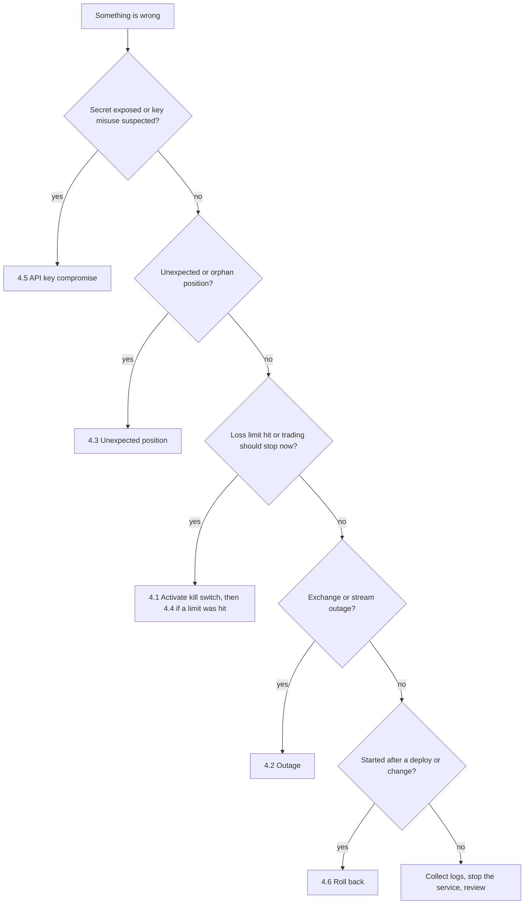

# Operations & Observability Runbook (OPS)

**Project:** Silver Bot (ICT Silver Bullet trading bot)
**Version:** 0.1
**Owner:** Cian Jake Francisco
**Status:** Draft
**Last updated:** 2026-10-08
**Last reconciled:** 2026-10-08 against code at commit `62037d1`

This runbook says how to run, watch and stop Silver Bot, and what to do when something goes wrong. It absorbs the operational parts of the old `DEPLOYMENT.md` (VPS setup, emergency commands, security checklist). Only commands that work with the code as built are given as steps. Where the intended action is not supported by the code, the runbook says so and gives the manual alternative.

Related documents: [sdd-silverbot.md](sdd-silverbot.md) §5 (safety), §6 (infrastructure) and §3.3 (file artifacts); [rfc-silverbot-risk-kill-switch.md](rfc-silverbot-risk-kill-switch.md) (RFC-002); [rfc-silverbot-readiness-gates.md](rfc-silverbot-readiness-gates.md) (RFC-004); [qad-silverbot.md](qad-silverbot.md) §6 (mode gates); [clr-silverbot.md](clr-silverbot.md) (key hygiene); [aia-silverbot.md](aia-silverbot.md) (ML filter); [scrutiny-silverbot.md](scrutiny-silverbot.md) and [audit-docs-drift.md](audit-docs-drift.md) for `G-#`, `D-#`, `H-#`.

**Read this first: what the deployed bot actually does today.**

- The container and systemd entry point `python -m silver_bot` runs `main()`: it loads configuration, initialises SQLite, writes `bot_started` then `bot_stopped` to `logs/audit.jsonl` and exits with code 0. It connects to no exchange, starts no stream, sends no Telegram message and runs no paper engine (`main.py:27-50`, D-1, G-3).
- The compose `bot` service has `restart: unless-stopped` and the systemd unit has `Restart=always`, so that exit is followed by an endless restart loop (`docker-compose.yaml:32`, `deploy/systemd/silver-bot.service:13`, H-4). Whether this is intended is an open owner question (BRD OI-11).
- Paper trading, backtesting and demo runs exist as library code driven by tests, not by the container (QAD-T73, QAD-T83).
- Live trading is `Planned, blocked`: the configuration loader rejects `LIVE_TRADING=true` and the adapter cannot place orders (SDD §5.1).

Everything below that mentions alerts, streams, positions or reports describes the library behaviour for when a runtime drives it, and marks what is not wired.

## 0. Operating Posture per Mode

| Mode | How it is started (compose) | What runs today | Watched by | Stop with |
|---|---|---|---|---|
| Backtest | `docker compose --profile backtest run --rm backtest` | Startup stub only (config, SQLite, two audit lines, exit 0) | Command output; `logs/audit.jsonl` | The container exits by itself |
| Research | `docker compose --profile research run --rm research` (backtest mode, ML forced off) | Startup stub only | Same | Exits by itself |
| Paper (one-off) | `docker compose --profile paper run --rm paper` (`restart: "no"`) | Startup stub only | Same | Exits by itself |
| Paper (service) | `docker compose up bot` (container `silver-bot-paper`), or systemd `silver-bot` | Startup stub in a restart loop (H-4) | `docker compose logs`, `journalctl`, audit file | `sudo systemctl stop silver-bot` (see §4.1) |
| Demo (testnet) | `docker compose --profile demo run --rm demo` | Startup stub; demo readiness check available: `docker compose --profile demo run --rm demo python -m silver_bot.demo_readiness` | Same | Exits by itself |
| Live | None. `Planned, blocked` | Cannot start: the configuration is refused | n/a | n/a |

Safe defaults hold in every mode: `LIVE_TRADING=false` is forced by the Dockerfile and by compose (`Dockerfile:6`, `docker-compose.yaml:4`), the image runs as the non-root `silverbot` user, the ML filter and Telegram default to off, and the compose file defines no live service. Prepare the host first with `sh deploy/scripts/prepare-host.sh` from the repository directory (creates `data logs models reports`, copies `.env.example` to `.env` with mode 600 if absent, sets the directories to mode 700; `deploy/scripts/prepare-host.sh:2-13`). Copying `.env.example` unchanged does not load (D-2, H-14, G-4): review the file and set the values for the mode you intend.

When a real runtime exists (`Planned`), posture changes as follows: paper runs unattended only if the owner accepts the kill-switch and restart limits in §4; demo runs under daily owner review; live is not operated until RFC-004 gates exist and the owner approves.

## 1. SLOs & SLIs

Targets are the owner's to set (BRD OI-5, monitoring hours per day). The code measures very little; an unmeasured indicator is `Open` and is not given a number.

| SLI | Definition | Measured by the code today? | Source | Target |
|---|---|---|---|---|
| Container health | `python -m silver_bot.health` returns 0 (configuration loads and `live_trading` is false) every 60 s | Yes, configuration only: exit 2 if the config is rejected, exit 3 if live is true, else 0. It does not test the stream, the exchange or the loop (G-27) | `health.py:8-17`; `Dockerfile:28-29` | Open |
| Process uptime | Time the bot runs without exit | No. The process exits right after start; there is nothing to measure (H-4) | `main.py:27-50` | Open |
| Market stream uptime | Share of time the candle stream delivers closed candles | No. The stream has a reconnect wrapper in the library but no metric, and the container does not start it (G-13, H-12) | `data/stream.py` | Open |
| Alert delivery | Time from an alert-worthy event to a message reaching the owner | No. Telegram has no network transport, so delivery is never achieved (D-3, G-15, QAD-T69) | `monitoring/telegram.py:96-103` | Open |
| Kill-switch reaction | Time from the kill file appearing to the next entry being rejected | In library code only: checked on every `evaluate`, so reaction is at most one candle interval; the first rejection is recorded as a `KILL_SWITCH_ACTIVE` event. Inert unless a path is configured (D-12, G-6) | `risk/engine.py:30-31`; `execution/paper_trading.py:74-84` | Open |
| Audit completeness | Every decision has an `audit.jsonl` line | Partially: engines write when given a logger; `main()` writes only start and stop. A failed write raises into the caller (QAD-T67) | `monitoring/audit.py:72-75` | Open |
| Report freshness | Daily and weekly reports produced on time | No. The builders have no caller and no schedule (S-31, G-16, QAD-T70) | `monitoring/reports.py:18,52,92` | Open |

A starting point the owner may adopt once a runtime exists: no unobserved period longer than the owner's monitoring gap, every kill-switch event acknowledged within that gap, and one report per day. These are suggestions, not commitments, until OI-5 is answered.

## 2. Observability

### 2.1 Logs

- **Application log.** `get_logger` configures plain text, not JSON: `%(asctime)s %(levelname)s %(name)s %(message)s` at INFO (`utils/logging.py:11-15`). The `extra` fields passed in `main()` are not printed by this format. Read it with `docker compose logs`, `journalctl -u silver-bot` or the container's stdout.
- **Audit log.** `logs/audit.jsonl` is the machine-readable log: one JSON object per line, appended, with keys sorted. Fields are exactly `created_at` (ISO-8601, UTC), `level` (default `INFO`), `event_type`, `message` and `context` (`monitoring/audit.py:34-43,72-75`). The path is hard-coded in `main()` and cannot be changed (`main.py:29`).
- **Redaction.** A context value is replaced by `[REDACTED]` when its lower-cased key contains `api_key`, `apikey`, `secret`, `token`, `password`, `passphrase`, `private_key` or `chat_id`. Keys are matched, values are never scanned (`monitoring/audit.py:12-21,79-103`). Do not put a secret in a free-text `message`.
- **Write errors** are not handled: an I/O error in the audit logger propagates to the caller (`audit.py:72-75`).

Useful reads (all work with a standard shell on the host):

```bash
tail -n 50 logs/audit.jsonl
grep '"event_type": "kill_switch_active"' logs/audit.jsonl
grep -c '"event_type": "bot_started"' logs/audit.jsonl
```

The last command counts restarts; a large number confirms the restart loop (H-4). The existing file holds only `bot_started` and `bot_stopped` events, consistent with startup-only runs.

### 2.2 `audit.jsonl` event types

| `event_type` | Emitted by | When |
|---|---|---|
| `bot_started`, `bot_stopped` | `main()`; backtest engine; paper engine | Start and stop. From `main()` the context has mode, `paper_trading`, database path, `ml_filter_enabled`, `telegram_enabled` (`main.py:30-50`) |
| `strategy_decision` | Backtest and paper engines | Every evaluation, with symbol, direction, reason, entry, stop, target, reward-to-risk, session, quality score (`execution/paper_trading.py:290-305`) |
| `signal_rejected` | Backtest and paper engines | Strategy `NO_TRADE`, or ML reject (adds `ml_probability`, `ml_decision`) |
| `ml_decision` | Backtest and paper engines | Each ML filter result (decision, probability, thresholds, multiplier, model id, reason) |
| `risk_rejected` | Backtest and paper engines | A risk gate refused the trade |
| `kill_switch_active` | Backtest and paper engines | The risk rejection reason equals `Kill switch is active` (and once per run when the file is first seen in the paper loop) |
| `signal_detected`, `paper_order_created`, `paper_trade_opened`, `paper_trade_closed`, `error` | Paper engine lifecycle events | As named; no code path creates `error` (`execution/models.py:14-23`) |

### 2.3 Other records

- **SQLite** `data/silver_bot.sqlite3` (WAL mode): `paper_trades`, `paper_events`, `ml_predictions`, plus `candles`, `signals`, `trades`, `logs` which nothing fills today (G-14). Query with the Python standard library; the container has no `sqlite3` command.
- **Trade journal** (CSV) per trade: ids, symbol, timeframe, session, direction, entry and exit times and prices, stop, target, size, risk amount, realized pnl and R, fees, slippage, exit reason, quality score, ML probability and decision, notes (`monitoring/reports.py:244-272`). The exporter has no caller.
- **Daily report** keys: date, trades taken, rejected setups, pnl, drawdown, win rate, average R, best and worst trade, rule failures, ML decisions (`reports.py:77-89`). **Weekly report** keys: week start and end, total trades, net pnl, win rate, profit factor, average R, max drawdown, best and worst session, repeated rejection reasons (`reports.py:119-131`). The window starts at the first trade, not at a calendar week. Neither is produced automatically.
- **Dashboard JSON** has four keys: `daily`, `weekly`, `recent_trades`, `recent_rejections`. It is a JSON export only: no web page, server or redaction (`monitoring/dashboard.py:19-33`).
- **Readiness reports**: `python -m silver_bot.demo_readiness` and `python -m silver_bot.readiness` write JSON under `reports/`. They are advisory; nothing reads them (D-10). The "report exists" checks pass 0-byte files (H-2).
- **Container health**: `docker inspect --format '{{.State.Health.Status}}' silver-bot-paper` shows the Dockerfile health check state (`starting`, `healthy`, `unhealthy`) for the `bot` service. Compose defines no check of its own (D-82).

## 3. Alerting

Alerts go through `TelegramAlerter`, which is disabled by default and silently does nothing when disabled, when no client is set, or when the chat id is empty (`monitoring/telegram.py:96-103`). There is no real transport: only the `TelegramClient` protocol and an in-memory client exist, `bot_token` is stored but never used, and `main()` never builds an alerter (D-3, G-15). **No alert can reach the owner today.** If a client raised, the exception would propagate into the paper engine (no try/except). Treat the table as the intended behaviour once a transport exists.

| Alert text | Method | Fires when (paper engine) | Called today |
|---|---|---|---|
| `[bot_started] Paper bot started` | `bot_started` | Run start | In library runs only |
| `[bot_stopped] Paper bot stopped` | `bot_stopped` | Run end | In library runs only |
| `Signal detected: {symbol} {direction}` | `signal_detected` | A trade signal is produced | In library runs only |
| `Signal rejected: {symbol} {reason}` | `signal_rejected` | Strategy `NO_TRADE` | In library runs only |
| `Risk rejected: {symbol} {reason}` | `risk_rejection` | A risk gate refuses (not the kill switch) | In library runs only |
| `ML approved: {symbol} probability=p` | `ml_approval` | ML approves (only with an active model) | In library runs only |
| `ML rejected: {symbol} probability=p {reason}` | `ml_rejection` | ML rejects | In library runs only |
| `Paper trade opened: {symbol} {direction}` | `paper_trade_opened` | A paper position opens | In library runs only |
| `Paper trade closed: {symbol} PnL=x.xx` | `paper_trade_closed` | A paper position closes | In library runs only |
| `Kill switch active` | `kill_switch_active` | Once per run when the kill file is seen, and again on a risk rejection with reason `Kill switch is active` | In library runs only |
| `Daily report: trades=... PnL=... win_rate=...` | `daily_report` | Never invoked by any code | No |
| `Error: {message}` | `error` | Never invoked; no code creates an error event | No |

Source: `monitoring/telegram.py:51-94`, `execution/paper_trading.py:65,74-84,90,101,121,137,175-179,248-250`. Because the alert path is dead, the owner must watch the audit file or the process directly (OI-5), and the kill-switch alert cannot be relied on.

## 4. Incident Response

Severity guide: an incident that could place or hold real exposure is highest; with live trading blocked and no order surface, current incidents are about configuration, data and secrets. The owner is the only responder.



Common first moves, in order of safety:

1. Stop the service so nothing new starts: `sudo systemctl stop silver-bot` (systemd) or `docker compose down` (compose only, see warning in 4.1).
2. Preserve evidence: copy `logs/audit.jsonl` and the SQLite file before any change (see §5.3).
3. Do not edit `.env` to set `LIVE_TRADING=true` for any reason; the configuration refuses it.

### 4.1 Activate the kill switch

**Trigger.** Anything that says trading must stop now: a loss limit reached, an unexplained trade, a bad signal stream, a suspected compromise, a deploy gone wrong.

**What the kill switch is, as built.** A file whose existence blocks new entries. It is inert unless a path is configured in code (`RiskConfig.kill_switch_path` defaults to `None`); `KILL_SWITCH_PATH` from `.env` is never passed to the risk engine; the default engines have no path; nothing creates the file, nothing trips it automatically and nothing closes positions or stops the process (`risk/kill_switch.py:11-17`, `risk/models.py:26`, `execution/paper_trading.py:49`, D-12, D-22, G-6). The compose `demo` service sets `KILL_SWITCH_PATH=/app/data/KILL_SWITCH`, but no code consumes it (H-9). The kill switch is therefore **not a reliable emergency stop** in the deployed system. The reliable stop is stopping the process.

**Immediate steps.**

1. Stop the process (this works today): `sudo systemctl stop silver-bot`. If you are running compose by hand without systemd: `docker compose down`.
   - Warning: when the systemd unit is enabled, do not use `docker compose down` or `docker stop silver-bot-paper` alone. The unit has `Restart=always` with `RestartSec=10`, so systemd starts the container again about 10 seconds later (`deploy/systemd/silver-bot.service:13-14`). Stop through `systemctl stop`.
2. Create the lock file as the standing intent, for any code path that has a configured path: `touch data/KILL_SWITCH` from the repository directory (the path used by compose `demo`, `/app/data/KILL_SWITCH`, maps to `./data/KILL_SWITCH`). Its effect depends on a runtime that passes the path to the risk engine; today it has none. Do this anyway so that the readiness checkers also see an active switch and block (`readiness.py:190-227`, `demo_readiness.py:160-178`).
3. If positions exist on an exchange account, close them in the exchange's own interface. The bot cannot (`execution/paper_trading.py:59-122`); there is no emergency shutdown function (D-22).

**Verification.**

- `sudo systemctl status silver-bot` shows `inactive (dead)`; `docker compose ps` shows no running `bot` container.
- `ls data/KILL_SWITCH` shows the file.
- `tail -n 5 logs/audit.jsonl` shows no new lines after the stop time.
- In a library run with the path configured, an entry attempt records `risk_rejected` with reason `Kill switch is active` and a `kill_switch_active` event.

**Reset.** Delete the file by hand (`rm data/KILL_SWITCH`). No command exists; the switch is not latched and has no reset logic (`risk/kill_switch.py:14-17`). Do not reset until the cause is understood.

**Follow-up.** Record a postmortem (§6). The planned changes (armed by default from settings, automatic triggers on loss limits, position close on trip, reset step) are specified in RFC-002 and are `Planned`.

### 4.2 Exchange or stream outage

**Trigger.** No candles arriving, repeated reconnect attempts, venue maintenance, or network loss.

**What exists.** The library has a reconnecting market stream wrapper that re-creates a mock stream after a `ConnectionError`, and a polling stream skeleton; historical fetching and exchange order calls are not implemented (`NotImplementedError`, `OrderPlacementDisabled`) (G-13, G-17, H-12). The container starts none of this, so an outage cannot currently affect a running bot.

**Immediate steps.**

1. Check the venue's status page and your own network from the host.
2. Look for the symptom in the log: `docker compose logs --tail 100 bot` or `sudo journalctl -u silver-bot -n 100`.
3. If a paper or demo loop was running under a custom driver, stop it (§4.1 step 1) rather than letting it run blind. Never switch to a different endpoint in `.env` to "work around" an outage; demo mode accepts only a URL containing `testnet.binancefuture.com` and that check is a substring match (D-13).

**Verification.** Candles resume with increasing timestamps; the audit log shows `strategy_decision` lines again; `docker inspect --format '{{.State.Health.Status}}' silver-bot-paper` is `healthy` (configuration check only).

**Follow-up.** Note the outage length and whether any candle gap affected decisions; gap handling is not implemented (G-13). Raise a Change Record if the wrapper needs a wider exception set (H-12).

### 4.3 Unexpected or orphan position

**Trigger.** A position, order or fill the owner did not expect, or a pending order that never filled and still holds risk capacity.

**What exists.** No real order can be placed, so a real orphan position cannot come from this code. In paper mode, an unfilled pending order keeps a risk reservation that is never released, which can block later trades (H-10, QAD-T71). Entries and exits in paper mode are stop and take profit only.

**Immediate steps.**

1. Stop the process (§4.1 step 1).
2. If the position is on a real exchange account, it was not created by this bot: treat it as a possible key compromise and go to §4.5, then close or reduce it in the exchange interface.
3. If it is a paper position, list recent events from the database (host Python, standard library):

   ```bash
   python -c "import sqlite3; c=sqlite3.connect('data/silver_bot.sqlite3'); print(c.execute('select * from paper_events order by rowid desc limit 20').fetchall())"
   ```

**Verification.** The event history explains the position (signal, risk approval, order, fill). `grep '"event_type": "paper_trade_opened"' logs/audit.jsonl` shows the opening and the matching entry in `strategy_decision`.

**Follow-up.** If no signal explains it, treat it as a defect: preserve the files, open a Change Record, add a test scenario (QAD-T register). Risk state is in memory and lost on restart, so counters reset after a restart (H-11).

### 4.4 Daily-loss or consecutive-loss limit hit

**Trigger.** A risk rejection with reason `Max daily loss limit reached` (2% of current equity by default) or `Max consecutive losses limit reached` (3 by default); a `risk_rejected` audit event (`risk/engine.py:63-65`).

**What exists.** The limits only block new entries for the rest of the evaluation; they do not trip the kill switch, close positions or alert (G-6, D-22). The counters live in memory, so a restart clears them (H-11, G-7). Settings limits are not wired to the engine; the engine uses its own defaults (G-5).

**Immediate steps.**

1. Do not restart the service to "clear" the block: a restart resets the counters and removes the protection.
2. Stop the process for the rest of the trading day (§4.1 step 1) and create `data/KILL_SWITCH` as the owner's standing instruction.
3. Review the day: `grep '"event_type": "paper_trade_closed"' logs/audit.jsonl`.

**Verification.** No new `paper_trade_opened` lines after the stop; the rejection reason is present in the audit log.

**Follow-up.** Decide with the owner's drawdown tolerance (BRD OI-3) whether to resume. Record the cause in a postmortem. Resume only after deleting the kill file deliberately.

### 4.5 API key compromise

**Trigger.** A key or secret appears in a log, commit, image, screenshot or message; the exchange reports unexpected activity; the host is compromised; a leaked `.env`.

**Immediate steps (outside the bot, in this order).**

1. In the exchange account, delete or disable the API key at once. Check that withdrawals were never enabled and look for unknown activity.
2. Stop the bot: `sudo systemctl stop silver-bot`.
3. Remove the secret from the place it leaked: rotate it in `.env` (the new key must also have withdrawals off, trade-only scope and an IP allow-list where the venue supports it; CLR-5 to CLR-7). Note that `.env` is git-ignored and `.dockerignore` keeps it out of the image (`.dockerignore:1-3`); if a secret was committed, treat history as exposed.
4. Rotate the Telegram bot token with the bot's creator tool if it leaked (CLR-9).

**Verification.** The old key is rejected by the exchange; `git log -p -S '<first characters of the key>'` and a search of `logs/audit.jsonl` and the database find no copy (do not paste the whole secret into a command); the `.env` file mode is 600 (`ls -l .env`). Audit redaction is key-based, so a secret placed in a free-text message is not hidden.

**Follow-up.** Record the exposure window and what the key could do. Review the host. Note that the adapter keeps the key as a plain attribute (`exchange/binance_futures.py:32-33`).

### 4.6 Bad deploy and rollback

**Trigger.** A new image or configuration misbehaves: health check unhealthy, startup `configuration rejected`, unexpected audit output.

**Immediate steps.**

1. Stop the service: `sudo systemctl stop silver-bot`.
2. Read the cause: `docker compose logs --tail 100 bot` (a rejected configuration logs `configuration rejected: ...` and exits with code 2, `main.py:21-25`).
3. Roll back the code: in `/opt/silver-bot`, `git log --oneline` to find the previous commit, then `git checkout <previous-commit>`; rebuild with `docker compose build`.
4. Roll back configuration: restore the previous `.env` from your own backup (§5.3). If the ML model changed, deactivate it by setting `ML_FILTER_ENABLED=false` (note that the setting does not reach the filter today, so the filter is off regardless; D-4) or by `set_active` on the previous registry entry (`ml/registry.py:104-116`).
5. Start again: `sudo systemctl start silver-bot`.

**Verification.** `docker compose ps` shows the `bot` container up; `docker inspect --format '{{.State.Health.Status}}' silver-bot-paper` becomes `healthy`; the last audit lines are `bot_started`/`bot_stopped` at the new time; `python -m pytest` passes on the rolled-back commit before it goes back to the host.

**Follow-up.** Add the failure to the QAD gap register if a test would have caught it; update BUILD notes.

## 5. Routine Operations

### 5.1 Daily and weekly

Daily (owner, a few minutes): confirm the service is in the expected state (`sudo systemctl status silver-bot`, `docker compose ps`); read the tail of `logs/audit.jsonl`; check the restart count (`grep -c '"event_type": "bot_started"' logs/audit.jsonl`); note disk use of `logs/` and `data/`.

Weekly: review `risk_rejected` and `signal_rejected` reasons; confirm `.env` mode 600 and no tracked secrets; run the readiness checkers for the mode in use (`python -m silver_bot.demo_readiness` for demo); review dependency and base-image updates.

Reports: the daily and weekly report builders, journal exporter and dashboard export exist but nothing schedules or calls them (G-16). Until they are wired, produce a report only by calling the functions from a Python session. Do not treat a missing report as a failure of the bot.

### 5.2 Log rotation

`deploy/logrotate/silver-bot` rotates `/opt/silver-bot/logs/*.log` and `*.jsonl` daily, keeps 14, compresses, skips empty files and uses `copytruncate` (`deploy/logrotate/silver-bot:1-8`). The `*.log` glob matches nothing the code writes; only `logs/audit.jsonl` exists (D-85). The path assumes the install directory `/opt/silver-bot`. Install on the VPS:

```bash
sudo cp deploy/logrotate/silver-bot /etc/logrotate.d/silver-bot
sudo logrotate --debug /etc/logrotate.d/silver-bot
```

### 5.3 Backups

Nothing automates backups. Back up by hand, or with the owner's own schedule:

- **SQLite** (WAL mode): use the standard library's online backup so the copy is consistent, from the repository directory. Create the target directory first (`mkdir -p backups`):

  ```bash
  python -c "import sqlite3; s=sqlite3.connect('data/silver_bot.sqlite3'); d=sqlite3.connect('backups/silver_bot.sqlite3'); s.backup(d); d.close(); s.close()"
  ```

- **Audit log and reports**: copy `logs/audit.jsonl` (rotated `.gz` files too) and `reports/`.
- **Model registry and artifacts**: copy `models/` (empty today). These are pickle files: restore only your own copies (AIA-R10).
- **Configuration**: keep an offline copy of `.env` in a password manager or encrypted store, never in the repository or an image. Keep mode 600 on the working copy.
- **Restore test**: periodically open a backup copy with `sqlite3.connect` and compare row counts against the live database. A backup is untested until it has been opened once.

### 5.4 VPS setup and updates

First setup (from the old VPS checklist, kept where it matches the files):

1. Create the VPS, add an SSH key, update packages, install Docker and Docker Compose.
2. Create the service user the unit expects: `User=silverbot Group=docker` (`silver-bot.service:15-16`). No file in the repository creates it (G-26); create it by hand and give it ownership of the install directory.
3. Clone the private repository to `/opt/silver-bot` (the unit and logrotate file hard-code this path).
4. Create `.env`, confirm it is not committed, run `sh deploy/scripts/prepare-host.sh`, keep `LIVE_TRADING=false`. Bind mounts are owned by the host user and the container user's UID is not pinned, so permission errors on `./data` are possible (G-26).
5. Build with `docker compose build` and run the tests (`python -m pytest`) before deploying.
6. Install the unit and start it:

   ```bash
   sudo cp deploy/systemd/silver-bot.service /etc/systemd/system/silver-bot.service
   sudo systemctl daemon-reload
   sudo systemctl enable silver-bot
   sudo systemctl start silver-bot
   ```

7. Install log rotation (§5.2) and watch the logs: `sudo journalctl -u silver-bot -f`.

Security checklist (carried from the old deployment document): the API key has withdrawals disabled, IP restriction where possible and minimum permissions; the repository contains no keys, tokens, private keys, account screenshots or `.env`; the image contains no `.env`, no `config.yaml` with secrets and no runtime SQLite files (`.dockerignore:1-21`). The unit has no sandboxing and the compose file has no `read_only`, `cap_drop` or resource limits (S-33); treat the host as the trust boundary.

Updates: stop the service, back up (§5.3), `git pull`, `docker compose build`, run the tests, start the service, verify as in §4.6. Keep the previous commit id so rollback is a checkout.

Command source check (old emergency commands kept only where they match): `sudo systemctl stop|restart silver-bot` matches the unit name `silver-bot.service`; `sudo journalctl -u silver-bot -f` matches it; `docker compose down` matches `docker-compose.yaml` (project name `silver-bot`); the old image name `ict-silver-bullet-bot` does not match (compose builds `silver-bot:local`) and is dropped.

## 6. Postmortems

Template, one file per incident under `docs/`, named `postmortem-silverbot-<date>-<slug>.md`:

```text
Title, date, duration, severity
Summary (what happened, in two sentences)
Timeline (UTC): detection, first action, containment, resolution
Impact (money, data, exposure; "none" is a valid answer)
Root cause
What worked / what did not (include missing alerts, G-15)
Detection: how was it noticed, and why not sooner
Corrective actions: owner, due date, linked G-# or Change Record
Tests or docs added (QAD-T# or section)
```

Incidents to date: none yet. The repository has no live or paper runtime incident history. Known standing hazards that would have been incidents are tracked as gaps: kill switch inert (G-6), restart loop (G-3), no alert transport (G-15), NaN approves (G-8).

## 7. Self-Check

- [x] Every runbook step uses a command that matches a file in the repository (compose service names `bot`, `paper`, `demo`, `backtest`, `research`; container `silver-bot-paper`; unit `silver-bot.service`; `deploy/` paths).
- [x] The kill switch is described as a file-exists check that is inert without a configured path, has no automatic trigger and no emergency shutdown.
- [x] Telegram is described as having no transport and not wired; no SLO claims alert delivery.
- [x] The restart loop, the in-memory risk state and the lost-on-restart counters are called out where they change the procedure.
- [x] SLIs the code does not measure are marked `Open`; no number was invented.
- [x] The incident flowchart is a Mermaid block; no other diagram was added.
- [ ] The runbook has been exercised on a VPS; it has not (no runtime exists), so the steps are verified against files only.
