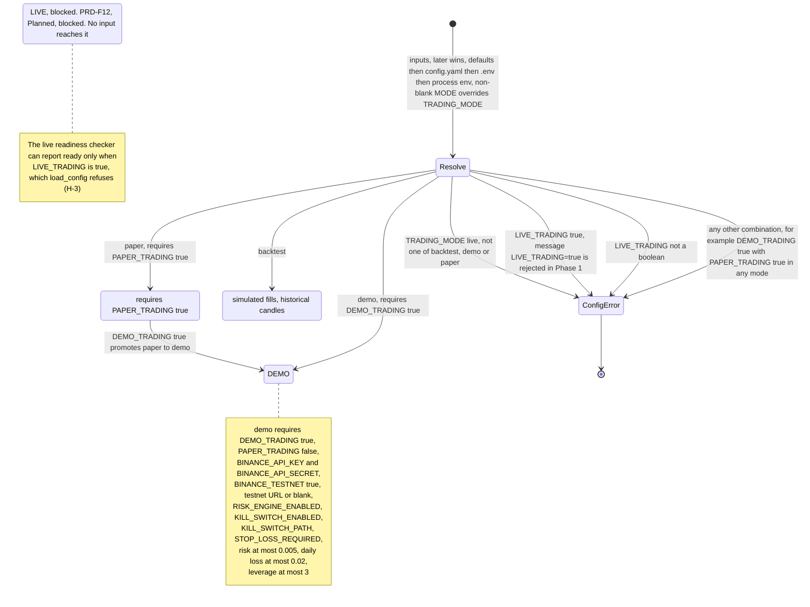

# Product Requirements (PRD)

**Project:** Silver Bot (ICT Silver Bullet trading bot)
**Version:** 0.1
**Owner:** Cian Jake Francisco
**Status:** Draft
**Last updated:** 2026-10-14
**Last reconciled:** 2026-10-08 against code at commit `62037d1`; statements about G-2, G-4 to G-8, G-10 and G-11 re-checked 2026-10-09 against `70ccaec`; section 3 (PRD-F2 to PRD-F6, PRD-F10, PRD-F11), US-05, US-21, US-22, sections 5.1 to 5.5 and section 9 re-checked 2026-10-09 against `099085b` (G-3 entrypoint batch 2); section 3 (PRD-F2, PRD-F9, PRD-F11), US-18, US-21, US-22 and sections 5.1 and 5.5 re-checked 2026-10-09 against `5c781fc` (G-3 review fixes); PRD-F13, US-23 and the dashboard entrypoint added 2026-10-09 at the `feat/operator-dashboard` head (silverbot-cr-001)

This document is the source of truth for what Silver Bot must do, what is built, and in which phases the rest is delivered. It defines the ids `PRD-F1` to `PRD-F13` (features) and `US-01` onward (user stories), and it replaces the old `TODO.md` and `PROGRESS.md` as the feature and phase record. Business context is in [brd-silverbot.md](brd-silverbot.md); gaps (`G-#`) are in [scrutiny-silverbot.md](scrutiny-silverbot.md); drift findings (`D-#`) and hazards (`H-#`) are in [audit-docs-drift.md](audit-docs-drift.md). The design is in [sdd-silverbot.md](sdd-silverbot.md), the design records are the four RFCs linked in section 3, and the test matrix is in [qad-silverbot.md](qad-silverbot.md); AIA, CLR and OPS are [aia-silverbot.md](aia-silverbot.md), [clr-silverbot.md](clr-silverbot.md) and [ops-silverbot.md](ops-silverbot.md). Status values: Built; Built (caveats); Partial; Stub; Planned; Planned, blocked. No row states a strategy performance result; none exists because the evidence reports stay empty until the owner runs a backtest on real data (G-1, D-86).

## 1. Purpose & Value Proposition

Silver Bot is a personal, single-operator bot that encodes the ICT Silver Bullet method for crypto futures (default Binance Futures, BTCUSDT, 1m; `src/silver_bot/config/settings.py:74-76`) behind a mandatory risk layer. It exists to answer one question safely: does this method have an edge after realistic costs? It does this by climbing four modes in order: backtest, paper, exchange demo/testnet, and only then, if ever, live.

Value to the owner:

- Rule-based decisions with a recorded reason for every rejected setup (no forced or skipped trades).
- A risk engine that every trade must pass (stop loss, reward-to-risk, loss limits, kill switch) before any simulated or demo order exists.
- A readable audit trail (JSONL audit log, trade records, reports) so every decision can be reviewed.
- A hard block on live trading until evidence exists. The block is unconditional today: `LIVE_TRADING=true` and `TRADING_MODE=live` are rejected at config load (`settings.py:105-108`).

Honest current state: the building blocks are real and tested (220 collected tests from 181 test functions in 23 files on `dev`, 2026-10-09). Since `099085b` backtest mode runs end to end from the command line on Binance kline CSV files the owner downloads; paper and demo exit 78 until real market data exists (D-1, G-3 partial, G-13).

## 2. Persona: Owner-Operator

| Attribute | Value |
|---|---|
| Who | Cian Jake Francisco, the sole developer, operator, funder and decision maker. No customers and no outside funds ([brd-silverbot.md](brd-silverbot.md) §3, §9). |
| Goals | (1) Find out cheaply whether the method has an edge after costs. (2) Run it consistently with an enforced risk layer. (3) Keep a complete decision log. (4) Never lose more than the risk limits allow while the edge is unproven. |
| Constraints | Capital, drawdown tolerance, return goal, monitoring hours, jurisdiction and data source are Owner input required (OI-1 to OI-12 in BRD §8). Python 3.11 or newer. Personal machine for development, optional VPS with Docker for unattended runs. |
| Skills assumed | Comfortable with a terminal, Python virtual environments, `.env` files, Docker Compose basics and reading JSON/CSV reports. The only UI is a read-only status page on localhost (PRD-F13); it has no controls. |
| Non-goals for the persona | No multi-user access, no sharing of the bot, no go-to-market ([brd-silverbot.md](brd-silverbot.md) §6). |

## 3. Core Features & Priorities

Priority is MoSCoW for this release. Status comes from the code-verified fact sheets at the reconciled commit. "RFC" links the design record that covers the feature; `N/A` means no RFC covers it.

| PRD-F# | Feature | Priority (MoSCoW) | Status | Evidence | RFC |
|---|---|---|---|---|---|
| PRD-F1 | Silver Bullet signal engine: sessions, liquidity, sweep, displacement, MSS, FVG, HTF bias, quality score; LONG / SHORT / NO_TRADE with reasons | Must | Built | All stages present with verbatim NO_TRADE reasons (`strategy/silver_bullet.py:67-209`); 14 tests incl. lookahead guards. Caveats: config never wired to settings (D-14, H-6, G-18); swing-only liquidity, no invalidation, no spread/ATR/news filters (D-18, D-19, G-19) | [rfc-silverbot-signal-engine.md](rfc-silverbot-signal-engine.md) |
| PRD-F2 | Event-driven backtester, cost simulation, reports and out-of-sample validation | Must | Partial | Engine, cost model, partial TP, four exports, metrics built and tested (8 engine tests). Costs default to 5 bps slippage and 3 bps spread since `59ed6d5` (G-11 closed). Since batch 2: `python -m silver_bot --candles PATH` in backtest mode loads Binance kline CSV files (`data/csv_loader.py:44-84`, `e5baec7`) and `run_backtest` (`backtest/runner.py:60-124`, `f84557e`) writes the four exports plus `out_of_sample_validation_report.json` (chronological 60/20/20 split, each segment in a fresh engine, nothing tuned) and `backtest_run.json`, with settings risk caps and a simulated per-run kill switch (9 runner and 10 entrypoint tests). Gaps: no walk-forward or Monte Carlo and no pass or fail criteria (D-6, G-12); no code stops tuning on the final test (D-33); missing metrics and exports (D-25 to D-32, G-20); strategy settings are defaults (G-18); the reports stay empty until the owner runs it on real data (G-1) | N/A |
| PRD-F3 | Risk engine and kill switch | Must | Built (caveats) | 14 gates in order with verbatim reasons (`risk/engine.py:48-107`), 31 risk test functions. Since batch 1: per-trade risk capped at 0.5% in `RiskConfig` and at load; `build_risk_engine` wires settings, the kill-switch path and SQLite state; the kill switch fails closed and trips on the loss limits. Since batch 2, `build_risk_config` (`risk/factory.py:15-23`, `4726cb5`) feeds CLI backtests, which run on a simulated per-run kill switch. Caveats: nothing calls `build_risk_engine` until the paper runtime exists, so the paper loop keeps defaults, no kill-switch path and in-memory state (G-5, G-6, G-7 partial); no emergency shutdown or position close (D-22, G-21) | [rfc-silverbot-risk-kill-switch.md](rfc-silverbot-risk-kill-switch.md) |
| PRD-F4 | Paper trading: market stream, reconnect, REST fallback, paper executor, trade management | Must | Partial | `PaperExecutionEngine`, `PaperTradingEngine`, mock and reconnecting stream, storage and alerts built and tested (4 tests). No WebSocket; polling skeleton depends on a stubbed adapter; not constructed by any entry point: `TRADING_MODE=paper` exits 78 with `mode not available yet: needs market data (G-13)` (`main.py:89-91`) (D-8, G-3, G-13, G-21) | N/A |
| PRD-F5 | Binance Futures demo/testnet mode | Should | Partial | Config rules, 18-check demo readiness, adapter URL guard and compose `demo` service built and tested. All network I/O is a stub (`exchange/binance_futures.py:72`); no demo runtime: demo mode exits 78 (`main.py:89-91`; D-46 partial, G-3, G-17). URL guard is an exact `https` host match since `0a76564` (D-13, G-10 closed) | [rfc-silverbot-readiness-gates.md](rfc-silverbot-readiness-gates.md) |
| PRD-F6 | ML probability filter (approve / reject / reduce risk only) | Could | Partial | Dataset, features, training, calibration, promotion, registry and filter built and tested (27 ML test functions). A NaN, infinite or out-of-range probability rejects since `8e66054` (H-1, G-8 closed). Settings reach the filter in CLI backtests only (`backtest/runner.py:50-55`; D-4, G-9 partial); no pipeline entry point and no shipped model; promotion not enforced on registry (D-37, G-22) | [rfc-silverbot-ml-filter-gate.md](rfc-silverbot-ml-filter-gate.md) |
| PRD-F7 | Monitoring and alerting: structured logs, audit log, journal, Telegram, daily/weekly reports, dashboard JSON | Must | Partial | Audit JSONL with secret redaction, journal, daily and weekly report builders, dashboard JSON builder and 6 tests exist. Reports, journal and dashboard have no caller (D-48, D-49, G-16); Telegram has no network transport (D-3, D-47, G-15); app log is plain text (D-81) | N/A |
| PRD-F8 | Readiness gates: demo and live readiness checkers and reports | Must | Built (caveats) | Live (15 checks) and demo (18 checks) checkers, report export and 17 tests. Report checks require a non-empty JSON object since `88220e6` (H-2, G-2 closed). Report-only and never consulted (D-10); the evidence files are still 0 bytes (D-86, G-1); a live-ready result needs `LIVE_TRADING=true`, which the app refuses to load (H-3) | [rfc-silverbot-readiness-gates.md](rfc-silverbot-readiness-gates.md) |
| PRD-F9 | Safe configuration: typed loading, fail-closed validation, safe defaults | Must | Built | Typed `load_config`, fail-closed live rejection, demo rules, path checks and 21 config tests. `.env.example` loads as paper mode since `c6d909d` (G-4 closed); `MAX_RISK_PER_TRADE` capped at 0.005 and an enabled kill switch needs a path in every mode. Caveats: daily-loss and leverage limits checked only in demo mode (D-11 partial); `MODE` override (the shipped `.env.example` leaves `MODE` blank since `5c781fc`) and yaml parser quirks (D-42, D-43, D-44, G-24) | N/A |
| PRD-F10 | Market data and storage: historical fetcher, SQLite | Must | Partial | SQLite with eight tables (including `risk_state`) and six writers built and tested; an offline loader for Binance public kline CSV files validates, de-duplicates and sorts candles and counts gaps (`data/csv_loader.py:44-84`, `e5baec7`, 11 tests); the fetcher is a wrapper over a stub that raises `NotImplementedError` (D-8, G-13); `signals` and `trades` tables unused, no candle read API, no migrations (D-9, D-34, D-35, G-14) | N/A |
| PRD-F11 | Deployment: Docker, compose, systemd, logrotate, host prep, health | Should | Partial | Dockerfile, compose (5 services), systemd unit, logrotate, `prepare-host.sh` and health command exist; 7 file-content tests. Since `f6bc017` the unit runs `up bot --exit-code-from bot` with `RestartPreventExitStatus=2 78` (2 added in `5c781fc`, so exit 2 is not restarted either) and compose `bot` has `restart: "no"`, so the paper container exits 78 once and is not restarted (H-4 fixed); `backtest` and `research` read `/app/data/candles` (`docker-compose.yaml:73,84`). No paper runtime to supervise (G-3 partial); `silverbot` user never created (D-50); no hardening (G-26); health checks config only (D-82, G-27) | N/A |
| PRD-F12 | Live trading | Won't (this release) | Planned, blocked | Rejected unconditionally at config load (`config/settings.py:105-108`); order methods raise `OrderPlacementDisabled` (`exchange/base.py:44-52`); no live executor (G-17) | [rfc-silverbot-readiness-gates.md](rfc-silverbot-readiness-gates.md) |
| PRD-F13 | Operator dashboard: read-only status page on localhost | Should | Built (caveats) | Evidence ladder, Next strip and six panels from files and SQLite, served on 127.0.0.1 (`monitoring/status.py`, `monitoring/dashboard_server.py`); panels 3 and 4 stay empty until a paper session runs (G-3) | [cr-silverbot-operator-dashboard.md](cr-silverbot-operator-dashboard.md), [cr-silverbot-dashboard-reskin.md](cr-silverbot-dashboard-reskin.md) |

## 4. User Stories & Acceptance Criteria

Each acceptance criterion (AC) is Given/When/Then. A test reference `tests/<file>.py::<name>` means a test of that name exists and pins the behaviour. "Not covered (G-#)" means no test pins it; the gap is tracked in [scrutiny-silverbot.md](scrutiny-silverbot.md). Quoted reason strings are verbatim from code.

### PRD-F1 Signal engine

**US-01** As the owner, I want every evaluation to end as LONG, SHORT or NO_TRADE with a reason, so that I can review why a setup was taken or rejected.

- AC-01.1 Given a complete bullish setup (sweep, displacement, MSS, FVG retracement) in an enabled session, when the strategy evaluates, then it returns LONG with entry, stop, take profit, reward-to-risk and session. Test: `tests/test_silver_bullet_strategy.py::test_strategy_generates_long_signal_for_complete_silver_bullet_setup`.
- AC-01.2 Given the mirrored bearish setup, when the strategy evaluates, then it returns SHORT with entry, stop and target. Test: `tests/test_silver_bullet_strategy.py::test_strategy_generates_short_signal_for_complete_silver_bullet_setup`.
- AC-01.3 Given a candle outside every enabled window, when the strategy evaluates, then it returns NO_TRADE with reason "Outside enabled Silver Bullet session". Test: `tests/test_silver_bullet_strategy.py::test_strategy_rejects_outside_session_with_clear_reason`.
- AC-01.4 Given a sweep, MSS and FVG but a latest candle that has not retraced into the FVG, when the strategy evaluates, then it returns NO_TRADE with reason "No retracement into matching Fair Value Gap". Test: `tests/test_silver_bullet_strategy.py::test_strategy_rejects_when_latest_candle_has_not_retraced_into_fvg`.
- AC-01.5 Given a setup whose quality score is below the minimum, or whose reward-to-risk is below the minimum, when the strategy evaluates, then it returns NO_TRADE naming the score or reward-to-risk reason. Not covered by any test (G-32; QAD §3.8).
- AC-01.6 Given a NO_TRADE signal built without a reason, when it is constructed, then construction raises "NO_TRADE signals require a reason". Not covered by any test (G-32; QAD §3.8).

**US-02** As the owner, I want session windows evaluated in New York time with daylight saving handled, so that the 10:00 window is correct all year.

- AC-02.1 Given 14:30 UTC in June, when the session is checked, then new_york_am is active with local start hour 10. Test: `tests/test_strategy_sessions.py::test_new_york_session_detection_is_timezone_aware`.
- AC-02.2 Given 15:30 UTC in January, when the session is checked, then new_york_am is active (standard time). Test: `tests/test_strategy_sessions.py::test_new_york_session_detection_handles_standard_time`.
- AC-02.3 Given a disabled custom session, when a candle falls in its window, then it does not activate. Test: `tests/test_strategy_sessions.py::test_sessions_are_configurable_and_disabled_sessions_do_not_activate`.
- AC-02.4 Given session settings in the environment or yaml, when the bot starts, then the strategy uses them. Not covered (G-18); sessions are hard-coded defaults today (D-14).

**US-03** As the owner, I want detection to use only data known at the time, so that backtests are not flattered by lookahead.

- AC-03.1 Given a liquidity level timestamped after the sweep candle, when sweeps are detected, then no sweep is returned. Test: `tests/test_strategy_modules.py::test_liquidity_sweep_ignores_levels_not_known_before_sweep`.
- AC-03.2 Given candles before the structure break exists, when MSS is detected, then it returns none. Test: `tests/test_strategy_modules.py::test_market_structure_shift_does_not_use_future_break_candle`.
- AC-03.3 Given two candles, when FVGs are detected, then none is found until the confirming third candle exists. Test: `tests/test_strategy_modules.py::test_fvg_detection_waits_for_confirming_third_candle`.
- AC-03.4 Given an FVG that price has touched once, when retracement is checked, then only the first touch counts. Test: `tests/test_strategy_modules.py::test_fvg_retracement_only_counts_first_touch`.
- AC-03.5 Given a bullish sequence, when higher-timeframe bias is computed, then it reports bullish. Test: `tests/test_strategy_modules.py::test_higher_timeframe_bias_detection`.
- AC-03.6 Given the full strategy over a long history, when evaluated candle by candle, then no future candle influences a decision. Not covered (G-29, U-7).

### PRD-F2 Backtester

**US-04** As the owner, I want a deterministic event-driven backtest with costs and exports, so that I can examine every simulated trade.

- AC-04.1 Given a setup that reaches take profit, when the backtest runs with an export directory, then the trade is recorded and `trades.csv`, `equity_curve.csv`, `backtest_report.json` and `rejected_signals.csv` are written. Test: `tests/test_backtest_engine.py::test_backtest_records_winning_trade_and_exports`.
- AC-04.2 Given a setup that reaches the stop, when the backtest runs, then the exit is a stop loss with a loss of one risk unit. Test: `tests/test_backtest_engine.py::test_backtest_records_losing_trade`.
- AC-04.3 Given candles outside the session, when the backtest runs, then no trade is taken and the last rejection reason is "Outside enabled Silver Bullet session". Test: `tests/test_backtest_engine.py::test_backtest_records_no_trade_rejections`.
- AC-04.4 Given non-zero fees, when the backtest runs, then net profit is lower than the fee-free run. Test: `tests/test_backtest_engine.py::test_fees_reduce_net_profit`.
- AC-04.5 Given non-zero slippage, when the backtest runs, then net profit is lower. Test: `tests/test_backtest_engine.py::test_slippage_reduces_net_profit`.
- AC-04.6 Given a limit order whose entry price is never touched, when the backtest runs, then no trade is recorded. Test: `tests/test_backtest_engine.py::test_limit_order_not_filled_if_price_never_reaches_entry`.
- AC-04.7 Given the default configuration, when a backtest runs, then slippage and spread are non-zero. Test: `tests/test_backtest_engine.py::test_backtest_cost_defaults_are_conservative` (5.0 and 3.0 bps; G-11 closed).
- AC-04.8 Given partial take profit or breakeven enabled, when a trade reaches 1R, then the position is partly closed and the stop moves to breakeven. Not covered by any test (G-32; QAD §3.8); the logic exists but no test pins it.
- AC-04.9 Given the same candles twice, when the backtest runs twice, then the results are identical. Not covered by any test (G-32; QAD §3.8); the engine sorts candles by `open_time` before replay.

**US-05** As the owner, I want out-of-sample validation, so that I can judge whether results generalise.

- AC-05.1 Given sorted candles, when a chronological split is requested, then training, validation and final-test slices are returned (defaults 0.6 / 0.2 / 0.2). Test: `tests/test_backtest_runner.py::test_out_of_sample_report_structure` (30 / 10 / 10 of 50 candles, in time order, through `run_backtest`).
- AC-05.2 Given a final test set, when parameters are tuned, then the final test set is not used. Not covered (G-12, D-33); not enforced in code. The runner tunes nothing and records `parameters_tuned: false` (`backtest/runner.py:91`).
- AC-05.3 Given an evidence run, when validation completes, then a non-empty out-of-sample report is written with pass/fail criteria. Not covered (G-1, G-12): the runner writes a non-empty report (`tests/test_backtest_runner.py::test_reports_pass_readiness_report_checks`), but it has no pass or fail criteria, which are Open (BRD-M7), and no real-data run exists.
- AC-05.4 Given walk-forward, Monte Carlo or sensitivity analysis is requested, when it runs, then it produces results. Planned (D-6, G-12); not built.

### PRD-F3 Risk engine and kill switch

**US-06** As the owner, I want every trade sized and checked by the risk engine, so that no trade bypasses my limits.

- AC-06.1 Given 1% risk on a known stop distance, when evaluated, then the engine returns position size 20, risk 100 and reward-to-risk 2. Test: `tests/test_risk_engine.py::test_valid_position_sizing`.
- AC-06.2 Given a stop on the wrong side, when evaluated, then it rejects with "Invalid stop loss for trade direction". Test: `tests/test_risk_engine.py::test_invalid_stop_loss_is_rejected`.
- AC-06.3 Given no stop loss, when evaluated, then it rejects with "Stop loss is required". Test: `tests/test_risk_engine.py::test_missing_stop_loss_is_rejected`.
- AC-06.4 Given reward-to-risk below the minimum, when evaluated, then it rejects with "Reward-to-risk below configured minimum". Test: `tests/test_risk_engine.py::test_low_reward_to_risk_is_rejected`.
- AC-06.5 Given daily realised loss at the limit, when evaluated, then it rejects with "Max daily loss limit reached". Test: `tests/test_risk_engine.py::test_daily_loss_lockout`.
- AC-06.6 Given three consecutive losses, when evaluated, then it rejects with "Max consecutive losses limit reached". Test: `tests/test_risk_engine.py::test_consecutive_loss_lockout`.
- AC-06.7 Given three trades today, when evaluated, then it rejects with "Max trades per day limit reached". Test: `tests/test_risk_engine.py::test_max_trades_lockout`.
- AC-06.8 Given one open position, when evaluated, then it rejects with "Max open positions limit reached". Test: `tests/test_risk_engine.py::test_max_open_positions_lockout`.
- AC-06.9 Given notional above the leverage cap, when evaluated, then it rejects with "Maximum leverage exceeded". Test: `tests/test_risk_engine.py::test_maximum_leverage_rejection`.
- AC-06.10 Given the Settings risk limits (0.5% per trade, 2% daily loss, 3x leverage), when the bot is configured, then the risk engine uses those same limits and cannot be set above 0.5% per trade. Tests: `tests/test_risk_engine.py::test_build_risk_engine_carries_settings_caps`, `tests/test_risk_engine.py::test_risk_per_trade_above_half_percent_is_rejected`. Partial (G-5): no runtime calls `build_risk_engine` yet.
- AC-06.11 Given a restart, when the bot resumes the same day, then daily loss, consecutive loss and trade counts are retained. Tests: `tests/test_risk_engine.py::test_risk_state_survives_engine_restart`, `tests/test_risk_engine.py::test_restart_does_not_reset_consecutive_loss_limit`. Partial (G-7): only an engine built with SQLite storage persists, and no runtime builds one yet.

**US-07** As the owner, I want a kill switch that stops new entries, so that I can halt the bot immediately.

- AC-07.1 Given the kill-switch file exists, when the risk engine evaluates, then it rejects first with "Kill switch is active". Test: `tests/test_risk_engine.py::test_kill_switch_active`.
- AC-07.2 Given the kill-switch file exists during a backtest, when a signal is produced, then the rejected record reads "Risk rejected: Kill switch is active". Test: `tests/test_backtest_engine.py::test_backtest_logs_risk_rejection_when_kill_switch_active`.
- AC-07.3 Given the kill-switch file exists during a paper run, when candles are processed, then no trade opens, a KILL_SWITCH_ACTIVE event is recorded and a "Kill switch active" alert is sent. Test: `tests/test_paper_trading.py::test_paper_trading_kill_switch_alert_and_risk_rejection`.
- AC-07.4 Given a default-constructed engine, when no kill-switch path is supplied, then the kill switch is armed. Not covered (G-6); `RiskConfig` still defaults to no path (backtests); the settings path is armed only through `build_risk_engine` (D-12, H-9).
- AC-07.5 Given a breach of a loss limit, when it occurs, then the kill switch trips automatically and open positions are closed. The trip is tested (`tests/test_risk_engine.py::test_consecutive_losses_trip_kill_switch`, `tests/test_risk_engine.py::test_daily_loss_rejection_trips_kill_switch`); position close is not built (G-6, D-22).

### PRD-F4 Paper trading

**US-08** As the owner, I want a paper session that simulates fills and records everything, so that I can watch the strategy without capital at risk.

- AC-08.1 Given a stream that produces one winning setup, when a paper run completes, then one winning trade is opened and closed, one trade and at least four events are stored, a daily paper report is built and four Telegram messages reach an in-memory client. Test: `tests/test_paper_trading.py::test_paper_trading_opens_closes_stores_and_alerts`.
- AC-08.2 Given the default alerter, when a paper run completes, then no message is sent. Test: `tests/test_paper_trading.py::test_paper_trading_telegram_disabled_by_default`.
- AC-08.3 Given a paper session is requested through the entrypoint, when the bot starts in paper mode, then the paper engine runs. Not covered (G-3); the entrypoint only initialises storage and exits (D-1).
- AC-08.4 Given a pending order that never fills, when the session continues, then the order is cancelled and its risk capacity released. Not covered (G-21, H-10).

**US-09** As the owner, I want the market stream to recover from connection failures, so that a dropped connection does not end the session.

- AC-09.1 Given a mock stream that fails once with a connection error, when the reconnecting stream runs, then it re-creates the stream and yields the expected candles in two attempts. Test: `tests/test_paper_trading.py::test_reconnecting_market_stream_recovers_from_mock_failure`.
- AC-09.2 Given a live WebSocket feed, when the connection drops, then the bot reconnects, then falls back to REST polling. Planned (G-13); no WebSocket exists.
- AC-09.3 Given the polling stream, when a poll returns a candle still forming, then only closed candles are yielded. Not covered (G-13, H-12).

### PRD-F5 Demo/testnet mode

**US-10** As the owner, I want demo mode to accept only the Binance Futures testnet and to place no real orders, so that exchange plumbing can be tried safely.

- AC-10.1 Given a safe demo environment, when the config loads, then mode is demo, testnet is true and live is false. Test: `tests/test_config.py::test_demo_config_passes_with_safe_values`.
- AC-10.2 Given demo mode with the production base URL, when the config loads, then it is rejected. Test: `tests/test_config.py::test_demo_config_rejects_production_binance_url`.
- AC-10.3 Given demo mode with `LIVE_TRADING=true`, when the config loads, then it is rejected. Test: `tests/test_config.py::test_demo_config_rejects_live_trading_flag`.
- AC-10.4 Given demo mode with `BINANCE_TESTNET=false`, when the config loads, then it is rejected. Test: `tests/test_config.py::test_demo_config_rejects_disabled_testnet_flag`.
- AC-10.5 Given a demo configuration, when the adapter is built, then it uses the testnet base URL. Test: `tests/test_exchange.py::test_binance_adapter_uses_testnet_url_in_demo_mode`.
- AC-10.6 Given testnet with the production URL, when the adapter is built, then it raises "testnet endpoint". Test: `tests/test_exchange.py::test_binance_adapter_rejects_production_url_for_testnet_mode`.
- AC-10.7 Given any request to place or cancel an order, when the adapter is called, then it raises `OrderPlacementDisabled`. Tests: `tests/test_exchange.py::test_binance_adapter_rejects_real_order_placement`, `tests/test_exchange.py::test_binance_adapter_rejects_real_order_cancellation`.
- AC-10.8 Given a look-alike host that contains `testnet.binancefuture.com` as a substring, when the URL is validated, then it is rejected. Tests: `tests/test_exchange.py::test_testnet_url_rejects_lookalikes`, `tests/test_config.py::test_demo_config_rejects_lookalike_testnet_url` (G-10 closed).
- AC-10.9 Given demo mode, when the bot starts, then it connects to the testnet and places testnet orders. Not covered (G-3, G-17); no network I/O exists.

### PRD-F6 ML filter

**US-11** As the owner, I want the ML filter to approve, reject or reduce risk only, so that ML never creates or enlarges a trade.

- AC-11.1 Given a probability at or above the minimum, when the filter evaluates, then it approves with multiplier 1.0. Test: `tests/test_ml_probability_filter.py::test_ml_filter_approves_signal_above_min_probability`.
- AC-11.2 Given a probability below the reduce-risk threshold, when the filter evaluates, then it rejects with a multiplier of 0. Test: `tests/test_ml_probability_filter.py::test_ml_filter_rejects_signal_below_reduce_risk_threshold`.
- AC-11.3 Given a probability between the two thresholds, when the filter evaluates, then it reduces risk with a multiplier of 0.5. Test: `tests/test_ml_probability_filter.py::test_ml_filter_reduces_risk_between_thresholds`.
- AC-11.4 Given no active model, when the filter evaluates, then the rule-based signal is unchanged. Test: `tests/test_ml_probability_filter.py::test_ml_filter_missing_model_falls_back_to_rule_based_signal`.
- AC-11.5 Given the filter is disabled, when it evaluates, then the signal is unchanged. Test: `tests/test_ml_probability_filter.py::test_ml_filter_disabled_leaves_signal_unchanged`.
- AC-11.6 Given a prediction, when it is made, then a row is stored in `ml_predictions`. Test: `tests/test_ml_probability_filter.py::test_ml_prediction_is_stored_in_database`.
- AC-11.7 Given a reduce-risk decision, when a backtest runs, then the trade carries the probability and a reduced position size. Test: `tests/test_ml_probability_filter.py::test_backtest_includes_ml_probability_and_reduces_risk`.
- AC-11.8 Given a model that returns NaN, when the filter evaluates, then the signal is rejected. Test: `tests/test_ml_probability_filter.py::test_ml_filter_rejects_invalid_probability` (also infinities and values outside [0, 1]; G-8 closed).
- AC-11.9 Given `ML_FILTER_ENABLED=true` and thresholds in settings, when the bot starts, then the filter uses them. Not covered for the paper loop (G-9, D-4). In CLI backtests the settings reach the filter config: `tests/test_backtest_runner.py::test_settings_reach_backtest_config`.

**US-12** As the owner, I want a candidate model promoted only when it beats the active one under policy, so that a worse model never goes live in the filter.

- AC-12.1 Given a candidate that passes the policy, when promotion runs, then the decision is PROMOTE and a decision file is exported. Test: `tests/test_ml_promotion.py::test_candidate_model_is_promoted_when_policy_passes`.
- AC-12.2 Given a worse validation metric, when promotion runs, then it rejects with a validation score reason. Test: `tests/test_ml_promotion.py::test_candidate_model_rejected_due_to_worse_validation_metric`.
- AC-12.3 Given test-score degradation, poor calibration or too few samples, when promotion runs, then it rejects. Tests: `tests/test_ml_promotion.py::test_candidate_model_rejected_due_to_test_score_degradation`, `tests/test_ml_promotion.py::test_candidate_model_rejected_due_to_poor_calibration`, `tests/test_ml_promotion.py::test_candidate_model_rejected_due_to_insufficient_samples`.
- AC-12.4 Given a candidate optimised on the final test set, when promotion runs, then it rejects. Test: `tests/test_ml_promotion.py::test_candidate_rejected_if_final_test_was_used_for_optimization`.
- AC-12.5 Given no active model, when a valid candidate arrives, then it is promoted; given no candidate, then the current model is kept. Tests: `tests/test_ml_promotion.py::test_no_active_model_fallback_promotes_valid_candidate`, `tests/test_ml_promotion.py::test_no_candidate_metrics_keeps_current_model`.
- AC-12.6 Given a model written to the registry by any route, when it is activated, then promotion policy is enforced. Not covered (G-22, D-37).

### PRD-F7 Monitoring and alerting

**US-13** As the owner, I want a structured audit log that never contains secrets, so that I can review decisions and share logs safely.

- AC-13.1 Given an event whose context holds API keys, secrets or a Telegram token, when it is logged, then the JSONL line has an `event_type` and the secret values are replaced by "[REDACTED]" and absent from the file. Test: `tests/test_monitoring_reports.py::test_structured_log_generation_and_secret_redaction`.
- AC-13.2 Given demo credentials in the environment, when demo readiness logs an event, then they are redacted. Test: `tests/test_monitoring_reports.py::test_demo_credentials_are_redacted_from_logs`.
- AC-13.3 Given an audit file that cannot be written, when an event is logged, then the failure is handled without crashing a trading loop. Not covered by any test (G-32; QAD §3.8); I/O errors propagate today.
- AC-13.4 Given the application logger, when it emits a record, then the record is structured JSON with context fields. Not covered (G-16, D-81); the logger is plain text.

**US-14** As the owner, I want daily and weekly reports and Telegram alerts, so that I can check the bot without reading raw logs.

- AC-14.1 Given a day of trades and rejections, when the daily report is built, then it contains trades, rejections, pnl, drawdown, win rate, average R, best and worst trade, rule failures and ML decisions, and exports to JSON. Test: `tests/test_monitoring_reports.py::test_daily_report_generation_and_exports`.
- AC-14.2 Given a week of trades, when the weekly report, journal and dashboard are built, then totals, profit factor, best and worst session and repeated reasons are correct and the CSV and dashboard JSON files exist. Test: `tests/test_monitoring_reports.py::test_weekly_report_generation_journal_and_dashboard_export`.
- AC-14.3 Given the default (disabled) alerter, when an event occurs, then nothing is sent. Test: `tests/test_monitoring_reports.py::test_telegram_disabled_behavior`.
- AC-14.4 Given an enabled alerter with an in-memory client, when each event type fires, then all 12 message types are sent. Test: `tests/test_monitoring_reports.py::test_telegram_mocked_send_behavior`.
- AC-14.5 Given Telegram enabled with a token and chat id, when the bot raises an alert, then a message reaches Telegram over the network. Not covered (G-15, D-3); no transport exists.
- AC-14.6 Given a running bot, when a day or week ends, then reports are produced without manual calls. Not covered (G-16, D-48); builders have no caller.

### PRD-F8 Readiness gates

**US-15** As the owner, I want a live-readiness checker that fails closed, so that a missing safeguard is visible before any live step.

- AC-15.1 Given all required conditions, when the checker runs, then the result is ready. Test: `tests/test_readiness.py::test_live_readiness_passes_when_all_required_conditions_are_met`.
- AC-15.2 Given the three evidence reports missing, when the checker runs, then named checks fail. Test: `tests/test_readiness.py::test_live_readiness_blocks_when_required_reports_are_missing`.
- AC-15.3 Given unsafe live flags, missing API keys, unconfirmed withdrawal restriction or unsafe risk limits, when the checker runs, then the matching checks fail. Tests: `tests/test_readiness.py::test_live_readiness_blocks_unsafe_live_flags`, `tests/test_readiness.py::test_live_readiness_blocks_missing_api_keys_and_withdrawal_confirmation`, `tests/test_readiness.py::test_live_readiness_blocks_unsafe_risk_limits`.
- AC-15.4 Given Telegram enabled without `TELEGRAM_ALERTS_TESTED`, when the checker runs, then it fails; with the flag it passes. Test: `tests/test_readiness.py::test_live_readiness_requires_telegram_test_when_enabled`.
- AC-15.5 Given an active kill-switch file, when the checker runs, then readiness is blocked. Test: `tests/test_readiness.py::test_live_readiness_blocks_when_kill_switch_file_is_active`.
- AC-15.6 Given a result, when it is exported, then the JSON holds `ready`, a timestamp and each check; given a missing report or bad boolean, then the reason says how to fix it. Tests: `tests/test_readiness.py::test_readiness_report_export`, `tests/test_readiness.py::test_readiness_messages_explain_missing_report_and_invalid_boolean`.
- AC-15.7 Given a 0-byte or invalid evidence report, when the checker runs, then the report check fails. Test: `tests/test_readiness.py::test_live_readiness_rejects_unusable_report` (H-2 fixed).
- AC-15.8 Given live startup, when the bot would go live, then it consults the readiness report. Not covered (G-2, D-10); nothing consults it.

**US-16** As the owner, I want a demo-readiness checker, so that I know the demo setup is safe before using the testnet.

- AC-16.1 Given a safe demo environment, when the checker runs, then it is ready with no failed checks. Test: `tests/test_demo_readiness.py::test_demo_readiness_passes_with_safe_values`.
- AC-16.2 Given a production endpoint, when the checker runs, then the config and endpoint checks fail. Test: `tests/test_demo_readiness.py::test_demo_readiness_rejects_production_endpoint`.
- AC-16.3 Given the risk engine, kill switch or stop-loss requirement disabled, when the checker runs, then four named checks fail. Test: `tests/test_demo_readiness.py::test_demo_readiness_fails_if_risk_kill_switch_or_stop_loss_disabled`.
- AC-16.4 Given an active kill-switch file, when the checker runs, then `kill_switch_not_active` fails. Test: `tests/test_demo_readiness.py::test_demo_readiness_fails_if_kill_switch_file_is_active`.
- AC-16.5 Given risk 2%, daily loss 5% and leverage 25, when the checker runs, then the limit checks fail. Test: `tests/test_demo_readiness.py::test_demo_readiness_fails_unsafe_risk_limits`.
- AC-16.6 Given an exported report, when it is read, then it contains no API key or secret value. Test: `tests/test_demo_readiness.py::test_demo_readiness_report_does_not_print_secrets`.

### PRD-F9 Safe configuration

**US-17** As the owner, I want live trading impossible by configuration, so that no mistake in a file can enable it.

- AC-17.1 Given no settings, when the config loads, then mode is paper, live is false, paper is true and ML is off with thresholds 0.60 and 0.55. Test: `tests/test_config.py::test_default_config_is_safe`.
- AC-17.2 Given `LIVE_TRADING=true`, when the config loads, then `ConfigError` is raised. Test: `tests/test_config.py::test_live_trading_flag_is_rejected`.
- AC-17.3 Given `TRADING_MODE=live`, when the config loads, then `ConfigError` is raised. Test: `tests/test_config.py::test_live_mode_is_rejected`.
- AC-17.4 Given a `.env` that overrides mode, database path and symbol, when the config loads, then the overrides apply and live stays false. Test: `tests/test_config.py::test_env_file_overrides_defaults_without_enabling_live`.

**US-18** As the owner, I want invalid configuration rejected at load, so that a typo cannot start the bot in an unsafe state.

- AC-18.1 Given an API key without a secret, when the config loads, then it is rejected with "provided together". Test: `tests/test_config.py::test_partial_binance_credentials_are_rejected`.
- AC-18.2 Given a database or ML registry path containing `..`, when the config loads, then it is rejected. Tests: `tests/test_config.py::test_database_path_cannot_escape_workspace_by_parent_traversal`, `tests/test_config.py::test_ml_registry_path_cannot_escape_workspace`.
- AC-18.3 Given a database path that is an existing directory, when the config loads, then it is rejected. Test: `tests/test_config.py::test_database_path_cannot_be_existing_directory`.
- AC-18.4 Given a reduce-risk threshold above the minimum probability, when the config loads, then it is rejected. Test: `tests/test_config.py::test_ml_thresholds_must_be_valid`.
- AC-18.5 Given a bad symbol, timeframe or exchange name, when the config loads, then it is rejected. Test: `tests/test_config.py::test_symbol_timeframe_and_exchange_are_validated`.
- AC-18.6 Given a `.env` with a UTF-8 BOM, or yaml with nested section aliases, when the config loads, then both parse. Tests: `tests/test_config.py::test_env_file_allows_utf8_bom`, `tests/test_config.py::test_config_yaml_aliases_are_loaded`.
- AC-18.7 Given the shipped `.env.example` copied to `.env`, when the config loads, then it loads as paper, and with `TRADING_MODE=backtest` and `PAPER_TRADING=false` in the process environment it loads as backtest, because `MODE` is blank (`5c781fc`). Tests: `tests/test_config.py::test_shipped_env_example_loads_as_paper` (G-4 closed), `tests/test_config.py::test_shipped_env_example_lets_trading_mode_select_backtest`.
- AC-18.8 Given risk limits above 0.5% per trade, 2% daily loss or 3x leverage outside demo mode, when the config loads, then it is rejected. Per-trade risk: `tests/test_config.py::test_max_risk_per_trade_above_cap_is_rejected_in_paper_mode`. Daily loss and leverage: not covered, checked only in demo mode (G-5, G-24).

### PRD-F10 Market data and storage

**US-19** As the owner, I want trades, events, candles, logs and ML predictions stored in SQLite, so that sessions can be reviewed.

- AC-19.1 Given a new database path, when storage initialises, then the expected tables are created. Test: `tests/test_storage.py::test_database_initialization_creates_phase_one_tables` (asserts five of the eight tables); `tests/test_storage.py::test_risk_state_table_exists` covers `risk_state`.
- AC-19.2 Given a paper run, when it completes, then trades and events are stored. Test: `tests/test_paper_trading.py::test_paper_trading_opens_closes_stores_and_alerts`.
- AC-19.3 Given stored candles, when a backtest asks for a date range, then candles are read back. Not covered (G-14); no candle read API exists.
- AC-19.4 Given signals and trades, when they occur, then the `signals` and `trades` tables are filled. Not covered (G-14); the tables have no writer.

**US-20** As the owner, I want historical candles fetched for a symbol and range, so that I can run a backtest on real data.

- AC-20.1 Given a start equal to the end, when candles are requested, then the adapter raises "start must be before end" before any network work. Test: `tests/test_exchange.py::test_binance_ohlcv_skeleton_validates_date_range_before_network_work`.
- AC-20.2 Given a valid range, when candles are requested, then normalised candles are returned. Not covered (G-13, D-8); the call raises `NotImplementedError`.
- AC-20.3 Given fetched data, when it is stored, then gaps and quality are reported. Not covered (G-13, D-7); no normaliser or quality report exists.

### PRD-F11 Deployment

**US-21** As the owner, I want container and service files that default to paper mode, so that a deployment cannot go live by accident.

- AC-21.1 Given the Dockerfile, when it is read, then it sets `TRADING_MODE=paper`, `LIVE_TRADING=false`, `PAPER_TRADING=true` and the command `python -m silver_bot` with no live command after it. Test: `tests/test_deployment_files.py::test_dockerfile_defaults_to_safe_paper_mode`.
- AC-21.2 Given `.dockerignore`, when it is read, then `.env`, logs, data, models, reports and SQLite files are excluded. Test: `tests/test_deployment_files.py::test_dockerignore_excludes_secrets_and_runtime_state`.
- AC-21.3 Given compose, when it is read, then `LIVE_TRADING` is false, runtime volumes are mounted, the demo kill-switch path is set and no service sets live mode. Test: `tests/test_deployment_files.py::test_compose_mounts_runtime_volumes_and_has_no_live_default`.
- AC-21.4 Given the systemd unit, when it is read, then it runs `docker compose` `up bot` and never sets live mode. Test: `tests/test_deployment_files.py::test_systemd_service_runs_compose_paper_bot`.
- AC-21.7 Given the systemd unit and compose, when they are read, then the unit propagates the bot's exit code and does not restart on 2 or 78, and compose does not restart the `bot` container. Tests: `tests/test_deployment_files.py::test_systemd_propagates_exit_code_and_stops_on_mode_unavailable`, `tests/test_deployment_files.py::test_compose_bot_does_not_self_restart`.
- AC-21.5 Given a fresh host, when `prepare-host.sh` and the unit are used, then the `silverbot` user exists and bind mounts are writable by the container user. Not covered (G-26, D-50).
- AC-21.6 Given the `bot` service, when the container runs, then it stays running as a paper bot instead of exiting and restarting. Not covered (G-3): it exits 78 and is not restarted (H-4 fixed), but no paper runtime exists.

**US-22** As the owner, I want the entrypoint and health command to fail closed on bad configuration, so that a supervisor shows the problem.

- AC-22.1 Given a rejected configuration, when `python -m silver_bot` starts, then it logs "configuration rejected" and exits 2. Test: `tests/test_main.py::test_live_flag_still_rejected` (exit 2 on `LIVE_TRADING=true`; the log text is not asserted).
- AC-22.2 Given a valid configuration, when it starts, then it records `bot_started` and `bot_stopped` with the exit code in the audit log; backtest exits 0, paper and demo exit 78; if the mode run raises, `bot_stopped` is still written with `exit_code` 1 (`5c781fc`). Tests: `tests/test_main.py::test_backtest_end_to_end_writes_readiness_evidence`, `tests/test_main.py::test_paper_mode_exits_78_and_audits`, `tests/test_main.py::test_demo_mode_exits_78`, `tests/test_main.py::test_crash_during_backtest_still_audits_bot_stopped`.
- AC-22.4 Given a bad flag, `--candles` outside backtest mode, backtest mode without `--candles`, or a malformed CSV, when it starts, then it exits 2. Tests: `tests/test_main.py::test_unknown_flag_exits_2`, `tests/test_main.py::test_candles_flag_outside_backtest_is_usage_error`, `tests/test_main.py::test_backtest_without_candles_is_usage_error`, `tests/test_main.py::test_backtest_with_bad_csv_returns_2`.
- AC-22.3 Given a rejected configuration, when `python -m silver_bot.health` runs, then it exits 2. Not covered (G-28, G-27).

### PRD-F13 Operator dashboard

**US-23** As the owner, I want one local read-only page that shows mode, kill switch, readiness, risk state, paper activity, recent audit events and evidence-file health, so that I can check the bot's safety state without opening files by hand.

- AC-23.1 Given the server is running, when the owner requests `GET /` from the same machine, then the page shows the safety banner first, then the evidence ladder and the Next strip, then the six panels in the [dsd-silverbot.md](dsd-silverbot.md) §3.2 order. Test: `tests/test_dashboard_server.py::test_page_shows_six_panels_in_layout_order_with_banner_first`.
- AC-23.2 Given any request, when the server handles it, then a method other than GET gets 405, and no file under `data/`, `reports/`, `logs/` or the kill-switch path is created or changed, except the `-wal` and `-shm` sidecar files that SQLite itself creates for any reader of a WAL-mode database (the database file's bytes are unchanged). Tests: `tests/test_dashboard_server.py::test_serving_changes_no_source_file`, `tests/test_dashboard_server.py::test_other_methods_get_405`.
- AC-23.3 Given an evidence report that is missing, 0 bytes or not valid JSON, when the page renders, then that row shows `[ ERR ]` and no metric from it. Test: `tests/test_dashboard_status.py::test_evidence_rows_flag_missing_empty_and_invalid`.
- AC-23.4 Given API keys and a Telegram token in the configuration, when the page renders, then neither value appears anywhere in the response. Test: `tests/test_dashboard_server.py::test_secrets_never_reach_the_page`.
- AC-23.5 Given an empty `risk_state`, `paper_trades` or `paper_events` table, when the page renders, then the panel shows its stated empty state and no invented value. Test: `tests/test_dashboard_status.py::test_sqlite_panels_empty_when_database_missing`.
- AC-23.6 Given the server is started, when it binds, then it listens on `127.0.0.1` only, and a request whose `Host` header is not `127.0.0.1` or `localhost` (with the server port) gets 400. Tests: `tests/test_dashboard_server.py::test_server_binds_loopback_only`, `tests/test_dashboard_server.py::test_foreign_host_header_gets_400`.
- AC-23.7 Given one source that raises on read, when the page renders, then only that panel shows `[ ERR ] unreadable` with the exception type, and the other panels render. Test: `tests/test_dashboard_status.py::test_one_unreadable_source_only_breaks_its_panel`.
- AC-23.8 Given any combination of evidence and readiness files, when the page renders, then the ladder shows five steps (Backtest, Out-of-sample, Paper, Demo, Live) with the states of [dsd-silverbot.md](dsd-silverbot.md) §4.5, and step 5 is always `[ OFF ] blocked (PRD-F12)`, including when `live_readiness_report.json` has `ready` true. Tests: `tests/test_dashboard_status.py::test_ladder_strategy_steps_by_evidence_state`, `tests/test_dashboard_status.py::test_ladder_demo_fresh_is_ready`, `tests/test_dashboard_status.py::test_ladder_demo_stale_is_ready_stale`, `tests/test_dashboard_status.py::test_ladder_demo_not_ready_drops_the_stale_suffix`, `tests/test_dashboard_status.py::test_ladder_demo_missing_is_off_and_bad_files_are_unreadable`, `tests/test_dashboard_status.py::test_ladder_live_is_blocked_even_when_live_report_says_ready`.
- AC-23.9 Given the ladder states, when the page renders, then the first of steps 1 to 4 that is not `[ OK ]` is marked NEXT, and the Next strip shows exactly the DSD §4.5 text for that step, or `All evidence gates pass. Live trading stays blocked (PRD-F12).` when steps 1 to 4 are all `[ OK ]`. Tests: `tests/test_dashboard_status.py::test_next_is_first_non_ok_step_with_exact_strip_text`, `tests/test_dashboard_status.py::test_next_skips_an_ok_step_after_a_failing_one`, `tests/test_dashboard_server.py::test_ladder_with_todays_data_shows_backtest_next`.
- AC-23.10 Given a readiness report whose `generated_at` is more than 24 hours before the page time, when the page renders, then its readiness row and (for demo) its ladder step show `stale`, with `[ WRN ]` when the report is otherwise READY and `[ ERR ]` kept when it is NOT READY. Tests: `tests/test_dashboard_status.py::test_readiness_ready_older_than_24_hours_is_stale`, `tests/test_dashboard_status.py::test_readiness_ready_within_24_hours_is_fresh`, `tests/test_dashboard_status.py::test_readiness_not_ready_older_than_24_hours_keeps_err_and_gains_stale`, `tests/test_dashboard_status.py::test_readiness_both_stale_reasons_are_listed_in_order`.
- AC-23.11 Given the server is running, when `GET /fonts/IBMPlexMono-Regular.woff2` or `GET /fonts/IBMPlexMono-Bold.woff2` is requested, then the response is 200 with `Content-Type: font/woff2`, the security headers and the file's bytes; any other path under `/fonts/`, including encoded or `..` paths, gets 404. Tests: `tests/test_dashboard_server.py::test_fonts_are_served_with_headers_and_exact_bytes`, `tests/test_dashboard_server.py::test_font_lookalike_paths_get_404`.
- AC-23.12 Given any response, when the server sends it, then `Content-Security-Policy` is exactly `default-src 'none'; style-src 'unsafe-inline'; font-src 'self'`, and the page HTML contains no `http:` or `https:` URL. Tests: `tests/test_dashboard_server.py::test_csp_is_exact_on_200_404_405_and_400`, `tests/test_dashboard_server.py::test_csp_literal_is_pinned`, `tests/test_dashboard_server.py::test_pages_carry_no_url`.
- AC-23.13 Given the page renders, when it is inspected, then the title and header read `Silverbot`, the header holds the S-tier mark as inline SVG, the CSS `:root` values equal the dark tokens of [dsd-silverbot.md](dsd-silverbot.md) §2.1, and one or more unreadable panels add a single `degraded` summary line under the banner. Tests: `tests/test_dashboard_server.py::test_title_header_and_mark`, `tests/test_dashboard_server.py::test_root_block_holds_exactly_the_ten_tokens`, `tests/test_dashboard_server.py::test_degraded_line_only_when_a_source_fails`, `tests/test_dashboard_status.py::test_raising_collector_counts_as_degraded`.

Story counts: 23 stories. Each of PRD-F1 to PRD-F11 and PRD-F13 has at least one story. PRD-F12 has none because it is out of scope (§6).

## 5. Operator Flow & UX Intent

The only UI is a read-only status page on `127.0.0.1` (PRD-F13); it has no controls. The operator otherwise works through a terminal, environment files, JSON/CSV reports and (planned) Telegram messages.

### 5.1 Operator Surface Inventory

**Command-line entrypoints that exist** (the CLI is thin; no subcommands and no mode flags; the mode comes from configuration):

| Entrypoint | Arguments | Behaviour | Exit codes |
|---|---|---|---|
| `python -m silver_bot`, `python main.py`, console script `silver-bot` | `--candles PATH` (repeatable; a `.csv` file or a directory of them; backtest mode only); `--output-dir DIR` (default `reports`) | Loads config, initialises SQLite storage, writes `bot_started`, runs the configured mode, writes `bot_stopped` with `exit_code` to `logs/audit.jsonl` (`main.py:51-112`, `099085b`). Backtest: loads the CSV files and writes `backtest_report.json`, `trades.csv`, `equity_curve.csv`, `rejected_signals.csv`, `out_of_sample_validation_report.json` and `backtest_run.json` into the output directory. Paper and demo: log and audit `mode_unavailable`, `mode not available yet: needs market data (G-13)` (G-3 partial). | 0 backtest done; 2 bad arguments, `ConfigError` ("configuration rejected"), missing `--candles` in backtest, `--candles` outside backtest, or bad candle data; 78 paper or demo (mode not available yet) |
| `python -m silver_bot.readiness` | `--output` (default `reports/live_readiness_report.json`) | Runs 15 live-readiness checks from process environment only; writes the report. Report-only; never enables live trading (`readiness.py:126-147`). | 0 ready; 2 not ready |
| `python -m silver_bot.demo_readiness` | `--output` (default `reports/demo_readiness_report.json`) | Runs 18 demo-readiness checks from `.env` overlaid by process environment; writes the report (`demo_readiness.py:99-111`). | 0 ready; 2 not ready |
| `python -m silver_bot.health` | none | Loads config; no output, no connectivity or database check (`health.py:8-21`). Used by the Dockerfile `HEALTHCHECK`. | 0 ok; 2 `ConfigError`; 3 live flag (unreachable) |
| `python -m silver_bot.monitoring.dashboard_server` | `--port N` (default 8765; 0 to 65535) | Read-only status page: serves six panels on `127.0.0.1` only, built afresh on each `GET /`; reads config, reports, the audit log and SQLite (read-only) and writes nothing (`monitoring/dashboard_server.py`, `monitoring/status.py`). Reads the current directory; prints the URL and that directory. | 0 stopped by the owner; 2 busy or out-of-range port |
| `pytest` | standard pytest arguments | Runs the 304 collected tests in `tests/` (`pyproject.toml`: `pythonpath=["src"]`, `testpaths=["tests"]`). | pytest codes |

Not present: any paper runner, demo runner, report scheduler, model training entry point, or kill-switch command (G-3, G-16, G-22, G-6). Paper and ML pipelines are libraries called from tests only. There is no network data download; the owner fetches Binance kline files by hand ([runbook-backtest.md](runbook-backtest.md)).

**Docker Compose** (`docker-compose.yaml`, project `silver-bot`): services `bot` (paper), `paper` (profile paper), `demo` (profile demo, forces testnet and risk limits), `backtest` (profile backtest) and `research` (profile research, ML forced off), all `restart: "no"`. `bot`, `paper` and `demo` run `python -m silver_bot` and exit 78; `backtest` and `research` run `python -m silver_bot --candles /app/data/candles` (host `./data/candles`), for example `docker compose --profile backtest run --rm backtest`.

**Environment and file flags** (`settings.py`; load order, later wins: defaults, `config.yaml`, `.env`, process environment):

| Flag | Default | Effect |
|---|---|---|
| `TRADING_MODE` | `paper` | One of `backtest`, `demo`, `paper`; `live` is rejected |
| `MODE` | unset | If non-blank, overrides `TRADING_MODE` from any source (D-42) |
| `LIVE_TRADING` | `false` | `true` raises `ConfigError` |
| `PAPER_TRADING` | `true` | Must be true in paper mode; must be false when `DEMO_TRADING=true` |
| `DEMO_TRADING` | `false` | `true` triggers all demo requirements in any mode; promotes `paper` to `demo` (D-78) |
| `BINANCE_TESTNET`, `BINANCE_FUTURES_BASE_URL`, `BINANCE_API_KEY`, `BINANCE_API_SECRET` | testnet false; keys unset | Demo needs keys, testnet true and a testnet URL |
| `RISK_ENGINE_ENABLED`, `KILL_SWITCH_ENABLED`, `KILL_SWITCH_PATH`, `STOP_LOSS_REQUIRED`, `MAX_RISK_PER_TRADE`, `MAX_DAILY_LOSS`, `MAX_LEVERAGE` | see settings | Daily-loss and leverage caps range-checked only in demo mode (0.02, 3); `MAX_RISK_PER_TRADE` capped at 0.005 in every mode. The three caps reach CLI backtests; a backtest always uses its own simulated kill switch, never `KILL_SWITCH_PATH` |
| `ML_FILTER_ENABLED`, `ML_REGISTRY_PATH`, `ML_MIN_PROBABILITY`, `ML_REDUCE_RISK_THRESHOLD` | off; thresholds 0.60 and 0.55 | Parsed and validated; reach the filter in CLI backtests only (D-4, G-9 partial) |
| `TELEGRAM_ENABLED`, `TELEGRAM_BOT_TOKEN`, `TELEGRAM_CHAT_ID`, `TELEGRAM_ALERTS_TESTED` | false | Enabled requires token and chat id; the last is read only by live readiness |
| `DATABASE_PATH` | `data/silver_bot.sqlite3` | No `..`, not a directory |
| `SYMBOL`, `TIMEFRAME`, `EXCHANGE_NAME` | BTCUSDT, 1m, binance | Format-validated; a backtest stamps `SYMBOL` on every loaded candle, rejects a candle whose duration differs from `TIMEFRAME` (`5c781fc`; a 5m file loaded as `1m` fails) and requires candle spacing to be a whole multiple of `TIMEFRAME`, counting larger steps as gaps |
| `BACKTEST_REPORT_PATH`, `OOS_VALIDATION_REPORT_PATH`, `PAPER_TRADING_REPORT_PATH` | under `reports/` | Read by live readiness only |

The complete key list with line references lives in [sdd-silverbot.md](sdd-silverbot.md) section 3.4. `.env.example` loads as paper mode (G-4 closed in `c6d909d`) and leaves `MODE` blank, so `TRADING_MODE` selects the mode (`5c781fc`).

**Reports and files the system can produce:**

| File | Producer | Status |
|---|---|---|
| `logs/audit.jsonl` | Audit logger (path hard-coded in `main.py:63`) | Written by every run |
| `trades.csv`, `equity_curve.csv`, `backtest_report.json`, `rejected_signals.csv` | Backtest export; the CLI writes them to `--output-dir` (default `reports/`) | Written by a CLI backtest; `daily_summary.csv` is not produced (D-25) |
| `out_of_sample_validation_report.json`, `backtest_run.json` | `run_backtest` (`backtest/runner.py:76-119`) | Written by a CLI backtest: per-segment metrics and simulated kill-switch records; the run record with inputs, costs and the kill-switch mode `simulated_per_run` |
| `reports/live_readiness_report.json`, `reports/demo_readiness_report.json` | Readiness CLIs | Written on demand |
| `reports/backtest_report.json`, `reports/out_of_sample_validation_report.json`, `reports/paper_trading_report.json` | Evidence; the first two from a CLI backtest, no writer for the paper report | Local and git-ignored; empty until the owner runs a backtest on real data (G-1, D-86); no paper report (G-3) |
| Trade journal CSV, daily and weekly report JSON, dashboard JSON | Monitoring builders | No caller (G-16) |
| `calibration_report.json`, `calibration_bins.csv`, model artifacts, `model_registry.json`, promotion decision JSON | ML pipeline | Library only; no entry point (G-22) |
| `data/silver_bot.sqlite3` | Storage | Created at startup |

**Telegram messages** (12 types, sent only through a client object that today is in-memory; G-15): "Paper bot started", "Paper bot stopped", "Signal detected: {symbol} {direction}", "Signal rejected: {symbol} {reason}", "Risk rejected: {symbol} {reason}", "ML approved: {symbol} probability=p", "ML rejected: {symbol} probability=p {reason}", "Paper trade opened: {symbol} {direction}", "Paper trade closed: {symbol} PnL=x.xx", "Daily report: trades=... PnL=... win_rate=...", "Error: {message}" and "Kill switch active". The daily-report and error messages are never triggered (D-47).

### 5.2 Mode Model

The only supported modes are `backtest`, `paper` and `demo`. Live is not a state the application can enter. All transitions are decided at config load and fail closed (`settings.py:95-116`).

The mode resolution decided at config load, showing which inputs are accepted and which fail closed with a `ConfigError`.

Caveats recorded elsewhere: `DEMO_TRADING=true` promotes paper to demo in any mode (D-78); the daily-loss and leverage caps apply only in demo mode, while `MAX_RISK_PER_TRADE` is capped in every mode (D-11, G-24); `main()` branches on the resulting mode once: backtest runs, paper and demo exit 78 (`main.py:83-91`; D-1 partial).

### 5.3 Core Flows

Each flow lists the intended steps and the current reality. Steps marked Not built have no code path today (G-3).

1. **Backtest run.** Intended: owner supplies historical candles, selects `TRADING_MODE=backtest`, runs the bot, reviews `trades.csv`, `equity_curve.csv`, `rejected_signals.csv` and `backtest_report.json`, and runs out-of-sample validation. Reality since `099085b`: the owner downloads Binance kline CSV files into `data/candles/`, sets `TRADING_MODE=backtest` and `PAPER_TRADING=false`, runs `python -m silver_bot --candles data/candles` and reads the six reports ([runbook-backtest.md](runbook-backtest.md)). There is no network data source (G-13), no walk-forward or pass or fail criteria (G-12), and no real-data run yet, so the evidence reports are empty (G-1).
2. **Paper session.** Intended: start in paper mode, receive a live candle stream, evaluate signals, pass risk, simulate fills, store trades and send alerts. Reality: `PaperTradingEngine` runs against a mock stream in tests; no entry point constructs it, and the stream has no WebSocket (US-08, US-09, G-3, G-13).
3. **Demo startup.** Intended: set the demo flags, run `python -m silver_bot.demo_readiness`, then start in demo mode against the testnet. Reality: config rules and the readiness checker work; startup audits `mode_unavailable` and exits 78; no testnet call exists (US-10, G-3, G-17).
4. **Readiness check.** Owner exports the environment, runs `python -m silver_bot.readiness` (live) or `python -m silver_bot.demo_readiness` (demo), reads the JSON, and fixes failed checks. Works today. Limits: results are advisory and not consulted by the bot (D-10), and evidence-report checks test only that each file is a non-empty JSON object (H-2 fixed in `88220e6`).
5. **Kill-switch activation.** Owner creates the file at `KILL_SWITCH_PATH`; the next risk evaluation rejects with "Kill switch is active"; the paper engine records a KILL_SWITCH_ACTIVE event and alerts once. The engine also writes the file itself, with a JSON reason, when it rejects on the daily-loss or consecutive-loss limit. Reset: read the reason, then delete the file with the bot stopped ([ops-silverbot.md](ops-silverbot.md) §4.1). Limits: needs the path configured (only `build_risk_config` and `build_risk_engine` pass it, and no paper runtime calls them yet; a CLI backtest uses its own simulated switch and ignores the real file), does not close positions (US-07, G-6).

### 5.4 Instrumentation & Event Taxonomy

The audit log (`logs/audit.jsonl`) is the structured log. Each line is one JSON object with sorted keys and exactly these fields: `created_at` (ISO-8601, UTC), `level` (default "INFO"), `event_type`, `message`, `context`. Values under keys containing `api_key`, `apikey`, `secret`, `token`, `password`, `passphrase`, `private_key` or `chat_id` are replaced by "[REDACTED]" (key-based, substring match). With no log path, events stay in memory only. File write errors are not caught.

| `event_type` | Emitted by | Context fields (non-exhaustive) |
|---|---|---|
| `bot_started`, `bot_stopped` | Entrypoint, backtest engine, paper engine | mode, paper_trading, database_path, ml_filter_enabled, telegram_enabled (entrypoint start); mode, exit_code (entrypoint stop); candles (backtest); candles_processed, closed_trades, ending_equity (paper stop) |
| `mode_unavailable` | Entrypoint, level WARNING, in paper and demo mode | mode; message `mode not available yet: needs market data (G-13)` (`main.py:90`) |
| `strategy_decision` | Backtest and paper engines | symbol, timeframe, direction, reason, entry_price, stop_loss, take_profit, risk_reward_ratio, session_name, setup_quality_score |
| `signal_rejected` | Backtest and paper engines | reason (default "Unknown rejection reason"); ML reject adds ml_probability, ml_decision |
| `ml_decision` | Backtest and paper engines | decision, probability, threshold, reduce_risk_threshold, risk_multiplier, model_id, reason |
| `risk_rejected` | Backtest and paper engines | reason from the risk engine |
| `kill_switch_active` | Backtest and paper engines | emitted when the risk reason is "Kill switch is active" |
| `signal_detected`, `paper_order_created`, `paper_trade_opened`, `paper_trade_closed` | Paper engine lifecycle events; the backtest engine reuses `paper_trade_opened` and `paper_trade_closed` | symbol, timestamp and event context |
| `error` | Defined for the paper engine | Never emitted (D-47) |

Existing `logs/audit.jsonl` in the working tree holds only startup and shutdown events from before `099085b`.

The application logger (`utils/logging.py`) writes plain text (`asctime level name message`); the `extra` fields passed at startup are not rendered (D-81). Alerts and reports are described in §5.1. No metrics endpoint, tracing or external log shipping exists.

### 5.5 Non-Functional Requirements

| Area | Requirement | Status |
|---|---|---|
| Safety | Default mode is paper; live trading rejected at load; no trade without a stop loss; no martingale; no averaging down; ML and the risk engine cannot be bypassed; no real orders (adapter methods raise) | Enforced in code and tests for the points covered in §4; CLI backtests use the settings caps and a simulated per-run kill switch; the real kill switch and risk-state persistence reach no running bot until the paper runtime exists (G-5, G-6, G-7 partial) |
| Determinism of backtests | Same candles and configuration give the same result; candles are sorted by `open_time`; the strategy and ML see only candles up to the current one; at most one pending or open trade | Implemented (`backtest/engine.py:48,103-106`); determinism is not pinned by a test (AC-04.9, G-32; QAD §3.8) |
| No real API keys in tests | Tests use mocks and in-memory clients; the suite needs no keys or network | Holds for the 19 test files |
| Python version | Python 3.11 or newer; `requires-python = ">=3.11"`; Docker image `python:3.11-slim` | Holds; no runtime dependencies are declared (`dependencies = []`, G-25) |
| Timezone correctness | Session windows are evaluated in America/New_York with daylight saving; audit timestamps are UTC | Session tests cover June and January (AC-02.1, AC-02.2); tzdata availability in deployment is Open (U-8, G-29) |
| Secrets | No keys in the repository; `.env` is git-ignored and excluded from the image; logs redact secrets | Redaction tested (US-13); readiness secret scan outside git is Open (U-20) |
| Robustness | Unattended runs need supervisor-safe exit behaviour and persisted risk state | Supervisor-safe exit met since `f6bc017` (exit 78 is not restarted, and exit 2 since `5c781fc`; H-4 fixed); no long-running paper runtime (G-3); persistence built for a store-backed engine (G-7 partial) |
| Standing rules | Never enable live by default, hardcode keys, use martingale, average down, trade without a stop loss, let ML place trades, or bypass the risk engine or kill switch; never optimise on the final test set | Carried from the old TODO.md "Never Do" list and AGENTS.md; the final-test rule is enforced only in model promotion (AC-12.4, D-33) |

## 6. Out of Scope for This Release

- **PRD-F12 Live trading** (`Planned, blocked`). Nothing in this release places a real order. Unblock conditions, to be argued in [rfc-silverbot-readiness-gates.md](rfc-silverbot-readiness-gates.md) and decided by the owner:
  1. Non-empty, cost-inclusive backtest and out-of-sample reports that meet the thresholds in BRD-M1 to BRD-M8 (G-1, G-11, G-12).
  2. A stable paper run with a non-empty paper report, and a demo/testnet run, which first need a real runtime and real data (G-3, G-13, G-17).
  3. A readiness gate that is meaningful and consulted (D-10, H-3), a kill switch armed in the running bot (automatic triggers built; G-6), and unified, persisted risk limits in the running bot (built; used by CLI backtests without persistence, not by any paper runtime; G-5, G-7).
  4. A tested Telegram transport (G-15), API-key handling with withdrawals disabled, and owner decisions on capital, jurisdiction and venue (OI-1, OI-6, OI-10).
  5. An explicit owner decision recorded as a change record; this is a separate decision from this release (BRD §6).
- Selling or licensing the bot, multi-user operation, custody of other people's funds and any go-to-market activity.
- Strategies other than ICT Silver Bullet; instruments other than the configured symbol for the first evidence run.
- Any UI other than the read-only localhost dashboard (PRD-F13): a terminal status view and any control surface are out of scope.
- Funding-rate modelling, trailing stops and session-end exits (G-20, G-21).

## 7. ML Feature Specification

PRD-F6 is optional and `Could` priority. The filter sits after the rule-based signal and before the risk engine in the backtest and paper loops. Detailed lifecycle, features, calibration and risks belong to the AIA ([aia-silverbot.md](aia-silverbot.md)) and the design to [rfc-silverbot-ml-filter-gate.md](rfc-silverbot-ml-filter-gate.md).

**Allowed powers** (enforced by `ml/filter.py` and pinned by US-11):

| Power | Behaviour |
|---|---|
| Approve | Probability at or above the minimum leaves the signal unchanged (default minimum 0.60) |
| Reject | Probability below the reduce-risk threshold (default 0.55) rejects the signal; message "ML rejected: ..." |
| Reduce risk | Probability between the thresholds scales position size, risk amount and leverage by a multiplier in (0, 1] (default 0.5); it can never raise them |
| Pass through | Filter disabled, no active model or a non-trade signal: signal unchanged |

**Forbidden powers** (AGENTS.md and the BRD capital gate): the filter cannot generate a trade, place an order, increase risk above the maximum, bypass the stop loss, or bypass the risk engine or kill switch. A rejected signal never reaches order creation.

**Known limits:** a NaN probability approved before `8e66054` and now rejects (H-1, G-8 closed); the filter is not built from settings (D-4, G-9); no model is shipped (so the filter is a pass-through); the promotion policy is not enforced on the registry (D-37); the pickle artifact load executes code if artifacts are untrusted (H-8, G-23); leakage control is name-based (D-39, G-22). No claim is made that the filter improves results (BRD assumption stress-test, SCRUTINY §4).

## 8. Dependencies & Assumptions

**External services**

| Dependency | Use | Status |
|---|---|---|
| Binance Futures production (`https://fapi.binance.com`) | Intended data and, if ever, live orders | Constant only; no request is ever sent (SCRUTINY §2.1) |
| Binance Futures testnet (`https://testnet.binancefuture.com`) | Demo mode | URL constant and guard exist; endpoints, signing and rate limits are Open until implemented |
| Telegram Bot API | Alerts | No code references the API host; protocol and in-memory client only (G-15) |
| Docker and Docker Compose; systemd; logrotate | Optional unattended deployment on a VPS | Files exist (PRD-F11) |

**Python dependencies:** `pyproject.toml` declares `dependencies = []` (standard library only at runtime), `dev = ["pytest>=8.0"]`, and a setuptools >= 68 build. scikit-learn is used by the ML training path but is undeclared and optional (G-25, U-13). There is no `requirements.txt` (D-40). The Docker base image is `python:3.11-slim`.

**Assumptions** (each tracked as a gap; none is proven)

| Assumption | Gap |
|---|---|
| The Silver Bullet method has an edge on the chosen instrument | G-1; SCRUTINY §4 |
| The cost model (fees, slippage, spread, no funding) is realistic | G-11, G-20 |
| The 1m timeframe is appropriate once costs are included | SCRUTINY §4 (Open) |
| Testnet behaves like the live venue | SCRUTINY §4; G-17 |
| The ML filter adds value | G-9, G-22 |
| Historical data can be obtained by the owner | OI-8, G-13, G-30 |
| Capital, drawdown tolerance, return goal and data horizon are supplied by the owner | G-30; BRD §8 |
| Artifacts and registry are local and self-generated | G-23 |

## 9. Implementation Plan

Phases are carried from the old `TODO.md` and re-validated against the code at the reconciled commit. Legend: `[x]` done and verified; `[~]` exists in part or as a stub (with the drift finding); `[ ]` not done. Wording is the old `TODO.md` wording. No phase is complete as a deliverable until the owner-visible runtime exists (G-3). Fixes for `[~]` items are planned work and are labelled Planned until built.

### Phase 1: Foundation (PRD-F9, PRD-F10)

- [x] Create Python project scaffold
- [x] Create `src/` layout
- [~] Add `pyproject.toml` or `requirements.txt` (`pyproject.toml` exists with no runtime dependencies and there is no `requirements.txt`; D-40, G-25)
- [x] Add `.env.example` (loads as paper since `c6d909d`; D-2, H-14, G-4 closed)
- [x] Add config loader
- [x] Add config validation
- [x] Add exchange adapter interface
- [x] Add Binance Futures adapter skeleton
- [~] Add historical data fetcher (wrapper over a stub that raises `NotImplementedError`; D-8, G-13)
- [x] Add local storage layer (smaller than described; D-9, G-14)
- [x] Add basic tests

### Phase 2: Strategy Engine (PRD-F1)

- [x] Add Silver Bullet session engine
- [x] Add timezone handling
- [x] Add swing high/low detection
- [x] Add liquidity level detection
- [x] Add liquidity sweep detection
- [x] Add Fair Value Gap detection
- [x] Add displacement detection
- [x] Add market structure shift detection
- [x] Add higher timeframe bias
- [x] Add full Silver Bullet signal engine (not configured from settings; D-14, G-18)
- [x] Add signal quality score (weights differ from the old document; D-17, G-19)

### Phase 3: Backtesting (PRD-F2)

- [x] Add event-driven backtester
- [x] Add fee simulation
- [x] Add slippage simulation (default 5.0 bps since `59ed6d5`; D-5, G-11 closed)
- [x] Add spread simulation (default 3.0 bps since `59ed6d5`; D-5, G-11 closed)
- [x] Add stop-loss simulation
- [x] Add take-profit simulation
- [x] Add partial TP simulation (untested; G-32; QAD §3.8)
- [x] Add breakeven simulation (untested; G-32; QAD §3.8)
- [x] Export trades.csv
- [x] Export equity_curve.csv
- [x] Export backtest_report.json
- [~] Add performance metrics (several documented metrics missing; D-26, D-27, D-28, D-29, G-20)
- [x] Run a backtest from the command line on downloaded Binance kline CSV files, with a chronological out-of-sample report and a run record (`e5baec7`, `f84557e`, `099085b`; walk-forward and pass or fail criteria missing, G-12)

### Phase 4: Risk Management (PRD-F3)

- [x] Add position sizing
- [x] Add max daily loss (state persists only for a store-backed engine; H-11, G-7 partial)
- [x] Add max consecutive losses
- [x] Add max trades per day
- [x] Add max open positions
- [x] Add leverage validation
- [x] Add minimum RR validation
- [~] Add kill switch (fail closed and auto-trips on loss limits since `08c81ad`; no path unless built by `build_risk_engine`; D-12, H-9, G-6 partial)
- [~] Add emergency shutdown logic (no such function exists; the kill switch only blocks new entries; D-22, G-6)

### Phase 5: Paper Trading (PRD-F4)

- [~] Add live market stream (mock stream and a polling skeleton over a stubbed adapter; no WebSocket; D-8, G-13)
- [~] Add WebSocket reconnect (reconnecting wrapper works over the mock stream; no WebSocket exists; D-8, H-12, G-13)
- [~] Add REST fallback (the polling class is the only REST path and depends on the stubbed fetch; D-8, G-13)
- [x] Add paper executor
- [x] Add simulated fills
- [x] Add paper trade logs
- [~] Add Telegram alerts (in-memory client only; D-3, G-15)
- [~] Add daily paper report (builder exists, no caller; D-48, G-16)

### Phase 6: ML Filter (PRD-F6)

- [x] Build ML dataset from detected setups
- [x] Add feature engineering (23 features; fewer than documented, D-38)
- [x] Add time-based split
- [x] Train baseline model
- [x] Evaluate model
- [x] Add calibration report (report-only; G-22)
- [~] Add model promotion rules (criteria narrower and not enforced on the registry; D-36, D-37, G-22)
- [x] Add model registry
- [~] Add ML probability filter (wired to settings in CLI backtests only; D-4, G-9. NaN hazard fixed, H-1, G-8)
- [x] Add model rollback support

### Phase 7: Monitoring (PRD-F7)

- [~] Add structured logging (only the audit log is JSON; the app log is plain text; D-81, G-16)
- [~] Add trade journal (CSV exporter, no caller; D-48, G-16)
- [~] Add Telegram status alerts (in-memory client only; D-3, G-15)
- [~] Add Telegram error alerts (method exists, never called; D-47, G-15)
- [~] Add daily report (builder, no caller; D-48, G-16)
- [~] Add weekly report (builder, no caller; D-48, G-16)
- [~] Add dashboard (JSON export has no caller, D-49, G-16; the read-only localhost page is built as PRD-F13)

### Phase 8: Deployment (PRD-F11)

- [x] Add Dockerfile (the default `CMD` runs paper mode, which exits 78 until a paper runtime exists; G-3)
- [~] Add docker-compose.yaml (`bot`, `paper` and `demo` exit 78; `backtest` and `research` run a backtest on `/app/data/candles`; no restart loop since `f6bc017`, H-4 fixed; G-3, G-26)
- [~] Add deployment script (`prepare-host.sh` does not create the `silverbot` user and is untested; D-50, G-26, G-28)
- [~] Add systemd service example (needs the `silverbot` user, hard-coded `/opt/silver-bot`, no sandboxing; D-50, D-83, G-26)
- [x] Add log rotation (file untested; the `*.log` glob matches nothing the code writes; D-85)
- [~] Add VPS setup instructions (carried into [OPS](ops-silverbot.md); user creation missing; D-50)
- [x] Add production safety checklist (carried into [OPS](ops-silverbot.md))

### Phase 9: Live Readiness (PRD-F8)

- [x] Add live readiness checker (report checks require a non-empty JSON object; H-3 open)
- [x] Add complete configuration checklist
- [ ] Backtest passes (the CLI can write the reports; none exists from real data; G-1)
- [ ] Out-of-sample validation passes (G-1, G-12)
- [ ] Paper trading stable (G-1, G-3)
- [ ] Risk engine tested (unit tests exist; this evidence item stays open until the running bot uses `build_risk_engine`; G-5)
- [ ] Kill switch tested (G-6)
- [ ] Telegram alerts tested (G-15)
- [ ] API key secured (Owner input required; OI-10)
- [ ] Withdrawals disabled (Owner input required; OI-10)
- [ ] Live readiness checklist passes (cannot pass without `LIVE_TRADING=true`; H-3, G-2)

### Phase 9.5: Binance Demo/Testnet (PRD-F5)

- [x] Add demo/testnet mode config
- [x] Add Binance Futures testnet endpoint validation (exact `https` host match since `0a76564`; D-13, G-10 closed)
- [x] Add demo readiness checker
- [x] Add demo readiness report export
- [x] Add demo/testnet documentation (carried into [OPS](ops-silverbot.md) and the SDD)
- [x] Add demo/testnet tests

### Standing rules (Never Do)

Carried from the old `TODO.md` "Never Do" list. These are permanent constraints, not deliverables, so they stay unchecked; enforcement status is in section 5.5.

- [ ] Do not enable live trading by default
- [ ] Do not hardcode API keys
- [ ] Do not use martingale
- [ ] Do not average down
- [ ] Do not trade without stop loss
- [ ] Do not let ML place trades directly
- [ ] Do not bypass the risk engine

### Next

Corrected from the old "Next Recommended" list and ordered by the SCRUTINY verdict (PROCEED WITH FIXES). Items 2, 4 (reject empty evidence) and part of 3 and 6 were done in the HIGH safety fixes batch 1 (2026-10-09); the rest are Planned.

1. Make the entrypoint a real runtime with mode dispatch and supervisor-safe exit behaviour (G-3, H-4). Mode dispatch, the backtest runtime and exit 78 are done (`099085b`, `f6bc017`); the paper and demo runtimes wait on item 5.
2. Fix `.env.example` so it loads (G-4). Done in `c6d909d`.
3. Unify risk limits to the documented 0.5% cap and arm the kill switch by default with persisted risk state (G-5, G-6, G-7); design in [rfc-silverbot-risk-kill-switch.md](rfc-silverbot-risk-kill-switch.md). Built in `5e4acc5`, `08c81ad` and `2d7f713`; the item 1 runtime must call `build_risk_engine(config, storage)`.
4. Make readiness meaningful: reject empty or invalid evidence (done in `88220e6`) and consult the report (D-10).
5. Real data access: historical fetch and stream (G-13). Until then the owner can run the CLI backtest (non-zero costs and a chronological out-of-sample split are built) on downloaded Binance kline files to produce the first non-empty evidence (G-1, G-12).
6. Harden ML settings wiring (G-9). NaN rejection (G-8) and the exact testnet URL guard (G-10) are done.
7. Telegram transport and report scheduling (G-15, G-16), then a paper run and a demo run.
8. Close the owner-input register (BRD §8) before setting numeric targets.

## Self-Check

- [x] PRD-F1 to PRD-F13 appear in §3 with the status taken from the code-verified fact sheets, and the §3 status values are all from the allowed set.
- [x] Each of PRD-F1 to PRD-F11 and PRD-F13 has at least one user story, and every acceptance criterion is Given/When/Then.
- [x] Every cited test name was checked by grep for `def <name>` under `tests/`; untested criteria say "Not covered (G-#)" with an existing gap id.
- [x] The operator surface lists only entrypoints, flags and files that exist, and the mode model reflects fail-closed rejection of live trading.
- [x] Every `TODO.md` checkbox is carried into §9; items that the code shows as stub or partial are marked `[~]` with a `D-#`, and Phase 9 evidence items stay `[ ]`.
- [x] No strategy performance claim is made; the empty evidence reports are cited (G-1, D-86).
- [x] Links point only to files that exist.
- [ ] Every `[~]` item in §9 has been closed or re-scoped (open until the corresponding gaps are fixed).
