# Request for Comments (RFC) / Tech Spec

**Title:** ML Filter Gate: approve, reject or reduce risk on a rule-based signal, with model registry and promotion rules
**Project:** Silver Bot (ICT Silver Bullet trading bot)
**RFC ID:** `silverbot-rfc-003`
**Version:** 0.1
**Author:** Cian Jake Francisco
**Status:** Draft
**Last updated:** 2026-10-08
**Last reconciled:** 2026-10-08 against code at commit `62037d1`
**PRD Reference:** [prd-silverbot.md](prd-silverbot.md) PRD-F6
**SDD Reference:** [sdd-silverbot.md](sdd-silverbot.md) §8 (ML architecture) and §8.1 (leakage and misuse surface), §3.4 (configuration reference)

This RFC is the single source of the ML filter rules, thresholds, reason strings, registry behaviour and promotion policy. It replaces the old `ML_MODEL.md`. Where the old plan and the code disagree, the code wins and the disagreement is cited as a `D-#` or `H-#` finding in [audit-docs-drift.md](audit-docs-drift.md). All `file:line` references are relative to `src/silver_bot/` and describe the code at the reconciled commit.

## 1. Context & Objective

ML is optional and subordinate. The rule-based engine ([RFC-001](rfc-silverbot-signal-engine.md)) finds a candidate; an ML probability filter may then judge it. The filter may do exactly three things: approve the signal unchanged, reject it, or reduce risk. It cannot create a trade, place an order, move a stop, raise risk above the configured maximum, or bypass the risk engine ([RFC-002](rfc-silverbot-risk-kill-switch.md)) or the kill switch. This is a project rule (`AGENTS.md`) and the code structure enforces it: the filter's `evaluate` takes an existing `SilverBulletSignal`, and both consumers return before calling it on `NO_TRADE` (`ml/filter.py:98-109`, `backtest/engine.py:110-128`, `execution/paper_trading.py:127-140`).

Objectives:

1. State the decision logic and the two thresholds exactly as coded.
2. State the guarantee that ML can only lower risk, and where that guarantee is conditional.
3. Record the model registry, promotion policy and rollback rules as built, and the fact that they are not coupled to each other or to the runtime.
4. Record the known flaw that a NaN probability approves a signal (H-1, G-8).

Non-goals: this RFC does not describe a trained or shipped model. The `models/` directory is empty and no model is registered (G-9). No model accuracy, calibration or trading-result claim is made.

## 2. Proposed Solution, as built

The offline library produces labelled rows, features, trained artifacts, calibration reports, a promotion decision and a registry entry. The runtime filter loads the active registry entry, scores the signal, and maps the probability to a decision.

The offline training chain and the runtime filter path.

```mermaid
flowchart TD
    subgraph OFF["Offline (library functions, no entry point)"]
        O1["MLDatasetBuilder"] --> O2["time_based_split"] --> O3["train_baseline_models"] --> O4["build_calibration_report"] --> O5["evaluate_model_promotion (advisory)"] --> O6["ModelRegistry.register_model / set_active"]
    end
    subgraph RUN["Runtime (backtest and paper loops)"]
        R1["rule-based signal"] --> R2["MLProbabilityFilter.evaluate"]
        R2 --> R3["APPROVE | REDUCE_RISK | REJECT"]
        R3 -->|"if not rejected"| R4["risk engine"]
        R4 -->|"if REDUCE_RISK"| R5["multiply size, risk amount, leverage"]
    end
```

Wiring facts:

- The backtest builds the filter from `BacktestConfig.ml_filter`, whose default is `MLFilterConfig()`, which is **disabled** (`backtest/engine.py:42`, `backtest/models.py:41`).
- The paper loop builds `MLProbabilityFilter()` with no config when none is injected, which is also disabled (`execution/paper_trading.py:53`).
- The settings keys `ML_FILTER_ENABLED`, `ML_REGISTRY_PATH`, `ML_MIN_PROBABILITY` and `ML_REDUCE_RISK_THRESHOLD` are parsed and validated at config load but **no code converts them into an `MLFilterConfig`**, so they have no runtime effect (`config/settings.py:79-82,151-169`; D-4, G-9).
- No code outside `ml/` and the tests calls `train_baseline_models`, `build_calibration_report`, `evaluate_model_promotion`, `MLDatasetBuilder` or `ModelRegistry.register_model`; there is no command-line entry point for the offline pipeline (G-22).

## 3. Technical Details & Contracts

### 3.1 Filter configuration (`MLFilterConfig`, `ml/filter.py:26-43`)

| Field | Default | Validation (raises `ValueError` with this text) | Source |
|-------|---------|-----------------------------------------------|--------|
| `enabled` | `False` | none | `ml/filter.py:29` |
| `registry_path` | `models/model_registry.json` | none | `ml/filter.py:30` |
| `min_probability` | 0.60 | outside `[0, 1]`: `min_probability must be between 0 and 1` | `ml/filter.py:31,38-39` |
| `reduce_risk_threshold` | 0.55 | outside `[0, 1]`: `reduce_risk_threshold must be between 0 and 1` | `ml/filter.py:32,36-37` |
| `reduced_risk_multiplier` | 0.5 | outside `(0, 1]`: `reduced_risk_multiplier must be greater than 0 and no more than 1` | `ml/filter.py:33,42-43` |
| (relation) | | `reduce_risk_threshold > min_probability`: `reduce_risk_threshold must be less than or equal to min_probability` | `ml/filter.py:40-41` |

The environment keys carry the same defaults and checks, with `ConfigError` instead of `ValueError`: `ML_FILTER_ENABLED` (alias `ML_ENABLED`) false; `ML_REGISTRY_PATH` `models/model_registry.json` (rejects an empty name, `..` and a directory); `ML_MIN_PROBABILITY` 0.60; `ML_REDUCE_RISK_THRESHOLD` 0.55 (`config/settings.py:151-169`). The multiplier has no environment key.

### 3.2 Decision logic (`MLProbabilityFilter.evaluate`, `ml/filter.py:77-158`)

Checks run in this order and the first match returns:

| Step | Condition | Decision | Probability | Multiplier | Reason (verbatim) | Source |
|------|-----------|----------|-------------|-----------|-------------------|--------|
| 1 | `enabled` is false | APPROVE | `None` | 1.0 | `ML filter disabled; rule-based signal unchanged` | `ml/filter.py:86-97` |
| 2 | signal is `NO_TRADE` | APPROVE | `None` | 1.0 | `ML filter only processes existing rule-based trade signals` | `ml/filter.py:98-109` |
| 3 | no active model, or the registry read raises `FileNotFoundError`, `KeyError` or `ValueError` (including malformed JSON) | APPROVE | `None` | 1.0 | `No active ML model found; rule-based signal unchanged` | `ml/filter.py:111-123,160-164` |
| 4 | probability `>= min_probability` (0.60) | APPROVE | p | 1.0 | `ML approved setup` | `ml/filter.py:134-137` |
| 5 | `reduce_risk_threshold` (0.55) `<=` probability `< min_probability` | REDUCE_RISK | p | `reduced_risk_multiplier` (0.5) | `ML reduced risk for lower-confidence setup` | `ml/filter.py:138-141` |
| 6 | probability `< reduce_risk_threshold` | REJECT | p | 0.0 | `ML rejected setup below probability threshold` | `ml/filter.py:142-145` |

Steps 1 to 3 are fail-open **to the unchanged rule-based signal**. That means a missing model or a disabled filter never blocks a rule-based trade; the risk engine still applies afterwards. This is deliberate and is the reason a broken registry cannot stop the bot, but it also means a missing model cannot be told apart from an approval except by the reason text.

Scoring (steps 4 to 6): features are built from the signal and the candles up to the signal (`ml/features.py`), the pickled artifact is loaded for the active model id, the feature row is ordered by the entry's `features_used` (else pipeline order) with unknown names filled with 0.0, and the probability is read with `predict_proba` (`ml/filter.py:125-132`). Extraction accepts a bare estimator or a dict with an `estimator` key, takes the last column of the first row, and clamps the result to `[0, 1]` (`ml/filter.py:166-179`). An estimator without `predict_proba` raises `ValueError("Active ML model must expose predict_proba")` (`ml/filter.py:170`).

The result object carries `signal_id` (`symbol|timeframe|direction|generated_at`), `probability`, both thresholds, `risk_multiplier`, `model_id`, `model_name`, `reason`, `features_snapshot` and `created_at` (`ml/filter.py:46-60,182-192`).

### 3.3 The guarantee that risk only goes down

| Layer | What it guarantees | Source |
|-------|--------------------|--------|
| Multiplier values | The filter returns only 1.0, a config-validated value in `(0, 1]`, or 0.0 | `ml/filter.py:42-43,136-144` |
| Order | ML REJECT ends the signal before the risk engine; ML REDUCE_RISK is applied after risk approval | `backtest/engine.py:133,196`; `execution/paper_trading.py:181,252` |
| Backtest clamp | The backtest clamps the multiplier to `[0, 1]` and multiplies only on REDUCE_RISK | `backtest/engine.py:493-506` |
| Paper loop | The multiplier is applied with no clamp, relying on the config validation above | `execution/paper_trading.py:252-259` (D-62) |
| What is multiplied | `position_size`, `risk_amount` and `leverage` only; the stop loss and take profit are untouched | `backtest/engine.py:500-506` |
| Cannot add trades | The filter cannot turn a `NO_TRADE` into a trade; both consumers return on `NO_TRADE` before calling it | `ml/filter.py:98-109` |

The guarantee therefore holds for every value the filter can produce. It is conditional in one place: the paper loop trusts the filter's own validated multiplier rather than clamping again. Because `MLFilterConfig` validates `0 < multiplier <= 1`, a value above 1 is rejected at construction. A subclass or a replaced filter could return a larger multiplier and the paper loop would apply it (D-62).

### 3.4 Known flaw: NaN probability approves (H-1, G-8)

`max(0.0, min(1.0, probability))` is the only clamp (`ml/filter.py:179`). In Python, `min(1.0, nan)` returns `1.0` because the comparison `nan < 1.0` is false, so `max(0.0, 1.0)` is `1.0`. A model that returns NaN is therefore read as probability 1.0, which is at or above 0.60, so the decision is APPROVE with multiplier 1.0 and reason `ML approved setup`. The risk engine still applies afterwards, so a NaN cannot raise risk above the configured maximum, but a broken model approves instead of failing closed. This was confirmed by executing the expression. No test covers NaN output (H-13, G-28). The required behaviour is: a NaN or non-finite probability must reject. This is `Planned`.

Other errors are **not** caught and propagate out of `evaluate`: a missing or corrupt artifact (`FileNotFoundError`, `UnpicklingError`), a feature-build `ValueError`, a predict error, or a row-length mismatch (`ml/filter.py:125-132`). There is no staleness check: model age, `created_at` expiry and training-window freshness are never evaluated at inference.

### 3.5 Registry (`ml/registry.py`)

The registry is one JSON file `{"models": [...]}`, default `models/model_registry.json`.

| Field | Meaning |
|-------|---------|
| `model_id` | `uuid4` string; the version key |
| `model_name`, `model_type` | labels |
| `artifact_path`, `feature_list_path`, `metrics_path` | file paths |
| `features_used` | ordered feature names |
| `training_start_date`, `training_end_date`, `validation_start_date`, `validation_end_date` | optional strings; training does not populate them |
| `created_at` | UTC ISO timestamp |
| `active_status` | exactly one entry active at a time |
| `metrics` | copy of the metrics JSON read at registration |

Rules (`ml/registry.py:14-31,40-131`):

- `register_model` raises `FileNotFoundError` with `Model artifact does not exist: <path>`, `Feature list does not exist: <path>` or `Metrics file does not exist: <path>` when a file is missing (`ml/registry.py:58,60,62`).
- `register_model(active_status=True)` first deactivates every other entry.
- **Rollback** is `set_active(model_id)` on any earlier entry. Exactly one entry becomes active; an unknown id raises `KeyError("Unknown model_id: <id>")` (`ml/registry.py:104-116`). Entries are never deleted. `set_active` does not check that the artifact file still exists.
- `get_model` raises `KeyError("Unknown model_id: <id>")` for an unknown id (`ml/registry.py:102`).
- There is no `test_period` or `model_version` field; `model_id` is the version (D-71).
- `load_model_artifact` uses `pickle.load` on the registered path (`ml/registry.py:126-131`). If the registry or an artifact is untrusted, loading it executes arbitrary code (H-8, G-23). Mitigated only by the artifacts being self-generated and local.

### 3.6 Promotion policy (`ml/promotion.py`)

`PromotionPolicyConfig` defaults and validation (`ml/promotion.py:22-42`):

| Field | Default | Validation text |
|-------|---------|-----------------|
| `primary_metric` | `accuracy` | `primary_metric cannot be empty` |
| `minimum_validation_improvement` | 0.0 | `minimum_validation_improvement cannot be negative` |
| `maximum_test_score_degradation` | 0.02 | `maximum_test_score_degradation cannot be negative` |
| `maximum_brier_score` | 0.25 | `maximum_brier_score must be between 0 and 1` |
| `minimum_sample_count` | 30 | `minimum_sample_count must be positive` |

Outcomes are `promote`, `reject` and `keep_current` (`ml/promotion.py:14-19`). `evaluate_model_promotion` collects reasons and decides (`ml/promotion.py:73-182`):

| Condition | Effect | Reason (verbatim) | Source |
|-----------|--------|-------------------|--------|
| Candidate metrics are `None` | KEEP_CURRENT | `No candidate model metrics supplied; keeping current model` | `ml/promotion.py:89` |
| `used_final_test_for_optimization` is truthy (top level or under `metadata`) | reason added | `Candidate used final test data for optimization` | `ml/promotion.py:99` |
| Candidate validation metric missing | reason added | `Candidate validation metric missing: <metric>` | `ml/promotion.py:103` |
| Candidate test metric missing | reason added | `Candidate test metric missing: <metric>` | `ml/promotion.py:107` |
| Candidate Brier score missing | reason added | `Candidate Brier score missing` | `ml/promotion.py:111` |
| Candidate Brier score above 0.25 | reason added | `Candidate Brier score exceeds policy limit (<x> > <y>)` | `ml/promotion.py:113-116` |
| Candidate sample count missing | reason added | `Candidate sample count missing` | `ml/promotion.py:120` |
| Candidate sample count below 30 | reason added | `Candidate sample count below policy minimum (<n> < <m>)` | `ml/promotion.py:122-125` |
| Active model supplied and candidate validation score below current plus improvement | reason added | `Candidate validation score is not better than current active model (<a> < required <b>)` | `ml/promotion.py:133-136` |
| Active model supplied, equal validation score and no other reasons | KEEP_CURRENT | `Candidate validation score ties current active model; keeping current model` | `ml/promotion.py:137-146` |
| Active model supplied but its validation metric missing | reason added | `Current active validation metric missing: <metric>` | `ml/promotion.py:148` |
| Active model supplied and candidate test score below current minus 0.02 | reason added | `Candidate test score degrades beyond policy limit (<a> < allowed <b>)` | `ml/promotion.py:153-156` |
| Active model supplied but its test metric missing | reason added | `Current active test metric missing: <metric>` | `ml/promotion.py:158` |
| Any reason collected | REJECT with all reasons | (the reasons above) | `ml/promotion.py:160-169` |
| No reasons | PROMOTE | `Candidate passes model promotion policy` | `ml/promotion.py:171` |
| No reasons and no active model | PROMOTE, adds | `No active model exists; candidate may become active` | `ml/promotion.py:172-173` |

Sample count is the minimum over the `validation_metrics`, `test_metrics` and `calibration` sections and a top-level `sample_count` (`ml/promotion.py:237-246`).

Limits of the policy, as built:

- It does **not** check drawdown, trade count, expectancy or per-session performance (`ml/promotion.py:73-182`; D-36). The primary metric is accuracy by default.
- It is **advisory**: the result is an object or a JSON audit file (`export_promotion_decision`). Nothing couples it to `ModelRegistry.set_active` or `register_model(active_status=True)`, which can be called without it (D-37, `ml/registry.py:40-124`). An unpromoted model cannot raise risk (section 3.3) but can be made active.
- The training function writes only validation metrics, not `test_metrics`, a calibration block or `used_final_test_for_optimization`, so a caller must assemble the candidate dictionary for the policy (`ml/training.py:218-223`).

### 3.7 Offline pipeline summary (as built)

| Stage | Behaviour | Source |
|-------|-----------|--------|
| Dataset | One row per rule-based setup (re-runs the strategy on each prefix; `NO_TRADE` skipped); label 1 if TP is reached before SL, 0 if SL first, 0 if both in one candle; unresolved setups within `max_lookahead_candles` (default 100) are dropped; the entry fill is not required | `ml/dataset.py:66-153` |
| Features | 23 features in fixed order (setup geometry, session one-hot, time in session, day and hour, ATR, recent range, body, volume and returns, close position). Leakage control rejects feature names containing `future`, `label`, `outcome`, `tp_hit`, `sl_hit`, `exit`, `pnl`, `realized`, `mfe`, `mae` | `ml/features.py:21-59` |
| Split | Chronological, no shuffle, train 0.6, validation 0.2, test the remainder; no purge or embargo between splits | `ml/dataset.py:156-183` |
| Training | Always a pure-Python logistic regression (500 iterations, learning rate 0.1, no regularisation); random forest and gradient boosting only if scikit-learn is importable; metrics at a fixed 0.5 threshold; the test split is created but never scored | `ml/training.py:27-77,157-199,234-269` |
| Calibration | Brier score and expected calibration error over equal-width bins (default 10); report only, no calibrator is fitted or applied | `ml/calibration.py:59-119` |
| Artifacts | `pickle` files plus `feature_list.json` and `<model_name>_validation_metrics.json` | `ml/training.py:202-231` |

Leakage control is name-based plus prefix slicing, and the dataset builder passes the higher-timeframe candles to every strategy call without cutting them to the signal time, which may allow future HTF data into features and labels (D-39, U-6, G-22). Full treatment belongs in the SDD §8.1 and the AI risk assessment ([aia-silverbot.md](aia-silverbot.md)).

### 3.8 Old ML plan: carried and dropped

| Old rule (ML_MODEL.md) | Status | Finding |
|------------------------|--------|---------|
| ML may only approve, reject or reduce risk; never generate trades, place orders, raise risk, bypass stop loss or kill switch, or use the final test set | Carried; consistent with the code (section 3.3) | none |
| Thresholds: approve at or above `ML_MIN_PROBABILITY` 0.60; reduce between `ML_REDUCE_RISK_THRESHOLD` 0.55 and 0.60; reject below 0.55 | Carried as coded | D-70 (the plan's illustrative 0.65 is dropped) |
| ML filter is configurable by `ML_FILTER_ENABLED` and related keys | Dropped as stated: parsed but never wired | D-4, G-9 |
| New model replaces the active one only if out-of-sample improves, drawdown is not worse, trade count is sufficient and calibration is acceptable | Narrowed: accuracy, test degradation, Brier and sample count only | D-36 |
| A model may become active only after offline evaluation | Dropped as an enforced rule: not coupled to the registry | D-37 |
| Suggested features include liquidity, FVG, displacement, MSS, HTF bias, spread, volatility regime | Dropped: 23 features only | D-38 |
| Features known at signal time; time-based split avoids leakage | Carried with caveats: name-based control, unsliced HTF candles, no purge or embargo | D-39, D-73 |
| Baseline models include XGBoost and LightGBM | Dropped: logistic regression and optional scikit-learn forest and boosting | D-68 |
| Metrics include PR-AUC and trading metrics | Dropped: accuracy, precision, recall, F1, positive rate, ROC-AUC only | D-69 |
| Registry records `model_version`, `validation_period`, `test_period` | Changed: `model_id`, validation start and end dates; no test period | D-71 |
| Predictions stored with `model_version` | Changed: the SQLite column `model_version` stores `model_id` | D-72 |
| Staleness, drift and retraining schedule; regime labelling; alternative labels | Not built; `Planned` | none |
| ML responsibilities named in the old architecture (evaluate, predict files) | Changed: inference lives in `filter.py`; no `evaluate.py` or `predict.py` | D-74, D-75, D-76 |

## 4. Alternatives Considered

| Alternative | Why not (as built) |
|-------------|--------------------|
| ML generates signals | Rejected by project policy; the filter takes an existing signal and cannot create one. |
| Fail closed when no model is active | Not chosen: a missing model leaves the rule-based signal unchanged, so the bot works without ML. The trade-off is that a failed registry is not treated as an alarm. Open. |
| Reject on NaN or non-finite probability | The required behaviour, not built (H-1, G-8). Planned. |
| Calibrated probabilities (Platt or isotonic) before thresholding | Not built; calibration is report-only (`ml/calibration.py:90-119`). Planned. |
| Promotion enforced inside the registry | Not built (D-37). Planned. |
| Safer artifact format than pickle | Not built (H-8, G-23). Open. |
| Purge and embargo around split boundaries | Not built (D-73). Planned. |

## 5. Safety, Privacy & Performance

**Safety.**

- ML cannot increase risk, create a trade or bypass the risk engine (section 3.3). The filter is disabled by default in both loops, so with no change the bot behaves as the rule-based strategy plus the risk engine.
- The NaN flaw (section 3.4) means a broken model approves instead of failing closed. The risk engine still bounds the consequence.
- Pickle loading of an untrusted file is code execution (H-8). Keep the registry and artifact files local and self-generated; do not load artifacts from elsewhere.
- Model promotion and activation are manual steps with no enforced policy gate (D-37).

**Privacy.** Features are derived from market data and the signal only. No personal data is used. The prediction log stores the decision, probability, thresholds, multiplier, model id and reason in SQLite `ml_predictions`, and in the audit log (`execution/paper_trading.py:140-160`, `storage/sqlite.py:100-113,228-244`).

**Performance.** Inference is one feature build, one unpickle and one `predict_proba` call per signal; the artifact is loaded on every evaluation with no cache. Training is pure-Python batch gradient descent over up to 500 iterations. No latency or accuracy figure exists and none is claimed.

**Evidence of behaviour (tests).** 25 ML tests across `tests/test_ml_dataset.py`, `tests/test_ml_training_registry.py`, `tests/test_ml_calibration.py`, `tests/test_ml_promotion.py` and `tests/test_ml_probability_filter.py` pin approve, reject, reduce, missing model, disabled filter, SQLite storage, the backtest multiplier, promotion cases (promote, worse validation, test degradation, poor calibration, low samples, no active model, no candidate, tie with failure, final-test flag), calibration, registry register and rollback, and the leakage name check. There is no test for NaN output, a stale model, a corrupt artifact, `MLFilterConfig` invalid values or the scikit-learn models (H-13, G-28).

## 6. Execution Status

| Capability | Status | Evidence |
|-----------|--------|----------|
| Filter decision logic with thresholds 0.60 and 0.55 and multiplier 0.5 | Built | `ml/filter.py:77-158`; 7 filter tests |
| Filter used by backtest and paper loops (disabled by default) | Built | `backtest/engine.py:42`, `execution/paper_trading.py:53` |
| Dataset, features, split, training, calibration report | Built | `ml/dataset.py`, `ml/features.py`, `ml/training.py`, `ml/calibration.py` |
| Promotion policy and audit export | Built | `ml/promotion.py`; 9 promotion tests |
| Registry with register, activate and rollback | Built | `ml/registry.py:40-124`; registry test |
| Settings-to-filter wiring (ML env keys take effect) | Planned | No code builds `MLFilterConfig` from settings (D-4, G-9) |
| NaN rejection | Planned | H-1, G-8 |
| Promotion enforced on the registry | Planned | D-37 |
| Offline pipeline entry point | Planned | G-22 |
| Shipped trained model | Planned | `models/` is empty; no model exists |
| Staleness check, drift monitoring, retraining schedule | Planned | None in `ml/` |
| Purge and embargo, HTF slicing in the dataset | Planned | D-73, U-6 |
| Safer artifact format | Planned | H-8 |

## 7. Risks & Open Items

| Ref | Item | Status |
|-----|------|--------|
| G-8 | NaN model probability becomes 1.0 and approves a signal (H-1). | Open |
| G-9 | ML filter not wired to settings (D-4); no model is shipped. Safe because the filter is disabled, but the documented control does not work. | Open |
| G-22 | Pipeline gaps: no entry point, calibration report-only, promotion narrower and not enforced, 23 features, name-based leakage control, no purge or embargo, possible HTF lookahead (D-36 to D-39, D-68 to D-76, U-6). | Open |
| G-23 | Pickle artifact load is arbitrary code execution if the registry or artifacts are untrusted (H-8). | Open |
| G-28 | No tests for NaN, stale model, corrupt artifact, invalid `MLFilterConfig`. | Open |
| Fail-open policy | Whether a missing active model should alarm rather than silently approve. | Open |
| U-6 | Whether the dataset builder leaks future HTF data into features and labels. | Open |
| Success bar for ML | What measurable improvement would justify enabling the filter. | Owner input required |

## 8. Self-Check

- [x] Thresholds 0.60, 0.55 and multiplier 0.5 are stated as coded, with `ml/filter.py` lines.
- [x] Every filter reason and every promotion reason is copied verbatim with its source line, including the two "Current active ... missing" reasons.
- [x] The "risk only goes down" guarantee lists each layer and the one conditional (unclamped paper loop, D-62).
- [x] The NaN-approves flaw is stated precisely with the code line (H-1, G-8).
- [x] ML environment keys are recorded as parsed but unwired (D-4); readiness and promotion are recorded as advisory (D-37).
- [x] Each dropped or changed old-plan rule in section 3.8 carries a `D-#`.
- [ ] A trained model exists, is calibrated and passes the promotion policy on real evidence (not yet; Planned).
