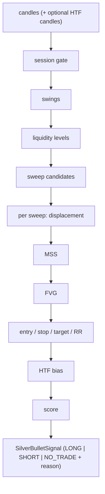

# Request for Comments (RFC) / Tech Spec

**Title:** Signal Engine: ICT Silver Bullet rule set, scoring and NO_TRADE reasons
**Project:** Silver Bot (ICT Silver Bullet trading bot)
**RFC ID:** `silverbot-rfc-001`
**Version:** 0.1
**Author:** Cian Jake Francisco
**Status:** Draft
**Last updated:** 2026-10-08
**Last reconciled:** 2026-10-08 against code at commit `62037d1`
**PRD Reference:** [prd-silverbot.md](prd-silverbot.md) PRD-F1
**SDD Reference:** [sdd-silverbot.md](sdd-silverbot.md) §2 (module map), §3.4 (configuration reference), §4.1 (runtime sequences)

This RFC is the single source of the strategy rules, thresholds and rejection reasons. It replaces the old `STRATEGY_NOTES.md`. Where the old notes and the code disagree, the code wins and the disagreement is cited as a `D-#` finding in [audit-docs-drift.md](audit-docs-drift.md). All `file:line` references are relative to `src/silver_bot/` and describe the code at the reconciled commit.

## 1. Context & Objective

Silver Bot turns the ICT Silver Bullet idea into deterministic, testable rules. The strategy engine reads a list of candles and returns exactly one of three outcomes: `LONG`, `SHORT` or `NO_TRADE` (`models.py:11-16`). A `NO_TRADE` outcome always carries a human-readable reason (`strategy/models.py:190-192`). A `LONG` or `SHORT` outcome is a candidate only: its docstring states it is not an executable order and does not bypass risk checks (`strategy/models.py:170-175`). The risk engine ([RFC-002](rfc-silverbot-risk-kill-switch.md)) and the optional ML gate ([RFC-003](rfc-silverbot-ml-filter-gate.md)) sit downstream.

Objectives:

1. State every rule the engine applies, with the threshold and default exactly as coded.
2. Record every rejection reason string verbatim with its source line, so a reader can map any logged `NO_TRADE` back to a rule.
3. Separate what is built from what the old notes described but the code does not do.

Non-goals: position sizing, order placement, spread, news and open-position checks. The strategy emits none of these (`strategy/silver_bullet.py:67-209`); see [RFC-002](rfc-silverbot-risk-kill-switch.md) for risk and PRD-F4 for execution.

No performance claim is made here. `reports/backtest_report.json`, `reports/out_of_sample_validation_report.json` and `reports/paper_trading_report.json` are 0 bytes (G-1, D-86), so the edge of this rule set is unproven.

## 2. Proposed Solution, as built

`SilverBulletStrategyEngine.evaluate(candles, higher_timeframe_candles=None)` runs a fixed sequence of gates on the supplied candles. The latest candle is the "current" candle. The sequence is (`strategy/silver_bullet.py:67-209`):

1. Enough candles exist.
2. The latest candle's open time falls inside an enabled session window.
3. Swing points are detected.
4. Liquidity levels are derived from swings inside a lookback window.
5. Sweep candidates are collected, newest first. For each candidate, in order:
   1. A displacement candle exists after the sweep, in the sweep direction.
   2. A market structure shift (MSS) exists after the sweep.
   3. The MSS direction matches the sweep direction.
   4. An unmitigated Fair Value Gap (FVG) of the matching direction is receiving its first retracement on the latest candle, and formed after the sweep.
   5. The stop does not equal the entry.
   6. The take profit and reward-to-risk (RR) meet the minimum.
   7. The higher-timeframe (HTF) bias does not oppose the setup.
   8. The quality score meets the minimum.
6. The first candidate that passes all of 5.1 to 5.8 becomes a `LONG` or `SHORT` signal. If none passes, the result is `NO_TRADE` carrying only the last candidate's reason (`strategy/silver_bullet.py:92-108`).

The engine is constructed with defaults by the two callers in `src/`: `SilverBulletStrategyEngine()` at `backtest/engine.py:39` and `execution/paper_trading.py:48`. No code outside `strategy/` builds a `SilverBulletStrategyConfig`, so the session list and every parameter below are the hard-coded defaults at runtime (D-14, H-6, G-18).

### Data flow

The signal engine stages from candles to a `SilverBulletSignal`.

## 3. Technical Details & Contracts

### 3.1 Configuration (`SilverBulletStrategyConfig`, `strategy/models.py:152-167`)

| Parameter | Default | Meaning | Validation |
|-----------|---------|---------|-----------|
| `sessions` | `()`, replaced by `DEFAULT_SESSIONS` when empty | Session windows | None; an empty tuple silently uses the defaults (`strategy/silver_bullet.py:35-52`) |
| `session_timezone` | `"America/New_York"` | Zone for session windows | An unknown zone name raises `ZoneInfoNotFoundError` |
| `swing_lookback` | 3 | Prior candles compared for a swing | `< 1` raises `ValueError("lookback must be positive")` |
| `liquidity_lookback` | 30 | Candles back from the current index in which swings become levels, and the sweep-scan window | `< 1` raises `ValueError("lookback must be positive")` |
| `minimum_fvg_size` | 0.0 | Smallest accepted FVG size, price units | `< 0` raises `ValueError("minimum_size cannot be negative")` |
| `atr_period` | 5 | Candles for ATR and the average body | `< 1` raises `ValueError("period must be positive")` |
| `displacement_body_multiplier` | 1.2 | Body must reach average body times this | `<= 0` raises `ValueError("body_multiplier must be positive")` |
| `displacement_range_multiplier` | 1.0 | Range must reach ATR times this | `<= 0` raises `ValueError("range_multiplier must be positive")` |
| `stop_buffer` | 0.0 | Distance added beyond the swept price for the stop | None; a negative value is accepted |
| `minimum_rr` | 2.0 | Minimum reward-to-risk; also the fallback target multiple | None |
| `minimum_signal_score` | 70 | Minimum quality score | None |
| `allow_counter_bias` | `False` | Accept setups against the HTF bias | None |
| HTF bias lookback | 5 | Function default only; not a config field (`strategy/bias.py:14`) | `< 2` raises `ValueError("lookback must be at least 2")` |

The config class has no `__post_init__`; invalid values fail only inside the helper functions when first used (`strategy/models.py:152-167`).

### 3.2 Session windows and timezone

| Session | Default window (local time) | Default state | Source |
|---------|------------------------------|---------------|--------|
| `london` | 03:00 to 04:00 | enabled | `strategy/sessions.py:12` |
| `new_york_am` | 10:00 to 11:00 | enabled | `strategy/sessions.py:13` |
| `new_york_pm` | 14:00 to 15:00 | disabled | `strategy/sessions.py:14` |

Rules:

- The times are local to `session_timezone`, default `America/New_York` (`strategy/sessions.py:24`, `strategy/models.py:157`).
- Membership is `start <= local_time < end` on the same calendar date: start inclusive, end exclusive, no midnight crossing (`strategy/sessions.py:43-45`).
- Disabled windows are skipped; the first enabled window that contains the timestamp wins (`strategy/sessions.py:40-53`).
- A timestamp without tzinfo is treated as UTC, then converted to the session zone (`strategy/sessions.py:56-59`).
- If the `America/New_York` zone data is unavailable, the engine falls back to a fixed offset: -4 during US daylight time, -5 otherwise. Any other missing zone name re-raises. The fallback daylight window runs from 07:00 UTC on the second Sunday of March to 06:00 UTC on the first Sunday of November (`strategy/sessions.py:28-33,61-73`). Whether zone data is installed in deployment is Open (U-8).
- The session is evaluated on the latest candle's `open_time`, not its close time (`strategy/silver_bullet.py:70-71`).

### 3.3 Swing and liquidity definitions

- A swing high is a candle whose high is strictly greater than the highest high of the previous `swing_lookback` candles. A swing low is a candle whose low is strictly lower than the lowest low of the previous `swing_lookback` candles. Only prior candles are used, so there is no right-side confirmation. One candle can be both (`strategy/structure.py:30-50`).
- Swing highs are buy-side liquidity; swing lows are sell-side liquidity (`strategy/structure.py:39,48`).
- Liquidity levels come only from swings, with source `swing_high` or `swing_low`. A swing becomes a level only if its index is in `[current_index - liquidity_lookback, current_index)`, with the lower bound floored at 0 (`strategy/liquidity.py:25-41`). There are no previous-day, previous-session, equal-high/low or range levels.

### 3.4 Sweep, displacement, MSS, FVG and HTF bias

**Sweep** (`strategy/liquidity.py:45-85`). Only levels with a candle index lower than the sweep candle are considered. Candidates are tried nearest first by distance from the candle's low (bullish) or high (bearish). Sell-side is checked before buy-side.

| Direction | Level side | Condition | `swept_price` |
|-----------|-----------|-----------|---------------|
| Bullish sweep (LONG candidate) | sell-side | previous close `>= level`, and candle low `< level`, and candle close `> level` | candle low |
| Bearish sweep (SHORT candidate) | buy-side | previous close `<= level`, and candle high `> level`, and candle close `< level` | candle high |

The engine collects sweep candidates by scanning from the latest candle back through the `liquidity_lookback` window and tries each, newest first, until one yields a signal. The loop `range(len-1, start, -1)` excludes the window start itself (`strategy/silver_bullet.py:237-244`).

**Displacement** (`strategy/displacement.py:33-88`). The engine searches the candles after the sweep, in order, and takes the first prefix whose last candle qualifies (`strategy/silver_bullet.py:126-136`). A candle qualifies when all hold:

1. Colour matches the direction (bullish: close above open; bearish: close below open).
2. Body is at least the mean body of the previous `atr_period` candles times `displacement_body_multiplier`.
3. Range is at least ATR times `displacement_range_multiplier`. ATR is the simple mean true range over the last `atr_period` candles; fewer than 2 candles gives 0.0 (`strategy/displacement.py:14-30`).
4. Close is in the top 30 percent of the range (bullish: `close >= low + 0.7 * range`) or the bottom 30 percent (bearish: `close <= low + 0.3 * range`).

It returns nothing when ATR, average body or range is zero or negative. `strength_score = min(100, 50 + (body / average_body) * 15)` (`strategy/displacement.py:78`). Volume is not used. Displacement is not required to create or overlap the FVG.

**Market structure shift** (`strategy/structure.py:54-99`). For a bullish sweep, the MSS is bullish when the latest candle of the supplied prefix closes above the price of the last buy-side swing in the list whose index is below the latest index. For a bearish sweep, the MSS is bearish when the close is below the last sell-side swing. The engine returns the first MSS found scanning prefixes from the sweep index plus one to the end (`strategy/silver_bullet.py:246-256`). The reference swing is not constrained to follow the sweep and is not required to be a lower high or higher low (D-16).

**Fair Value Gap** (`strategy/fvg.py:18-90`).

- Bullish FVG at candle `i`: `candle[i-2].high < candle[i].low`; lower bound is the first high, upper bound is the third low. Bearish FVG: `candle[i-2].low > candle[i].high`; lower bound is the third high, upper bound is the first low. Midpoint is the mean of the bounds; size is upper minus lower; the gap is kept if `size >= minimum_size`.
- `latest_unmitigated_fvg` needs at least 3 candles, considers gaps of the requested direction formed before the latest candle (newest first), skips any gap already overlapped by a candle between the gap's third candle (exclusive) and the latest candle (exclusive), and returns the first gap that the latest candle overlaps (`latest.low <= upper` and `latest.high >= lower`).
- The engine additionally requires the gap's third-candle index to be greater than the sweep candle index (`strategy/silver_bullet.py:157`).

**HTF bias** (`strategy/bias.py:11-35`). Take the last 5 candles. Bullish if the last close, high and low are all above the first's; bearish for the mirror; otherwise neutral. Fewer than 5 candles gives neutral. The engine calls this on `higher_timeframe_candles or candles`, so with no HTF candles it uses the execution-timeframe candles (`strategy/silver_bullet.py:193`; D-15). A counter-bias setup (bullish sweep with bearish bias, or bearish sweep with bullish bias) is rejected unless `allow_counter_bias` is true; neutral bias never rejects (`strategy/silver_bullet.py:194-195,293-300`).

### 3.5 Entry, stop, target and reward-to-risk

| Item | LONG | SHORT | Source |
|------|------|-------|--------|
| Entry | FVG midpoint | FVG midpoint | `strategy/silver_bullet.py:160` |
| Stop loss | swept candle low minus `stop_buffer` | swept candle high plus `stop_buffer` | `strategy/silver_bullet.py:161-165` |
| Take profit | nearest buy-side level above entry among levels formed before the sweep candle | nearest sell-side level below entry among levels formed before the sweep candle | `strategy/liquidity.py:96-108`, `strategy/silver_bullet.py:169-173` |
| Fallback take profit (no level found) | entry plus `abs(entry - stop) * minimum_rr` | entry minus `abs(entry - stop) * minimum_rr` | `strategy/silver_bullet.py:174-183` |
| Risk / reward | risk = entry - stop; reward = TP - entry | risk = stop - entry; reward = entry - TP | `strategy/silver_bullet.py:276-291` |

RR is `reward / risk`; it is 0.0 when risk or reward is zero or negative, so a stop or target on the wrong side is caught by the minimum-RR gate (`strategy/silver_bullet.py:289-290`). The gate rejects when `risk_reward < minimum_rr` (`strategy/silver_bullet.py:190-191`).

### 3.6 Quality score (`strategy/scoring.py:25-50`)

| Component | Points | Rule |
|-----------|--------|------|
| Session | 15 | Session is active; else 0 |
| Liquidity | 20 | Constant 20 |
| Displacement | up to 20 | `min(20, int(strength_score // 5))` |
| FVG | 15 | FVG size greater than 0; else 0 |
| HTF alignment | 15 | Bullish sweep with bias bullish or neutral, or bearish sweep with bias bearish or neutral; else 0 |
| Reward-to-risk | up to 10 | 10 if RR `>= 2`; else `max(0, int(rr / 2 * 10))` |
| Volatility | 5 | 5 if the displacement ATR is greater than 0; else 0 |
| Total | capped at 100 | Maximum raw sum is 100 |

The score is evaluated after the RR and bias gates; the setup is rejected if the total is below `minimum_signal_score` (default 70) (`strategy/silver_bullet.py:197-209`). Four of the seven components never vary in practice: the session component is a constant 15 once the session gate passes (`strategy/scoring.py:25`), liquidity is a constant 20, the volatility score is 5 for any displacement that exists, and the FVG score is 15 for any detected gap (D-17, G-19).

### 3.7 Signal output (`strategy/models.py:170-202`)

| Field | Valid signal | NO_TRADE |
|-------|--------------|----------|
| `direction` | `LONG` or `SHORT` | `NO_TRADE` |
| `reason` | `None` | the rejection reason |
| `explanation` | `<LONG\|SHORT> candidate: <session> session, <bullish\|bearish> liquidity sweep, displacement, MSS, FVG retracement, RR x.xx, score N. Risk engine approval is still required before any trade.` (`strategy/silver_bullet.py:216-235`) | `NO_TRADE: <reason>` (`strategy/silver_bullet.py:266`) |
| `generated_at` | latest candle `close_time`, else `open_time` (`strategy/silver_bullet.py:273`) | same; `datetime.now(timezone.utc)` if there are no candles |
| `symbol`, `timeframe` | from the last candle | from the last candle or `"UNKNOWN"` |
| `entry_price`, `stop_loss`, `take_profit`, `risk_reward_ratio`, `session_name`, `setup_quality_score` | populated | defaults (`None` / 0) |

### 3.8 Rejection reasons, verbatim

Every `NO_TRADE` reason the engine can emit, in evaluation order. Reasons 6 to 14 are produced per sweep candidate; only the last candidate's reason survives (`strategy/silver_bullet.py:107`).

| # | Gate | Condition | Reason string (verbatim) | Source |
|---|------|-----------|--------------------------|--------|
| 1 | Minimum candles | `len(candles) < max(5, swing_lookback + 3)` | `Not enough candles to evaluate Silver Bullet setup` | `strategy/silver_bullet.py:68` |
| 2 | Session | latest open time is outside every enabled window | `Outside enabled Silver Bullet session` | `strategy/silver_bullet.py:73` |
| 3 | Swings | no swing points | `No swing highs or lows detected` | `strategy/silver_bullet.py:77` |
| 4 | Levels | no levels inside the lookback window | `No buy-side or sell-side liquidity levels detected` | `strategy/silver_bullet.py:86` |
| 5 | Sweep | no sweep candidates | `No liquidity sweep detected` | `strategy/silver_bullet.py:90` |
| 6 | Displacement | none after the sweep, in the sweep direction | `No directional displacement after liquidity sweep` | `strategy/silver_bullet.py:138` |
| 7 | MSS | none after the sweep | `No market structure shift after liquidity sweep` | `strategy/silver_bullet.py:142` |
| 8 | MSS direction | `mss.direction` differs from the expected direction | `Market structure shift direction does not match sweep` | `strategy/silver_bullet.py:150` |
| 9 | FVG | no first-touch unmitigated FVG, or FVG not after the sweep | `No retracement into matching Fair Value Gap` | `strategy/silver_bullet.py:158` |
| 10 | Stop equals entry | `stop_loss == entry_price` | `Stop loss equals entry price` | `strategy/silver_bullet.py:167` |
| 11 | Reward-to-risk | `risk_reward < minimum_rr` (also when risk or reward is not positive) | `Reward-to-risk below configured minimum` | `strategy/silver_bullet.py:191` |
| 12 | HTF bias | counter-bias and `allow_counter_bias` is false | `Setup rejected by higher-timeframe {bias.value} bias` (`bias.value` is `bullish` or `bearish`) | `strategy/silver_bullet.py:195` |
| 13 | Score | `quality.total < minimum_signal_score` | `Setup quality score {quality.total} below minimum {minimum_signal_score}` | `strategy/silver_bullet.py:207-208` |
| 14 | Fallback | every candidate rejected but no reason captured | `No complete setup after sweep` | `strategy/silver_bullet.py:107` |

Reason 8 cannot fire, because the MSS detector only emits the direction matching the sweep (`strategy/structure.py:67-98`). Reason 14 is effectively unreachable when candidates exist, because each rejected candidate contributes a reason (`strategy/silver_bullet.py:104-105`).

### 3.9 Construction-time errors (raised, not `NO_TRADE`)

| Error text (verbatim) | Raised when | Source |
|-----------------------|-------------|--------|
| `NO_TRADE signals require a reason` | A `NO_TRADE` signal is built with an empty reason | `strategy/models.py:192` |
| `Valid strategy signals require entry, stop, target, RR, and session` | A `LONG`/`SHORT` signal is missing entry, stop, take profit, RR or session name | `strategy/models.py:202` |
| `lookback must be positive` | Swing or liquidity lookback `< 1` | `strategy/structure.py:27`, `strategy/liquidity.py:26` |
| `period must be positive` | ATR period `< 1` | `strategy/displacement.py:15` |
| `body_multiplier must be positive` | Body multiplier `<= 0` | `strategy/displacement.py:45` |
| `range_multiplier must be positive` | Range multiplier `<= 0` | `strategy/displacement.py:47` |
| `minimum_size cannot be negative` | FVG minimum size `< 0` | `strategy/fvg.py:19` |
| `lookback must be at least 2` | HTF bias lookback `< 2` | `strategy/bias.py:19` |
| `Candle high/low must contain open and close` | A candle's high or low does not bound its open and close | `models.py:51` |
| `Candle volume cannot be negative` | Candle volume `< 0` | `models.py:53` |

### 3.10 Carried over from the old strategy notes, and what differs

The old notes' concept list (session window, liquidity sweep, displacement, MSS, FVG, retracement, defined stop, liquidity-based target) matches the engine's stages and is carried above. The following old rules are **not** carried because the code does not do them:

| Old rule | What the code does | Finding |
|----------|--------------------|---------|
| Sessions "stored in config", YAML `silver_bullet_sessions` | Hard-coded `DEFAULT_SESSIONS`; no loader | D-14 |
| `use_htf_bias = true` flag | No flag; bias always applied, falls back to execution candles | D-15 |
| MSS is a break of a recent lower high after the sweep | Last buy-side swing, not limited to lower highs or post-sweep swings | D-16 |
| Scoring: "Liquidity sweep quality: 20", "Spread/volatility condition: 5" | Liquidity is a constant 20; volatility is 5 whenever ATR is positive; spread is not considered | D-17 |
| Trade invalidation rules (session ends, stop hit first, FVG invalidated, opposite sweep, spread) | None implemented in `strategy/` | D-18 |
| No-trade filters (spread, ATR regime, news, already in a trade, exchange unstable) | Only the gates in section 3.8 | D-19 |
| Direction value `NONE` | `NO_TRADE` | D-20 |
| Signal fields `signal_id`, `ml_probability`, `status`, `created_at` | `SilverBulletSignal` uses `generated_at`, `explanation`, `risk_reward_ratio` and has none of those | D-21 |
| `Candle.close_time` required | Optional | D-51 |
| `strategy/scoring.py` not listed | Exists | D-52 |
| Sweep needs only low below the level and close above | Also needs the previous close on the original side of the level | D-53 |
| Displacement may use a volume filter, break minor structure, create an FVG | Body, ATR and close-position only | D-54 |
| Flag "reversal mode" for counter-bias | Flag is `allow_counter_bias` | D-55 |
| Fallback target is a fixed 2R | Fallback is `minimum_rr` times risk (default 2.0) | D-56 |
| Targets include previous-session and previous-day highs and lows | Swing levels formed before the sweep only | D-57 |
| Entry options A to D (limit or market, FVG boundary) | Fixed at the FVG midpoint; no order-type field | D-58 |
| Stop options A to C (below FVG low, displacement low) | Swept price plus or minus buffer only | D-59 |

Old default values restated for reference only, because the code matches them: timezone `America/New_York`, windows 03:00 to 04:00, 10:00 to 11:00 and 14:00 to 15:00 (the last disabled), `minimum_rr = 2.0`, `minimum_signal_score = 70`, `allow_counter_bias = false`.

## 4. Alternatives Considered

| Alternative | Why not (as built) |
|-------------|--------------------|
| Machine-learning signal generation | Rejected by project policy: ML may only approve, reject or reduce risk on an existing rule-based signal ([RFC-003](rfc-silverbot-ml-filter-gate.md)). |
| Swing confirmation with right-side candles | Avoided on purpose so a swing uses only prior candles and cannot see future data (`strategy/structure.py:22-23`); it also means a swing is recognised without confirmation. |
| Configurable sessions loaded from `config.yaml` | Described in the old notes but not built (D-14). Planned. |
| Richer liquidity sources (previous day or session extremes, equal highs and lows) | Not built (`strategy/liquidity.py:37`). Planned. |
| Separate `use_htf_bias` switch | Not built (D-15). The engine always applies bias, using execution candles when no HTF candles are supplied. |
| Reporting every candidate's rejection reason | The engine keeps only the last candidate's reason (`strategy/silver_bullet.py:107`); this is simpler but hides earlier candidate reasons. Open. |

## 5. Safety, Privacy & Performance

**Safety.**

- The engine places no orders and has no exchange access. It cannot size a position, enable live trading or bypass the kill switch; a signal is a candidate until the risk engine approves it ([RFC-002](rfc-silverbot-risk-kill-switch.md)).
- A valid signal always has an entry, a stop loss and a take profit (`strategy/models.py:200-202`), and the stop must differ from the entry (`strategy/silver_bullet.py:166-167`).
- The engine is read-only over its input and has no randomness, so the same candles give the same signal.
- Lookahead: swings, sweeps and the MSS use only candles up to the evaluated prefix, and tests pin that a future-dated level yields no sweep and an MSS is not found before its break candle exists. A full lookahead audit of the engine is Open (U-7).

**Privacy.** The engine handles only market data. It holds no keys, no personal data and no network access.

**Performance.** Complexity is bounded by the candle count and `liquidity_lookback`; displacement and MSS are re-evaluated on growing prefixes for each sweep candidate. No latency target or benchmark exists, and none is claimed.

**Evidence of behaviour (tests).** Strategy tests pin a complete LONG setup (entry 106, stop 98, take profit 140, RR 4.25), a complete SHORT setup (entry 94, stop 102, take profit 60, RR 4.25), the outside-session rejection and the no-retracement rejection (`tests/test_silver_bullet_strategy.py`); swing, liquidity, sweep, MSS, FVG, displacement, first-touch and no-lookahead cases (`tests/test_strategy_modules.py`); and daylight and standard time handling plus disabled sessions (`tests/test_strategy_sessions.py`). There are no tests for the config `ValueError`s, counter-bias rejection, the score threshold, RR rejection, the scoring breakdown or the displacement `ValueError`s (test-gap family, G-28).

## 6. Execution Status

| Capability | Status | Evidence |
|-----------|--------|----------|
| Session windows, timezone handling and DST fallback | Built | `strategy/sessions.py:11-87`; 3 session tests |
| Swing, liquidity (swing-only), sweep, displacement, MSS, FVG, HTF bias | Built | `strategy/*.py`; module tests above |
| Entry, stop, target, RR, score, `LONG`/`SHORT`/`NO_TRADE` with reasons | Built | `strategy/silver_bullet.py:67-235`; 4 strategy tests |
| Strategy config built from settings or YAML | Planned | No code builds `SilverBulletStrategyConfig` (D-14, H-6, G-18) |
| Previous-day, previous-session, equal high/low and range liquidity | Planned | `strategy/liquidity.py:37` |
| Trade invalidation and spread, ATR-regime, news and open-trade filters | Planned | D-18, D-19 |
| Entry, stop and target option selectors | Planned | D-58, D-59 |
| Sessions that span midnight | Planned | `strategy/sessions.py:43-45` |
| A demonstrated edge | Not established | Evidence reports are 0 bytes (G-1, D-86) |

## 7. Risks & Open Items

| Ref | Item | Status |
|-----|------|--------|
| G-1 | No non-empty backtest, out-of-sample or paper report; no strategy performance statement is possible. | Open |
| G-18 | Strategy config is never built from settings; the documented configurability does not exist (D-14, H-6). | Open |
| G-19 | Swing-only liquidity, no invalidation or filters, crude HTF bias (first versus last candle), differing MSS and scoring definitions, unreachable branches (D-15 to D-19). | Open |
| G-28 | Test-gap family: this RFC adds that no test covers counter-bias, score threshold, RR rejection or config validation. | Open |
| U-7 | Whether the engine has any lookahead beyond the tests that pin it. | Open |
| U-8 | Whether time-zone data is installed in the deployment image, which decides whether the fallback offsets are used. | Open |
| Lookback of 5 | HTF bias lookback is fixed at 5 and not configurable. | Open |
| Last-reason only | Only the last sweep candidate's reason is reported. | Open |

## 8. Self-Check

- [x] Every rejection reason in section 3.8 is copied verbatim from `strategy/silver_bullet.py` with its line.
- [x] Every default in section 3.1 matches `strategy/models.py:152-167` and `strategy/sessions.py:11-15`.
- [x] The scoring weights in section 3.6 sum to 100 and match `strategy/scoring.py:25-50`.
- [x] Each old-notes rule that the code does not implement is listed with a `D-#` in section 3.10.
- [x] No performance or profitability claim is made; evidence reports are recorded as empty (G-1).
- [x] Status labels in section 6 are Built, Planned or Not established, each with evidence.
- [ ] Lookahead freedom of the whole engine is verified end to end (Open, U-7).
