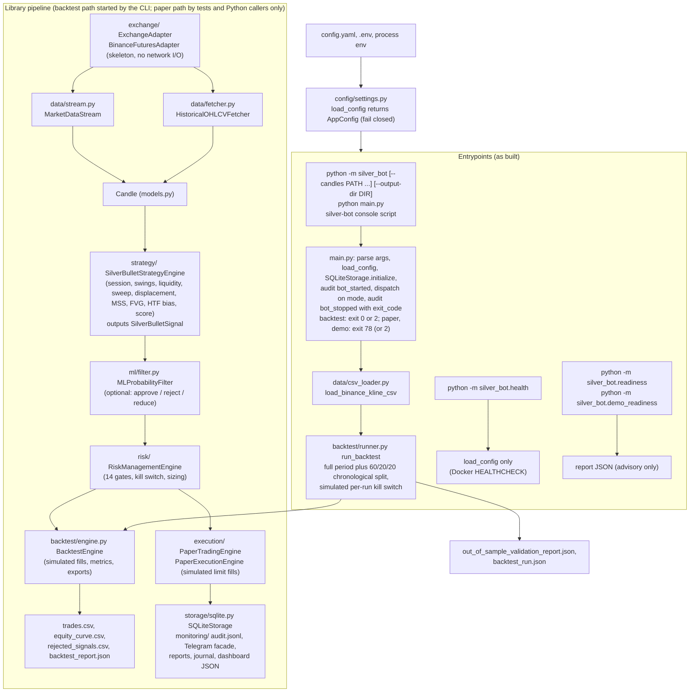
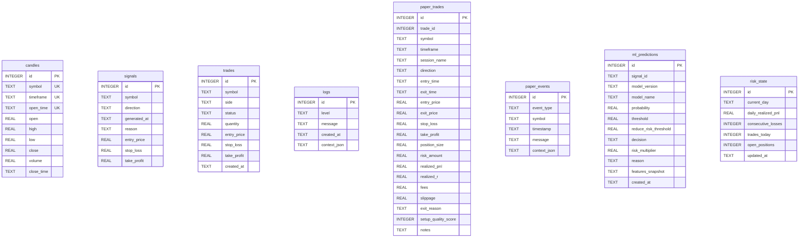
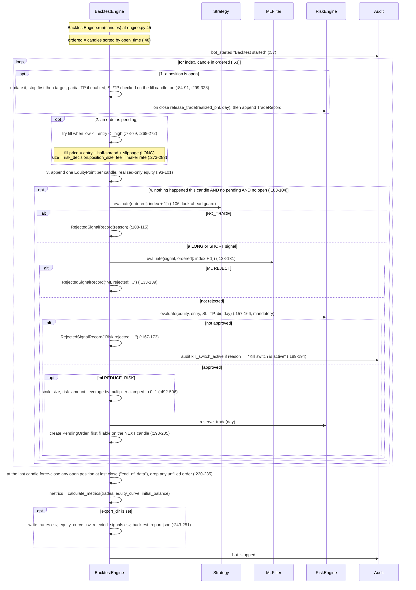
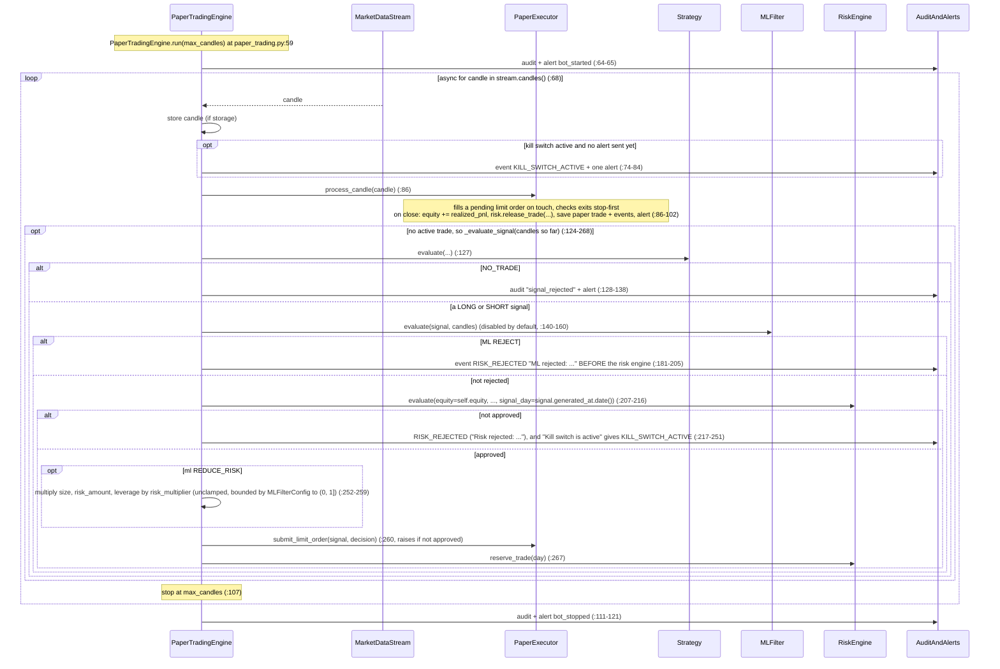
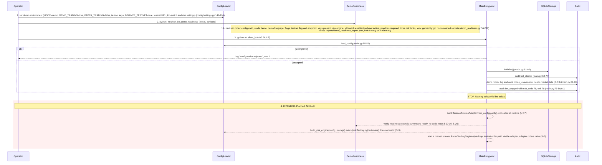

# System Design (SDD)

**Project:** Silver Bot (ICT Silver Bullet trading bot)
**Version:** 0.1
**Owner:** Cian Jake Francisco
**Status:** Draft
**Last updated:** 2026-10-14
**Last reconciled:** 2026-10-08 against code at commit `62037d1`; the section 2 module map row for `monitoring/status.py` and `monitoring/dashboard_server.py` added 2026-10-09 at the `feat/operator-dashboard` head (silverbot-cr-001); sections 1, 3.2, 3.4, 4.3, 5.3, 5.5, 7 and 8 and every `file:line` into the files changed by the HIGH safety fixes batch 1 re-checked 2026-10-09 against `70ccaec`; sections 2.1 to 2.4, 3.3, 4.1, 4.6, 5.3, 5.5 and 6 re-checked 2026-10-09 against `099085b` (G-3 entrypoint batch 2); the loader, run record, entrypoint exit, systemd and test-count statements re-checked 2026-10-09 against `5c781fc` (G-3 review fixes)

This document describes how Silver Bot is built, as coded, and how the unbuilt parts are intended to fit. It replaces the old `ARCHITECTURE.md` and `CONFIGURATION.md`; the full configuration reference is section 3.4. Product scope and feature status are in [prd-silverbot.md](prd-silverbot.md) (ids `PRD-F1` to `PRD-F12`); gaps (`G-#`) are in [scrutiny-silverbot.md](scrutiny-silverbot.md); drift findings (`D-#`) and code hazards (`H-#`) are in [audit-docs-drift.md](audit-docs-drift.md). The design records are the four RFCs ([rfc-silverbot-signal-engine.md](rfc-silverbot-signal-engine.md), [rfc-silverbot-risk-kill-switch.md](rfc-silverbot-risk-kill-switch.md), [rfc-silverbot-ml-filter-gate.md](rfc-silverbot-ml-filter-gate.md), [rfc-silverbot-readiness-gates.md](rfc-silverbot-readiness-gates.md)) and the test matrix is [qad-silverbot.md](qad-silverbot.md); AIA, OPS and BUILD are [aia-silverbot.md](aia-silverbot.md), [ops-silverbot.md](ops-silverbot.md) and [build-silverbot.md](build-silverbot.md).

Reading convention. **As built** states what the code does today, with `file:line` relative to `src/silver_bot/` unless the path starts with a root filename. **Intended** states design direction and is labelled `Planned`. Where the two differ, as built wins and the difference is cited. The headline fact: since `099085b` the entrypoint dispatches on the configured mode (`main.py:83-91`). Backtest mode loads local Binance kline CSV files and writes six reports (`main.py:94-112`, `backtest/runner.py:60-124`); paper and demo modes exit 78 with `mode not available yet: needs market data (G-13)` (`main.py:25-26,89-91`). The paper and demo runtimes exist as tested libraries only (G-3 partial, G-13, G-17). No performance claim is made anywhere in this document; the local evidence reports are empty until the owner runs a backtest on real data (G-1, D-86).

## 1. Architectural Vision & Principles

Silver Bot is a personal research, backtesting, paper and (eventually) demo/live trading system for one strategy, the ICT Silver Bullet, on crypto futures. Live trading is `Planned, blocked` (PRD-F12). The design principles below are the ones the code actually enforces, with the place each is enforced.

1. **Safety first, fail closed.** Configuration that is unsafe or ambiguous raises `ConfigError` at load rather than running with a guess (`config/settings.py:57-194`). Live trading cannot be reached from any input (section 5.1). The default mode is `paper` (`config/settings.py:29,69`).
2. **Rule-based signals only.** The strategy engine is deterministic and returns exactly `LONG`, `SHORT` or `NO_TRADE`; every `NO_TRADE` carries a reason (`models.py:11-16`, `strategy/models.py:190-202`).
3. **The risk engine is mandatory and sits between signal and order.** Every candidate in the backtester and the paper loop goes through `RiskManagementEngine.evaluate` (`backtest/engine.py:157-166`, `execution/paper_trading.py:207-216`). Caveat: a backtest started from the CLI takes its limits from settings through `build_risk_config` (`risk/factory.py:15-23`, `backtest/runner.py:48-49`) with a simulated per-run kill switch (section 5.3); the paper loop still builds its engine with default limits and no kill-switch path. `build_risk_engine` (`risk/factory.py:26-33`) adds SQLite state, but no runtime calls it until the paper runtime exists (G-5, G-6, G-7 partial).
4. **ML is a filter, never a generator.** The ML filter can approve an unchanged signal, reject it, or scale risk by a multiplier in (0, 1]; it takes an existing signal and cannot create one (`ml/filter.py:49-61,99-110`; section 8.1). It is disabled by default; the `ML_*` settings reach it in backtests only (`backtest/runner.py:50-55`), not in the paper loop (D-4, G-9 partial).
5. **No look-ahead.** The backtester hands the strategy and ML filter only `ordered[: index + 1]` (`backtest/engine.py:106,128-131`); swing, sweep and structure detection use only prior candles (`strategy/structure.py:30-50`).
6. **Modular adapters behind narrow interfaces.** The exchange is an abstract `ExchangeAdapter` (`exchange/base.py:29-52`); the market stream is an abstract `MarketDataStream` (`data/stream.py:15-20`); alerts go through a `TelegramClient` Protocol (`monitoring/telegram.py:9-13`). Real network transport behind these interfaces is not built (S-1 to S-6, S-30).
7. **Auditable.** Decisions are written as JSON lines with secret redaction (`monitoring/audit.py:34-103`); trades, paper events and ML predictions can be stored in SQLite (`storage/sqlite.py`).
8. **No martingale, no averaging down, no trade without a stop loss.** Position sizing is `risk_amount / stop_distance` with a mandatory stop (`risk/engine.py:93-96`); there is no scaling-in code anywhere. These are standing rules carried from the project instructions (PRD section 5.5).

Non-goals for this release: live order placement, multi-symbol operation, a web UI, custody of any funds other than the owner's own (PRD section 6).

## 2. High-Level Architecture

### 2.1 Module map

How configuration, the as-built entrypoints and the library pipeline connect. Backtest mode starts the backtest part of the pipeline from the CLI; paper and demo modes exit 78, so the paper loop is exercised by tests and by Python callers only.



### 2.2 Module table

Every package under `src/silver_bot/` and the top-level modules.

| Module | Responsibility | Key files | PRD-F# |
|---|---|---|---|
| `config/` | Typed, fail-closed configuration loading: defaults, `config.yaml`, `.env`, process env; mode rules; live rejection | `config/settings.py` (`AppConfig`, `TradingMode`, `ConfigError`, `load_config`) | PRD-F9 |
| `exchange/` | Abstract exchange adapter; order types; Binance Futures skeleton with testnet URL guard. Orders disabled, OHLCV fetch raises `NotImplementedError` | `exchange/base.py`, `exchange/binance_futures.py` | PRD-F5, PRD-F12 |
| `data/` | Offline Binance kline CSV loader (validate, de-duplicate, sort, count gaps); historical OHLCV fetch wrapper; market stream interface, mock stream, reconnect wrapper, polling skeleton | `data/csv_loader.py`, `data/fetcher.py`, `data/stream.py` | PRD-F10, PRD-F2, PRD-F4 |
| `strategy/` | ICT Silver Bullet rules: sessions, swings, liquidity, sweep, displacement, MSS, FVG, HTF bias, quality score; signal output | `strategy/silver_bullet.py`, `sessions.py`, `structure.py`, `liquidity.py`, `displacement.py`, `fvg.py`, `bias.py`, `scoring.py`, `models.py` | PRD-F1 |
| `risk/` | Position sizing, 14 ordered validation gates, per-day and per-streak limits, fail-closed file kill switch that auto-trips on loss limits, optional persisted state, factory from settings | `risk/engine.py`, `risk/kill_switch.py`, `risk/models.py`, `risk/factory.py` | PRD-F3 |
| `execution/` | Paper order lifecycle: pending limit order, fill on touch, stop/target exit, cost model; paper trading loop tying stream, strategy, ML, risk, storage and alerts | `execution/paper_executor.py`, `execution/paper_trading.py`, `execution/trade_management.py`, `execution/models.py` | PRD-F4 |
| `backtest/` | Event-driven backtester, cost simulation, metrics, CSV/JSON exports, chronological split helper; settings-driven runner that writes the out-of-sample and run-record reports | `backtest/engine.py`, `metrics.py`, `reporting.py`, `validation.py`, `models.py`, `runner.py` | PRD-F2 |
| `ml/` | Offline dataset, features, training, calibration report, promotion policy, JSON registry, probability filter | `ml/dataset.py`, `features.py`, `training.py`, `calibration.py`, `promotion.py`, `registry.py`, `filter.py` | PRD-F6 |
| `monitoring/` | Audit JSONL with redaction, Telegram facade (no transport), daily/weekly reports, trade journal, dashboard JSON | `monitoring/audit.py`, `telegram.py`, `reports.py`, `dashboard.py` | PRD-F7 |
| `monitoring/` (operator dashboard) | Read-only status collection from config, reports, audit log and SQLite (`status.py`); HTML render and a `127.0.0.1` server started with `python -m silver_bot.monitoring.dashboard_server` (`dashboard_server.py`); the evidence ladder and Next strip are collected in `status.py`; two vendored IBM Plex Mono woff2 files in `monitoring/fonts/` are served from the same server (silverbot-cr-002) | `monitoring/status.py`, `monitoring/dashboard_server.py`, `monitoring/fonts/` | PRD-F13 |
| `storage/` | SQLite persistence: eight tables, six writers, risk-state load, row counts | `storage/sqlite.py` | PRD-F10 |
| `utils/` | Plain-text application logger | `utils/logging.py` | PRD-F7 |
| `models.py` (top level) | Core shared models: `Candle`, `SignalDirection`, `TradeSide`, `TradeStatus`, `TradingSignal`, `Trade`, `LogEvent` | `models.py` | PRD-F1, PRD-F10 |
| `readiness.py`, `demo_readiness.py` (top level) | Live (15 checks) and demo (18 checks) readiness checkers and report export; advisory, never consulted at runtime | `readiness.py`, `demo_readiness.py` | PRD-F8, PRD-F5 |
| `main.py`, `__main__.py`, `health.py` (top level) | Entrypoint with mode dispatch (backtest run; paper and demo exit 78), module entry, container health command | `main.py`, `__main__.py`, `health.py` | PRD-F11, PRD-F9 |
| Deployment files (repo root) | Image, compose services, systemd unit, logrotate, host prep | `Dockerfile`, `docker-compose.yaml`, `deploy/` | PRD-F11 |
| (none) | Live trading: no executor, rejected at config load | n/a | PRD-F12 |

Package dependency direction: `config` and `models` are leaves; `strategy`, `risk`, `ml` and `exchange` depend on `models`; `backtest/models.py` imports `ml`, `risk` and `strategy`; `execution/models.py` imports `backtest.models`, `risk` and `strategy`; `monitoring` and `storage` are consumed by `execution`, `backtest` and `main`; `backtest/runner.py` imports `config`, `ml` and `risk` (`backtest/runner.py:12-20`); `main` imports `backtest.runner` and `data.csv_loader` (`main.py:13-15`). The `execution` package imports no exchange client (`execution/__init__.py:1-4`), which is one of the reasons no real order can leave the process (section 5.1).

### 2.3 Runtime modes and the code that selects them

The only modes are `backtest`, `paper` and `demo` (`TradingMode`, `config/settings.py:17-22`). Selection happens once, at config load, and fails closed:

| Step | Code | Behaviour |
|---|---|---|
| Source merge | `config/settings.py:68-94` | defaults, then `config.yaml`, then `.env`, then process environment; later wins |
| `MODE` override | `config/settings.py:95-96` | a non-blank `MODE` from any source overwrites `TRADING_MODE`, even one from a higher-precedence source (D-42) |
| Demo promotion | `config/settings.py:97-98` | `DEMO_TRADING=true` with `TRADING_MODE` exactly `paper` becomes `demo` (D-78) |
| Enum parse | `config/settings.py:100,226-232` | anything but `backtest`, `demo`, `paper` raises `TRADING_MODE must be one of: backtest, demo, paper`; `live` lands here |
| Live flag | `config/settings.py:101,105-106` | `LIVE_TRADING=true` raises `LIVE_TRADING=true is rejected in Phase 1` |
| Consistency | `config/settings.py:109-116` | paper needs `PAPER_TRADING=true`; demo needs `DEMO_TRADING=true`; `DEMO_TRADING=true` needs `PAPER_TRADING=false` (in any mode) |
| Demo requirements | `config/settings.py:141-194` | enforced whenever `DEMO_TRADING=true`: keys, testnet flag, testnet URL, risk engine, kill switch, kill-switch path, stop-loss flag, risk caps |

After load, `main()` branches once on the mode (`_dispatch`, `main.py:83-91`, since `099085b`). Command-line flags supply backtest inputs only; they never select the mode (decision ED-4 in the [G-3 entrypoint spec](superpowers/specs/2026-10-09-g3-entrypoint-design.md)):

| Mode | Intended behaviour | As built |
|---|---|---|
| `backtest` | Replay historical candles through strategy, ML, risk and a simulated fill model; export reports | Runs from the CLI: `python -m silver_bot --candles PATH` loads Binance kline CSV files (`data/csv_loader.py:44-84`) and calls `run_backtest` (`backtest/runner.py:60-124`), which writes six reports (section 3.3) and returns exit 0. No `--candles` or a bad file returns 2 (`main.py:94-102`). Data must be downloaded by the owner; there is no network fetch (G-13). No walk-forward or Monte Carlo (G-12) |
| `paper` | Live-like candle stream through strategy, ML, risk and simulated fills; store trades; alert | Exit 78 and audit `mode_unavailable` (`main.py:89-91`); `--candles` returns 2 (`main.py:86-88`). `PaperTradingEngine.run` works against a mock stream in tests only; no real stream (S-9, S-4, S-5, G-3 partial, G-13) |
| `demo` | Same loop against Binance Futures testnet with real testnet orders | Exit 78 as for paper. Config rules, 18-check readiness and URL guard exist; no adapter is built at runtime and all network I/O is a stub (D-46, S-25, G-17) |
| `live` | Real orders after readiness and owner approval | `Planned, blocked` (PRD-F12); not a state the application can enter |

The mode state machine is drawn in PRD section 5.2.

### 2.4 Tech Stack

Verified 2026-10-09 against commit `2b916d1`; the Market data loader, Orchestration, Host supervision, CLI and Tests rows re-verified 2026-10-09 against `099085b`. Version pins and the deprecations register are in [build-silverbot.md](build-silverbot.md) section 3; this table names the technology used for each concern and how far it is built. Status uses the PRD vocabulary: `Built`, `Partial`, `Planned`.

| Concern | Choice | Status | Evidence |
|---|---|---|---|
| Language | Python, `>=3.11` | Built | `pyproject.toml` (`requires-python`) |
| Runtime dependencies | Standard library only; `dependencies = []` | Built | `pyproject.toml`; undeclared optional deps are G-25 |
| Concurrency | `asyncio` for the market stream, exchange adapter and alerter interfaces | Partial | `data/stream.py:5`, `exchange/binance_futures.py:53`, `monitoring/telegram.py:12`; no network transport behind them (S-1 to S-6) |
| Configuration | Defaults, flat `config.yaml`, `.env`, process env; hand-written parser, no YAML library | Built | `config/settings.py:57-194`, `:284`; quirks are G-24; shipped `.env.example` loads as paper since `c6d909d` (G-4 closed) |
| Time zones | `zoneinfo` for session windows | Built | `strategy/sessions.py:6`; tzdata in the container is unverified (U-8) |
| Storage | SQLite via `sqlite3`, one file, eight tables (including `risk_state`) | Partial | `storage/sqlite.py:7,351`; no migrations, `signals` and `trades` unused (G-14) |
| File artifacts | JSON and CSV via `json` and `csv` | Built | `backtest/reporting.py:5-6`, `monitoring/reports.py:5-6`; section 3.3 |
| Logging and audit | `logging` with a plain-text format; audit events as JSON lines | Built | `utils/logging.py:8-15`, `monitoring/audit.py:74-75`; structured app log is G-16 |
| ML | Dependency-free logistic regression baseline; scikit-learn RandomForest and GradientBoosting only if it imports | Partial | `ml/training.py:28,171`; settings reach the filter in backtests only (`backtest/runner.py:50-55`, G-9 partial) |
| Model artifacts | `pickle` | Built | `ml/training.py:214`, `ml/registry.py:131`; loaded without trust checks (H-8, G-23) |
| Exchange | Binance Futures REST, testnet only | Partial | `exchange/binance_futures.py`; OHLCV fetch raises `NotImplementedError` (`:72`), orders are stubs (G-17) |
| Market data loader | Binance public kline CSV files (data.binance.vision) read offline with `csv`; the owner downloads them | Built | `data/csv_loader.py:44-84` (`e5baec7`); ms and µs timestamps, header skip, per-candle duration, duplicate and spacing checks, gap count; no network I/O |
| Market data stream | Binance WebSocket | Planned | Abstract `MarketDataStream` only (`data/stream.py:15-20`; G-13) |
| Alerts | Telegram Bot API | Planned | `TelegramClient` Protocol and an in-memory test client only (`monitoring/telegram.py:9-33`; G-15) |
| CLI | `argparse` for the readiness checkers and the main entrypoint (`--candles`, `--output-dir`); exit codes 0, 2 and 78 | Partial | `readiness.py:138`, `demo_readiness.py:102`, `main.py:29-48` (`099085b`); backtest runs, paper and demo exit 78 (G-3 partial); section 4.6 |
| Packaging | setuptools `>=68`, `src/` layout, console script `silver-bot` | Built | `pyproject.toml` |
| Container | Docker, `python:3.11-slim`, non-root `silverbot` user, config-only `HEALTHCHECK` | Built | `Dockerfile:1,20,24,28`; health semantics are G-27 |
| Orchestration | Docker Compose services `bot`, `paper`, `demo`, `backtest`, `research`; every service has `restart: "no"`; `backtest` and `research` pass `--candles /app/data/candles` | Partial | `docker-compose.yaml:24,32,34,44,65,73,76,84` (`f6bc017`); no compose healthcheck (G-26) |
| Host supervision | systemd unit running `docker compose up bot --exit-code-from bot` with `Restart=always` and `RestartPreventExitStatus=2 78`; logrotate (daily, 14 kept) | Partial | `deploy/systemd/silver-bot.service:11,13,15` (`f6bc017`, `5c781fc`), `deploy/logrotate/silver-bot`, `deploy/scripts/prepare-host.sh`; the unit runs as `User=silverbot`, which nothing creates on the host, and hardening is missing (G-26) |
| Tests | pytest `>=8.0` (optional extra `dev`), 25 test files | Built | `pyproject.toml`, `tests/`; gaps are G-28 |
| Continuous integration | None | Planned | No CI configuration in the repo |
| Doc tooling | `tools/materialize_docs.py` builds `AGENTS.md`, `MODEL_CARD.md`, `BRAND.md`, `DESIGN.md` and `.claude/agents/*.md`; `--check` verifies | Built | `tools/materialize_docs.py`, `tests/test_materialize_docs.py` |

When a row's technology changes, update this table and BUILD section 3 in the same change.

## 3. Data Architecture

### 3.1 Core data models (fields as coded)

All are frozen dataclasses with `slots=True` unless noted.

**`Candle`** (`models.py:35-54`): `symbol: str`, `timeframe: str`, `open_time: datetime`, `open: float`, `high: float`, `low: float`, `close: float`, `volume: float`, `close_time: datetime | None = None`. Invariants in `__post_init__`: `high` must contain `open` and `close`, `low` must be at or below both (`ValueError("Candle high/low must contain open and close")`); `volume >= 0` (`ValueError("Candle volume cannot be negative")`). `close_time` is optional (D-51).

**Enums** (`models.py:11-33`): `SignalDirection` = `LONG | SHORT | NO_TRADE` (D-20: the old docs said `NONE`); `TradeSide` = `BUY | SELL`; `TradeStatus` = `PLANNED | REJECTED | PAPER_OPEN | PAPER_CLOSED`.

**`TradingSignal`** (`models.py:57-71`): `symbol`, `direction`, `generated_at` (default now, UTC), `reason: str | None`, `entry_price`, `stop_loss`, `take_profit` (each `float | None`). `NO_TRADE` without a reason raises `ValueError("NO_TRADE signals require a rejection reason")`. This is the generic model; the strategy uses `SilverBulletSignal` instead.

**`Trade`** (`models.py:74-92`): `symbol`, `side: TradeSide`, `status: TradeStatus`, `quantity: float`, `entry_price`, `stop_loss`, `take_profit`, `created_at` (default now, UTC). Invariants: `quantity > 0`; `stop_loss != entry_price`. The SQLite `trades` table mirrors this shape but has no writer (S-14).

**`LogEvent`** (`models.py`): `level`, `message`, `created_at`, `context: dict[str, Any]`; persisted by `SQLiteStorage.save_log`.

**`SilverBulletSignal`** (`strategy/models.py:170-202`): `direction`, `symbol`, `timeframe`, `generated_at`, `reason: str | None`, `explanation: str`, `entry_price`, `stop_loss`, `take_profit`, `risk_reward_ratio`, `session_name`, `setup_quality_score: int = 0`. Invariants: `NO_TRADE` requires a reason; `LONG`/`SHORT` require entry, stop, target, risk/reward and session (`ValueError("Valid strategy signals require entry, stop, target, RR, and session")`). There is no `signal_id`, `ml_probability` or `status` field (D-21); the ML filter derives a `signal_id` string itself (`ml/filter.py:196`).

**Strategy intermediates** (`strategy/models.py`): `SessionWindow(name, start, end, enabled=True)`, `SessionState(is_active, name, timezone, start_at, end_at)`, `SwingPoint(index, timestamp, price, kind)`, `LiquidityLevel(price, side, source, candle_index, timestamp)`, `LiquiditySweep(direction, level, candle_index, timestamp, swept_price, close_price)`, `FairValueGap(direction, candle_index, lower_bound, upper_bound, midpoint, size, timestamp)`, `DisplacementEvent(direction, candle_index, timestamp, strength_score, body_size, candle_range, atr)`, `MarketStructureShift(direction, candle_index, timestamp, broken_level)`, `SignalQualityBreakdown(total, session, liquidity, displacement, fvg, htf_alignment, risk_reward, volatility)`.

**`SilverBulletStrategyConfig`** (`strategy/models.py:152-167`): `sessions` (empty means defaults), `session_timezone="America/New_York"`, `swing_lookback=3`, `liquidity_lookback=30`, `minimum_fvg_size=0.0`, `atr_period=5`, `displacement_body_multiplier=1.2`, `displacement_range_multiplier=1.0`, `stop_buffer=0.0`, `minimum_rr=2.0`, `minimum_signal_score=70`, `allow_counter_bias=False`. No validation in the dataclass; invalid values fail inside helper functions. No code outside `strategy/` builds this config (H-6, G-18).

**Risk models** (`risk/models.py`): `RiskConfig` (frozen; `risk_per_trade=0.005`, `minimum_stop_distance=0.01` in absolute price units, `minimum_reward_to_risk=2.0`, `max_daily_loss=0.02`, `max_consecutive_losses=3`, `max_trades_per_day=3`, `max_open_positions=1`, `max_leverage=3.0`, `kill_switch_path: Path | None = None`); `RiskState` (mutable; `current_day`, `daily_realized_pnl`, `consecutive_losses`, `trades_today`, `open_positions`; `roll_day` resets daily PnL and trades only, not streak or open count); `RiskRequest(equity, entry_price, stop_loss, take_profit, direction: str, signal_day)`; `RiskDecision(approved, reason, position_size=0.0, risk_amount=0.0, reward_to_risk=0.0, leverage=0.0)`. `RiskConfig.__post_init__` rejects `risk_per_trade` outside (0, 0.005] (`MAX_RISK_PER_TRADE = 0.005`, `risk/models.py:10,32-33`), non-positive stop distance, reward-to-risk or leverage, `max_daily_loss` outside (0, 1], and counts below 1 (`risk/models.py:31-47`). `RiskStateError(ValueError)` marks persisted state that cannot be trusted; `RiskStateStore` is a Protocol with `load_risk_state() -> RiskState | None` and `save_risk_state(state)` (`risk/models.py:69-78`). Risk state persists only when the engine is given a store (section 3.2, `risk_state`); otherwise it is in memory (G-7 partial).

**Execution models** (`execution/models.py`): `PaperEventType` = `signal_detected | risk_rejected | paper_order_created | paper_trade_opened | paper_trade_closed | error | kill_switch_active`; `PaperExecutionConfig(maker_fee=0.0002, taker_fee=0.0005, slippage_bps=1.0, spread_bps=1.0)`; `PaperOrder(signal, risk_decision, created_at, ml_probability, ml_decision)`; `PaperPosition(order, entry_time, entry_price, stop_loss, take_profit, quantity, entry_fee, risk_amount, max_favorable_excursion, max_adverse_excursion)`; `PaperLifecycleEvent(event_type, symbol, timestamp, message, trade, context)`. The `error` event type is never emitted (S-19).

**Backtest models** (`backtest/models.py`): `BacktestConfig` (defaults in 3.4.3; slippage 5.0 bps and spread 3.0 bps since `59ed6d5`, D-5 resolved); `PendingOrder`, `OpenPosition` (internal); `TradeRecord` (24 fields: `trade_id, symbol, timeframe, session_name, direction, entry_time, exit_time, entry_price, exit_price, stop_loss, take_profit, position_size, risk_amount, realized_pnl, realized_r, fees, slippage, max_favorable_excursion, max_adverse_excursion, exit_reason, setup_quality_score, notes, ml_probability, ml_decision`, `backtest/models.py:90-117`); `EquityPoint(timestamp, equity, realized_pnl, drawdown)`; `RejectedSignalRecord(timestamp, symbol, timeframe, reason, ml_probability, ml_decision)`; `ExitReason` = `stop_loss | take_profit | breakeven_stop | end_of_data` (D-30).

**ML models**: `MLSetupRow(signal_time, symbol, timeframe, direction, session_name, features, label, outcome_time)` (`ml/dataset.py:14-25`); `MLFilterConfig` and `MLFilterResult(signal_id, decision, probability, threshold, reduce_risk_threshold, risk_multiplier, model_id, model_name, reason, features_snapshot, created_at)` (`ml/filter.py:27-61`); `MLDecision` = `approve | reject | reduce_risk`; `ModelRegistryEntry(model_id, model_name, model_type, artifact_path, feature_list_path, metrics_path, features_used, training_start_date, training_end_date, validation_start_date, validation_end_date, created_at, active_status, metrics)` (`ml/registry.py:14-31`). There is no `prediction_id`, `model_version` or `test_period` (D-71, D-76).

### 3.2 SQLite schema

One file, `storage/sqlite.py`. `SQLiteStorage.initialize` creates the parent directory and runs `PRAGMA journal_mode = WAL;` plus eight `CREATE TABLE IF NOT EXISTS` statements (`storage/sqlite.py:23-127`). Each operation opens a new connection, commits on success and always closes; there is no migration system and no schema version (`storage/sqlite.py:349-356`, D-9). Datetimes are ISO-8601 text; contexts and feature snapshots are JSON with sorted keys.

| Table | Columns (name TYPE constraints) | Writer | Lines |
|---|---|---|---|
| `candles` | `id INTEGER PRIMARY KEY AUTOINCREMENT`, `symbol TEXT NOT NULL`, `timeframe TEXT NOT NULL`, `open_time TEXT NOT NULL`, `open REAL NOT NULL`, `high REAL NOT NULL`, `low REAL NOT NULL`, `close REAL NOT NULL`, `volume REAL NOT NULL`, `close_time TEXT`, `UNIQUE(symbol, timeframe, open_time)` | `save_candles` (INSERT OR REPLACE; returns count) | `:31-43`, `:129` |
| `signals` | `id INTEGER PRIMARY KEY AUTOINCREMENT`, `symbol TEXT NOT NULL`, `direction TEXT NOT NULL`, `generated_at TEXT NOT NULL`, `reason TEXT`, `entry_price REAL`, `stop_loss REAL`, `take_profit REAL` | none (unused, S-14) | `:44-53` |
| `trades` | `id INTEGER PRIMARY KEY AUTOINCREMENT`, `symbol TEXT NOT NULL`, `side TEXT NOT NULL`, `status TEXT NOT NULL`, `quantity REAL NOT NULL`, `entry_price REAL NOT NULL`, `stop_loss REAL NOT NULL`, `take_profit REAL NOT NULL`, `created_at TEXT NOT NULL` | none (unused, S-14) | `:54-64` |
| `logs` | `id INTEGER PRIMARY KEY AUTOINCREMENT`, `level TEXT NOT NULL`, `message TEXT NOT NULL`, `created_at TEXT NOT NULL`, `context_json TEXT NOT NULL` | `save_log` | `:65-71`, `:160` |
| `paper_trades` | `id INTEGER PRIMARY KEY AUTOINCREMENT`, `trade_id INTEGER NOT NULL`, `symbol TEXT NOT NULL`, `timeframe TEXT NOT NULL`, `session_name TEXT NOT NULL`, `direction TEXT NOT NULL`, `entry_time TEXT NOT NULL`, `exit_time TEXT NOT NULL`, `entry_price REAL NOT NULL`, `exit_price REAL NOT NULL`, `stop_loss REAL NOT NULL`, `take_profit REAL NOT NULL`, `position_size REAL NOT NULL`, `risk_amount REAL NOT NULL`, `realized_pnl REAL NOT NULL`, `realized_r REAL NOT NULL`, `fees REAL NOT NULL`, `slippage REAL NOT NULL`, `exit_reason TEXT NOT NULL`, `setup_quality_score INTEGER NOT NULL`, `notes TEXT NOT NULL` | `save_paper_trade` | `:72-94`, `:177` |
| `paper_events` | `id INTEGER PRIMARY KEY AUTOINCREMENT`, `event_type TEXT NOT NULL`, `symbol TEXT NOT NULL`, `timestamp TEXT NOT NULL`, `message TEXT NOT NULL`, `context_json TEXT NOT NULL` | `save_paper_event` | `:95-102`, `:214` |
| `ml_predictions` | `id INTEGER PRIMARY KEY AUTOINCREMENT`, `signal_id TEXT NOT NULL`, `model_version TEXT`, `model_name TEXT`, `probability REAL`, `threshold REAL NOT NULL`, `reduce_risk_threshold REAL NOT NULL`, `decision TEXT NOT NULL`, `risk_multiplier REAL NOT NULL`, `reason TEXT NOT NULL`, `features_snapshot TEXT NOT NULL`, `created_at TEXT NOT NULL` | `save_ml_prediction` (stores the prediction's `model_id` in `model_version`, `:248`) | `:103-116`, `:234` |
| `risk_state` | `id INTEGER PRIMARY KEY CHECK (id = 1)`, `current_day TEXT`, `daily_realized_pnl REAL NOT NULL`, `consecutive_losses INTEGER NOT NULL`, `trades_today INTEGER NOT NULL`, `open_positions INTEGER NOT NULL`, `updated_at TEXT NOT NULL` | `save_risk_state` (INSERT OR REPLACE of row 1; `updated_at` is UTC now); read by `load_risk_state` | `:117-125`, `:261-319` |

The eight SQLite tables with their columns and types, matching `storage/sqlite.py:31-125`. No table declares a `FOREIGN KEY` or `REFERENCES` clause, so the entities are shown without relationship lines; `paper_trades.trade_id` is a plain integer, not a key reference.



`risk_state` holds at most one row (`id = 1`). `load_risk_state` returns None when the row is absent and raises `RiskStateError` when the read fails with `sqlite3.Error`, `current_day` is not an ISO date, `daily_realized_pnl` is not a finite number, or a count is not a non-negative integer (`storage/sqlite.py:283-319`). `RiskManagementEngine` loads it once at construction, saves after `reserve_trade`, `release_trade` and a day roll in `evaluate`, and stops saving once a load has failed (`risk/engine.py:28-46,115,127-133`). Only `build_risk_engine(config, storage)` attaches a store (`risk/factory.py:33`); the backtest and paper engines do not. `open_positions` survives a restart but paper positions do not, so after a crash with an open trade the engine keeps rejecting at gate 13 until the owner resets the row ([ops-silverbot.md](ops-silverbot.md)).

Other methods: `count_rows(table_name)` accepts only a whitelist of the eight names and raises `ValueError("unknown table name")` otherwise; `table_names()` lists user tables (`storage/sqlite.py:321-347`). There is no read or query API for candles, signals or trades, no table for orders, performance metrics or backtest runs (G-14). The existing `test_database_initialization_creates_phase_one_tables` asserts five of the seven tables.

Callers: `main()` calls `initialize` only (`main.py:61-62`); `PaperTradingEngine` calls the paper and ML writers when a storage object is injected (`execution/paper_trading.py:99-100,140-160,281-288`).

### 3.3 File artifacts

| Artifact | Producer | Consumer | Status |
|---|---|---|---|
| `logs/audit.jsonl` | `StructuredAuditLogger` (path hard-coded in `main.py:63`; engines write when given a logger) | operator; `build_daily_performance_report` reads `ml_decision` events | Written by every `main()` run that loads a config: `bot_started`, then `mode_unavailable` (WARNING) in paper and demo, then `bot_stopped` with `exit_code` in its context (`main.py:64-80,90`) |
| `trades.csv`, `equity_curve.csv`, `rejected_signals.csv`, `backtest_report.json` | `export_backtest_result` when `BacktestConfig.export_dir` is set (`backtest/reporting.py:15-25`; header sets `backtest/models.py:90-139`); a CLI backtest writes them to `--output-dir` (default `reports/`) for the full period only (`backtest/runner.py:74`) | operator; `backtest_report.json` is the live readiness `backtest_report_exists` input | Written by `python -m silver_bot --candles PATH` in backtest mode. `backtest_report.json` holds the metrics dict only, `inf` as the string `"inf"`. A zero-trade run writes a 0-byte `trades.csv`. `daily_summary.csv` is not produced (D-25) |
| `out_of_sample_validation_report.json` | `run_backtest` (`backtest/runner.py:76-98`, `f84557e`) | live readiness `out_of_sample_validation_report_exists` | Keys `method` (`chronological_split`), `fractions` (0.6 / 0.2 / 0.2), `parameters_tuned` (always false; nothing is tuned), `segments.training`, `segments.validation`, `segments.final_test`; each segment holds `candles`, `start`, `end`, `metrics` and `kill_switch` (`tripped`, `reason`, `tripped_at`), from its own engine with fresh risk state (`backtest/runner.py:159-169`). No pass or fail verdict (G-12) |
| `backtest_run.json` | `run_backtest` (`backtest/runner.py:100-119`) | operator; the run record | `inputs` (`files`, `gaps` from the loader), `symbol`, `timeframe`, `candles`, `first_open_time`, `last_open_time`, `slippage_bps`, `spread_bps`, `maker_fee`, `taker_fee`, `ml_filter_enabled`, `risk_per_trade`, `kill_switch` (`mode: simulated_per_run`, `tripped`, `reason`, `tripped_at`) and `package_version`. The cost fields, `ml_filter_enabled` and `risk_per_trade` are read from the `BacktestConfig` the full-period engine ran with (`backtest/runner.py:74,110-115`, `5c781fc`) |
| `reports/backtest_report.json`, `reports/out_of_sample_validation_report.json`, `reports/paper_trading_report.json` | backtest CLI (first two); nothing yet for the paper report | live readiness "exists" checks (`readiness.py:76-90,150-177`) | Local files under the git-ignored `reports/` (`.gitignore:7`); empty until the owner runs a backtest on real data (G-1, D-86); no paper report writer (G-3) |
| `reports/live_readiness_report.json` | `python -m silver_bot.readiness` (`readiness.py:126-147`) | operator only; not consulted by any code (D-10) | Present, `ready=false` |
| `reports/demo_readiness_report.json` | `python -m silver_bot.demo_readiness` (`demo_readiness.py:99-111`) | operator only | Present, generated 2026-06-15, `ready=true` |
| `models/model_registry.json` | `ModelRegistry` (`ml/registry.py`) | `MLProbabilityFilter` (`ml/filter.py:112-133`) | `models/` is empty; no model shipped (S-23) |
| Model artifacts `<name>.pkl`, `feature_list.json`, `<name>_validation_metrics.json` | `train_baseline_models` (`ml/training.py:102-231`) | `ModelRegistry.register_model` | Library only (S-21) |
| `calibration_report.json`, `calibration_bins.csv` | `build_calibration_report` / export (`ml/calibration.py:90-119`) | promotion input | Library only |
| Promotion decision JSON | `export_promotion_decision` (`ml/promotion.py:185-190`) | operator; advisory | Library only |
| Trade journal CSV, daily and weekly report JSON, dashboard JSON | `monitoring/reports.py:140,156`, `monitoring/dashboard.py:27` | operator | Builders only, no caller (S-31, G-16) |
| Kill-switch file at `KILL_SWITCH_PATH` | created by the operator, or by `KillSwitch.trip` when the risk engine hits the daily-loss or consecutive-loss limit (JSON `reason` and `tripped_at`, `risk/kill_switch.py:53-60`); deleted only by the operator | `KillSwitch.is_active` (`risk/kill_switch.py:22-33`), both readiness checkers | Compose `demo` uses `/app/data/KILL_SWITCH` (`docker-compose.yaml:57`). Never read or written by a backtest |
| Simulated kill-switch file `KILL_SWITCH` in a fresh temporary directory, one per engine run | `_simulate` (`backtest/runner.py:127-144`); tripped by the backtest risk engine like the real file | `_read_trip` (`backtest/runner.py:145-156`) reads it before the directory is deleted | Not kept. Its trip record goes into `backtest_run.json` and each OOS segment (ED-5) |
| `data/silver_bot.sqlite3` | `SQLiteStorage` | storage, tests | Created at startup |

### 3.4 Configuration reference

This subsection replaces `CONFIGURATION.md`. It lists every configuration key the code reads. Section 3.4.1 covers `AppConfig` keys, 3.4.2 the readiness-only keys, 3.4.3 the code-level dataclass defaults, 3.4.4 container settings.

**Loader behaviour (as built).**

- Order, later wins: hard-coded defaults, `config.yaml`, `.env`, process environment (or the `environ` mapping when one is passed) (`config/settings.py:68-94`). `PROGRESS.md:119` had this order wrong (D-77).
- Relative `.env` and `config.yaml` paths resolve against the process working directory (`:59-60,92-93`). A missing file is silently skipped (`:266-267,285-286`).
- `.env` parser (`:265-281,342-345`): strips a UTF-8 BOM, skips blank and `#` lines, splits on the first `=`, strips one pair of matching quotes. A non-comment line with no `=` or an empty key raises `Invalid .env line N: ...`. No `export` prefix handling, no inline-comment stripping.
- `config.yaml` parser (`:284-304`) is a hand-rolled line parser, not YAML: indentation is ignored; a line ending in `:` with no other `:` opens a section; `key: value` becomes `SECTION_KEY`; a line with no `:` raises `Invalid config.yaml line N: expected key: value`; no inline-comment stripping, no lists, no nesting. Flattened names are mapped through a 31-entry alias table (`:306-339`); names not in the table pass through under their upper-cased flattened name.
- **Quirk (D-43, G-24).** A section stays open until the next section header, so root-level keys written after a section are prefixed with it. In both `config.yaml:6-7` and `config.example.yaml:10-11`, `database_path` and `exchange_name` follow the `trading:` block and become `TRADING_DATABASE_PATH` and `TRADING_EXCHANGE_NAME`, which are not in the alias table and are ignored. The defaults coincide, so the effect is invisible until someone changes them.
- **Quirk (D-44, G-24).** `risk: engine_enabled:` flattens to `RISK_ENGINE_ENGINE_ENABLED`, which is not aliased (the table holds `RISK_ENGINE_ENABLED` at `:331`); the key is ignored. Set `RISK_ENGINE_ENABLED` in `.env` or the environment instead.
- **Quirk (D-42).** `MODE` is not an alias: a non-blank `MODE` overwrites `TRADING_MODE` from any source (`:95-96`).
- **Quirk (D-78).** `DEMO_TRADING=true` applies all demo requirements in any mode and promotes `paper` to `demo` (`:97-98,113-116,141-194`).
- **Resolved (D-2, G-4, H-14; `c6d909d`).** `.env.example:6-7` sets `PAPER_TRADING=true` and `DEMO_TRADING=false`, so the shipped file loads as paper mode (`tests/test_config.py:258`). Before the fix it set the reverse, which promoted the mode to `demo` and failed on the missing API keys (`config/settings.py:97-98,141-142`).
- **Global rules (all modes, since `5e4acc5` and `08c81ad`).** `MAX_RISK_PER_TRADE` must be in (0, 0.005] (`config/settings.py:180-181`), and `KILL_SWITCH_ENABLED=true` with a blank `KILL_SWITCH_PATH` raises `KILL_SWITCH_PATH is required when KILL_SWITCH_ENABLED=true` (`config/settings.py:174-175`). The demo-only check `KILL_SWITCH_PATH is required in demo mode` (`:187-188`) is now unreachable, because demo already requires `KILL_SWITCH_ENABLED=true`.
- Types parsed by the helpers: booleans accept `1,true,yes,y,on` and `0,false,no,n,off` (case-insensitive, `:235-241`), else `<NAME> must be a boolean value`; floats use `float()` with no NaN, infinity or sign check except where noted (`:244-248`); a blank required key raises `<NAME> is required` (`:251-255`). `ConfigError` subclasses `ValueError`; `AppConfig` is a frozen, slotted dataclass with 26 fields.

#### 3.4.1 `AppConfig` keys (27 environment names; `MODE` is not a field)

yaml column: the spelling accepted in `config.yaml` (`section.key`). Line numbers are in `config/settings.py`.

| Env name | yaml path | Type | Default | Validation / fail-closed behaviour | Lines |
|---|---|---|---|---|---|
| `MODE` | root `mode` (aliased to `TRADING_MODE`) | str | unset | If non-blank, overrides `TRADING_MODE` from any source; not an `AppConfig` field | 95-96, 307 |
| `TRADING_MODE` | `trading.mode` | `TradingMode` | `paper` | Lower-cased; must be `backtest`, `demo` or `paper`, else `TRADING_MODE must be one of: backtest, demo, paper`; `live` rejected here | 69, 100, 226-232 |
| `LIVE_TRADING` | `trading.live_trading` | bool | `false` | `true` raises `LIVE_TRADING=true is rejected in Phase 1`; non-boolean raises `LIVE_TRADING must be a boolean value` | 70, 101, 105-106 |
| `PAPER_TRADING` | `trading.paper_trading` | bool | `true` | Must be true when mode is `paper`; must be false when `DEMO_TRADING=true` | 71, 102, 109-116 |
| `DEMO_TRADING` | `trading.demo_trading` | bool | `false` | `true` triggers every demo requirement in any mode; mode `demo` requires it true; promotes `paper` to `demo` | 72, 97, 103, 111-116 |
| `DATABASE_PATH` | root `database_path` (only before any section) | Path | `data/silver_bot.sqlite3` | Required; basename not empty, `.` or `..`; no `..` path part; not an existing directory | 73, 118-124 |
| `EXCHANGE_NAME` | root `exchange_name` (only before any section) | str | `binance_futures` | Required; lower-cased; letters, digits and `_` only | 74, 125-127 |
| `SYMBOL` | `exchange.symbol` | str | `BTCUSDT` | Required; upper-cased; letters and digits only | 75, 128-130 |
| `TIMEFRAME` | `exchange.timeframe` | str | `1m` | Required; lower-cased; digits then one of `m`, `h`, `d`, `w` (so `0m` and `1w` pass, bare `m` fails) | 76, 131-133 |
| `BINANCE_API_KEY` | `exchange.binance_api_key` | str or None | none | Blank becomes None; must be paired with the secret; required in demo | 135-138, 141-142 |
| `BINANCE_API_SECRET` | `exchange.binance_api_secret` | str or None | none | As above | 136-138, 141-142 |
| `BINANCE_TESTNET` | `exchange.binance_testnet` | bool | `false` | Must be true in demo (`BINANCE_TESTNET must be true when MODE=demo`); not cross-checked with the URL outside demo (the adapter constructor checks it) | 77, 139, 143-144 |
| `BINANCE_FUTURES_BASE_URL` | `exchange.binance_futures_base_url` | str or None | blank (None) | In demo, if set it must pass `is_binance_futures_testnet_url`: scheme `https`, hostname exactly `testnet.binancefuture.com`, no userinfo, port 443 or none (D-13 resolved, `0a76564`); blank is allowed | 78, 140, 145-146, 348-365 |
| `TELEGRAM_ENABLED` | `telegram.enabled`, `alerts.telegram_enabled` | bool | `false` | `true` requires token and chat id | 79, 147, 150-151 |
| `TELEGRAM_BOT_TOKEN` | `telegram.bot_token`, `alerts.telegram_bot_token` | str or None | none | Required when enabled; never read by the alerter (D-3) | 148 |
| `TELEGRAM_CHAT_ID` | `telegram.chat_id`, `alerts.telegram_chat_id` | str or None | none | Required when enabled | 149 |
| `ML_FILTER_ENABLED` | `ml.filter_enabled`, `ml.enabled` (alias `ML_ENABLED`) | bool | `false` | Boolean only; no check that a registry exists; reaches `MLFilterConfig` in backtests only (`backtest/runner.py:50-55`), not in the paper loop (D-4, G-9 partial) | 80, 152, 325-326 |
| `ML_REGISTRY_PATH` | `ml.registry_path` | Path | `models/model_registry.json` | Required; same file-path rules as `DATABASE_PATH` | 81, 153-159 |
| `ML_MIN_PROBABILITY` | `ml.min_probability` | float | `0.60` | Number in [0, 1] | 82, 160, 167-168 |
| `ML_REDUCE_RISK_THRESHOLD` | `ml.reduce_risk_threshold` | float | `0.55` | Number in [0, 1] and at most `ML_MIN_PROBABILITY` | 83, 161-166, 169-170 |
| `RISK_ENGINE_ENABLED` | none usable (`risk.engine_enabled` is ignored, D-44) | bool | `true` | Must be true in demo only; not consumed by any engine | 84, 171, 182-184 |
| `KILL_SWITCH_ENABLED` | `risk.kill_switch_enabled` | bool | `false` | Must be true in demo; when true in any mode `KILL_SWITCH_PATH` must be set; `build_risk_config` passes the path only when true (`risk/factory.py:22`); a backtest replaces it with its simulated per-run path whatever the value (`backtest/runner.py:49`) | 85, 172, 174-175, 185-186 |
| `KILL_SWITCH_PATH` | `risk.kill_switch_path` | Path or None | blank (None) | Required when `KILL_SWITCH_ENABLED=true` (any mode); no traversal or directory check; reaches `RiskConfig.kill_switch_path` only through `build_risk_config`; no running engine uses it, because backtests swap in a simulated path and the paper runtime is not built (G-6 partial) | 86, 173, 174-175, 187-188 |
| `STOP_LOSS_REQUIRED` | `risk.stop_loss_required` | bool | `true` | Must be true in demo only; not consumed (the risk engine requires a stop unconditionally, `risk/engine.py:54-55`) | 87, 176, 189-190 |
| `MAX_RISK_PER_TRADE` | `risk.max_risk_per_trade` | float | `0.005` | `0 < x <= 0.005` in every mode (`5e4acc5`); mapped to `RiskConfig.risk_per_trade` by `build_risk_config`, which CLI backtests use (G-5 partial: no paper runtime) | 88, 177, 180-181 |
| `MAX_DAILY_LOSS` | `risk.max_daily_loss` | float | `0.02` | Demo: `0 < x <= 0.02`; other modes any float (`RiskConfig` still requires (0, 1]); mapped by `build_risk_config` | 89, 178, 191-192 |
| `MAX_LEVERAGE` | `risk.max_leverage` | float | `3` | Demo: `0 < x <= 3`; other modes any float (`RiskConfig` still requires positive); mapped by `build_risk_config` | 90, 179, 193-194 |

Alias table (`config/settings.py:306-339`, 31 entries). yaml flattened name to canonical env name: `MODE` to `TRADING_MODE`; `DATABASE_PATH`, `EXCHANGE_NAME`, `TRADING_MODE` to themselves; `TRADING_LIVE_TRADING`, `TRADING_PAPER_TRADING`, `TRADING_DEMO_TRADING` to `LIVE_TRADING`, `PAPER_TRADING`, `DEMO_TRADING`; `EXCHANGE_SYMBOL`, `EXCHANGE_TIMEFRAME`, `EXCHANGE_BINANCE_API_KEY`, `EXCHANGE_BINANCE_API_SECRET`, `EXCHANGE_BINANCE_TESTNET`, `EXCHANGE_BINANCE_FUTURES_BASE_URL` to the unprefixed names; `TELEGRAM_*` to themselves and `ALERTS_TELEGRAM_*` to `TELEGRAM_*`; `ML_ENABLED` to `ML_FILTER_ENABLED` and the four `ML_*` names to themselves; `RISK_ENGINE_ENABLED` to itself; `RISK_KILL_SWITCH_ENABLED`, `RISK_KILL_SWITCH_PATH`, `RISK_STOP_LOSS_REQUIRED`, `RISK_MAX_RISK_PER_TRADE`, `RISK_MAX_DAILY_LOSS`, `RISK_MAX_LEVERAGE` to the unprefixed names.

Cross-field rules: `BINANCE_TESTNET` and the URL are not cross-validated outside demo (a testnet flag with a production URL passes config and fails in the adapter constructor, `exchange/binance_futures.py:39-40`); in non-demo modes `RISK_ENGINE_ENABLED=false`, `KILL_SWITCH_ENABLED=false`, `STOP_LOSS_REQUIRED=false` and any float for `MAX_DAILY_LOSS` and `MAX_LEVERAGE` are accepted; `MAX_RISK_PER_TRADE` is capped at 0.005 in every mode (D-11 partial).

Whether other modules consume `exchange_name`, `symbol`, `timeframe` and the risk fields is Open (U-15); a grep of the pipeline modules found only the `main()` audit context and `BinanceFuturesAdapter.from_config` using `AppConfig` (U-17).

#### 3.4.2 Readiness-only keys (6 names; not in `AppConfig`)

Read by the readiness checkers from the process environment (live) or `.env` overlaid by the process environment (demo). They never affect `load_config` and nothing at runtime consults the resulting reports.

| Env name | Type | Default | Used by | Behaviour | Lines |
|---|---|---|---|---|---|
| `READINESS_CHECK_PASSED` | bool | none (missing fails) | live check 11 `manual_readiness_confirmation` | Must be true | `readiness.py:98` |
| `API_WITHDRAWALS_DISABLED` | bool | none (missing fails) | live check 12 `withdrawals_disabled_confirmation` | Owner assertion that the API key cannot withdraw; the code cannot verify it | `readiness.py:99` |
| `TELEGRAM_ALERTS_TESTED` | bool | `false` in `.env.example` | live check 7 | Required true when `TELEGRAM_ENABLED=true` | `readiness.py:242-266` |
| `BACKTEST_REPORT_PATH` | path | `reports/backtest_report.json` | live check 1 | Must be a readable, non-empty file that parses as a JSON object (UTF-8, BOM allowed); content beyond that is not validated (H-2 resolved, `88220e6`) | `readiness.py:76,150-177` |
| `OOS_VALIDATION_REPORT_PATH` | path | `reports/out_of_sample_validation_report.json` | live check 2 | As above | `readiness.py:77-83` |
| `PAPER_TRADING_REPORT_PATH` | path | `reports/paper_trading_report.json` | live check 3 | As above | `readiness.py:84-90` |

Readiness environment sources differ (D-45). Live readiness reads only the process environment, applies no defaults to booleans (a missing boolean fails with "value is missing"), and treats missing float limits as passing (`readiness.py:74,180-199,291-293`). Demo readiness merges `.env` under the process environment, consults `config.yaml` only inside check 1, so a value supplied only in `config.yaml` fails the other checks (`demo_readiness.py:51-53,114-123`). Live check 9 requires `LIVE_TRADING=true` and check 10 requires `PAPER_TRADING=false`, a combination `load_config` refuses, so a ready live report can only come from a configuration the application will not load (H-3, G-2). The kill-switch active checks use `Path.exists()`, so a directory at the path also counts as active (D-80).

#### 3.4.3 Code-level defaults (not reachable from env or yaml)

No loader builds these dataclasses from settings; callers construct them in Python. The exceptions are `build_risk_config(config)` (`risk/factory.py:15-23`, `4726cb5`), which builds `RiskConfig` from `max_risk_per_trade`, `max_daily_loss`, `max_leverage` and (when enabled) `kill_switch_path`, with the other `RiskConfig` fields at their defaults; `build_risk_engine(config, storage=None)` (`risk/factory.py:26-33`), which wraps it with an optional state store; and `build_backtest_config` (`backtest/runner.py:35-57`), which takes `build_risk_config`, swaps in the simulated kill-switch path and builds `MLFilterConfig` from the four `ML_*` settings. CLI backtests use `build_backtest_config`; nothing calls `build_risk_engine` at runtime yet (G-3 partial).

| Setting | Default | Defined at |
|---|---|---|
| `RiskConfig` | see 3.1; `risk_per_trade` allowed (0, 0.005], default 0.005; `kill_switch_path` None (switch inert unless built by `build_risk_config` with `KILL_SWITCH_ENABLED=true`, or given a simulated path by the backtest runner) | `risk/models.py:21-29,32-33` |
| `PaperExecutionConfig` maker / taker / slippage_bps / spread_bps | 0.0002 / 0.0005 / 1.0 / 1.0 | `execution/models.py:30-33` |
| `PaperTradingEngine.initial_equity` | 10000.0 | `execution/paper_trading.py:45` |
| `BacktestConfig` initial_balance / maker_fee / taker_fee | 10000.0 / 0.0002 / 0.0005 | `backtest/models.py:30-33` |
| `BacktestConfig` slippage_bps / spread_bps | 5.0 / 3.0 (`59ed6d5`; a caller may still pass 0.0; not checked against real fills; D-5, H-7, G-11 closed) | `backtest/models.py:34-35` |
| `BacktestConfig` enable_partial_tp / partial_tp_r / partial_tp_fraction / move_stop_to_breakeven_after_partial / export_dir | False / 1.0 / 0.5 / True / None | `backtest/models.py:36-40` |
| `chronological_split` fractions | 0.6 train / 0.2 validation / 0.2 final test | `backtest/validation.py:27-28` |
| `HistoricalOHLCVFetcher.fetch` limit | 1000 | `data/fetcher.py:25` |
| `ReconnectPolicy` max_reconnects / reconnect_delay_seconds | 3 / 0.0 | `data/stream.py:27-28` |
| `BinancePollingMarketDataStream` poll_interval_seconds / limit | 60.0 / 2 | `data/stream.py:86-87` |
| `SilverBulletStrategyConfig` | see 3.1 | `strategy/models.py:152-167` |
| `DEFAULT_SESSIONS` (America/New_York) | `london` 03:00-04:00 on; `new_york_am` 10:00-11:00 on; `new_york_pm` 14:00-15:00 off | `strategy/sessions.py:11-15` |
| HTF bias lookback | 5 (function default, not configurable) | `strategy/bias.py:14` |
| `MLFilterConfig` enabled / registry_path / min_probability / reduce_risk_threshold / reduced_risk_multiplier | False / `models/model_registry.json` / 0.60 / 0.55 / 0.5 | `ml/filter.py:27-44` |
| `PromotionPolicyConfig` | primary_metric `accuracy`; minimum_validation_improvement 0.0; maximum_test_score_degradation 0.02; maximum_brier_score 0.25; minimum_sample_count 30 | `ml/promotion.py:26-30` |
| `MLDatasetBuilder.max_lookahead_candles` | 100 | `ml/dataset.py:66` |
| ML feature pipeline atr_period / recent_window | 5 / 5 | `ml/features.py:66-68` |
| Baseline logistic regression learning rate / iterations | 0.1 / 500 | `ml/training.py:44-45` |
| Calibration bin_count | 10 | `ml/calibration.py:63` |
| `TelegramAlertConfig` | enabled False, token None, chat_id None | `monitoring/telegram.py:16-22` |
| Audit log path | `logs/audit.jsonl`, hard-coded, not configurable | `main.py:63` |

Sessions, strategy parameters, ML thresholds beyond the three parsed keys, reconnect policy, backtest costs and balance, risk limits outside backtests and paper costs are therefore not configurable from the outside today (D-14, U-4, G-18, G-24). A CLI backtest runs `SilverBulletStrategyEngine()` with defaults (`backtest/engine.py:39`, H-6).

#### 3.4.4 Container settings

Dockerfile `ENV`: `PYTHONDONTWRITEBYTECODE=1`, `PYTHONUNBUFFERED=1`, `TRADING_MODE=paper`, `LIVE_TRADING=false`, `PAPER_TRADING=true`, `DATABASE_PATH=/app/data/silver_bot.sqlite3`, `ML_REGISTRY_PATH=/app/models/model_registry.json`, `TELEGRAM_ENABLED=false`, `ML_FILTER_ENABLED=false` (`Dockerfile:3-11`). Compose forces `LIVE_TRADING="false"` in every service (`docker-compose.yaml:3-8`); the `demo` service forces the demo environment including `KILL_SWITCH_PATH=/app/data/KILL_SWITCH`, `MAX_RISK_PER_TRADE=0.005`, `MAX_DAILY_LOSS=0.02`, `MAX_LEVERAGE=3` (`docker-compose.yaml:44-63`). `.dockerignore` excludes `config.yaml`, so the container reads environment only (U-2).

## 4. Interfaces & External Integrations

### 4.1 Runtime sequences

The first two sequences describe code that exists and is exercised by tests. Sequence A also runs from the CLI in backtest mode, once for the full period and once per out-of-sample segment (`backtest/runner.py:74,93-95`); Sequence B runs only when called from Python. The third mixes the real startup with the intended demo flow and marks which steps do not exist.

#### Sequence A: backtest bar loop (as built, `backtest/engine.py`)

The backtest bar loop in the order the code runs it, with line references into `backtest/engine.py`.



#### Sequence B: paper signal to risk to executor (as built, `execution/paper_trading.py`)

The paper trading loop from candle to executor, with line references into `execution/paper_trading.py`. The ML filter is disabled by default.



Nothing constructs `PaperTradingEngine` outside tests (S-9). There is no emergency shutdown: an active kill switch only rejects new entries; open paper positions continue to be managed.

#### Sequence C: demo startup with readiness (real startup; demo steps are intended)

The demo startup flow. Steps 1 to 3 exist and are shown as built; the shaded block is intended only (`Planned`) and nothing in it exists in code.



Step 3 is what the compose `bot`, `paper` and `demo` services run; each exits 78 (D-46 partial). In demo, even with the configuration rules satisfied, `KILL_SWITCH_PATH` reaches a `KillSwitch` only through `build_risk_config` or `build_risk_engine`, and no demo runtime calls either, so the switch is inert at runtime until the demo runtime exists (G-3 partial, G-6 partial).

### 4.2 Exchange adapter interface

Defined in `exchange/base.py` (as built, exact signatures):

```python
class OrderPlacementDisabled(RuntimeError): ...

@dataclass(frozen=True, slots=True)
class OrderRequest:
    symbol: str
    side: TradeSide
    quantity: Decimal
    stop_loss: Decimal
    take_profit: Decimal

class ExchangeAdapter(ABC):
    @abstractmethod
    async def fetch_ohlcv(self, *, symbol: str, timeframe: str, start: datetime,
                          end: datetime, limit: int = 1000) -> Sequence[Candle]: ...

    async def place_order(self, request: OrderRequest) -> None:
        raise OrderPlacementDisabled("Real order placement is disabled in Phase 1")

    async def cancel_order(self, *, symbol: str, order_id: str) -> None:
        raise OrderPlacementDisabled("Real order cancellation is disabled in Phase 1")
```

`fetch_ohlcv` is the only abstract method (`exchange/base.py:29-42`); `place_order` (`:44-47`) and `cancel_order` (`:49-52`) are concrete methods that always raise. No subclass overrides them. `OrderRequest` requires a stop loss and a take profit by shape.

Intended (`Planned`): a position, balance and account query surface, signed REST, a user data stream, and an explicit order path guarded by the live gate. These are not designed in detail here; no RFC covers the exchange and data surface yet (G-17); the live gate is discussed in [rfc-silverbot-readiness-gates.md](rfc-silverbot-readiness-gates.md).

### 4.3 Binance Futures adapter

`BinanceFuturesAdapter` (`exchange/binance_futures.py`) is a skeleton.

| Aspect | As built | Lines |
|---|---|---|
| Constructor | `__init__(*, api_key=None, api_secret=None, testnet=False, base_url=None)`; `base_url` defaults to the testnet URL when `testnet` else production; an explicit `base_url` wins | `:25-38` |
| Base URLs | production `https://fapi.binance.com`; testnet `https://testnet.binancefuture.com`. These are the only endpoint strings in the code | `:18-19` |
| Testnet guard | if `testnet=True` and the URL fails `is_binance_futures_testnet_url`, raises `ValueError("Demo/testnet mode requires the Binance Futures testnet endpoint")`. `is_binance_futures_testnet_url` is defined once in `config/settings.py:348-365` and imported here: it passes only when the stripped URL has scheme `https`, `hostname` exactly `testnet.binancefuture.com` (lower-cased by `urlsplit`), no username or password, and port 443 or none; a malformed port returns False. Lookalikes such as `testnet.binancefuture.com.evil.com`, a query-string mention, userinfo, `http` and a trailing dot are rejected (`tests/test_exchange.py:98,117,121`; D-13 resolved, `0a76564`). Not applied when `testnet=False` | `:13,39-40` |
| `from_config(config)` | passes `api_key`, `api_secret`, `binance_testnet`, `binance_base_url` from `AppConfig` | `:42-51` |
| `fetch_ohlcv` | validates `start < end` and `limit > 0`, then raises `NotImplementedError("Binance Futures OHLCV network fetching is not implemented in Phase 1")` | `:68-72` |
| Orders | not overridden; the base class raises `OrderPlacementDisabled` | `exchange/base.py:44-52` |
| Not implemented | HTTP, request signing (no HMAC, timestamp or `recvWindow`), REST endpoint paths, WebSocket, account and position endpoints, rate limiting | `:1-72`, S-3 |
| Credentials | stored as plain public instance attributes | `:33-34` |

Binance Futures REST and WebSocket endpoints, signing and rate limits are not verified against Binance documentation because no such code exists; they stay Open until implemented (scrutiny section 2.1). Nothing in the application builds this adapter at runtime (U-17, D-46).

### 4.4 Market data

- `MarketDataStream` (abstract): one method, `async candles() -> AsyncIterator[Candle]` (`data/stream.py:15-20`).
- `MockMarketDataStream` replays a fixed list and can raise `ConnectionError("mock stream failure")` at `fail_after` (`:31-42`). It is the only stream that works offline.
- `ReconnectingMarketDataStream` rebuilds the stream from a factory after a `ConnectionError` (only that type), sleeps `reconnect_delay_seconds` if above zero and re-raises after more than `max_reconnects` failures; it does not de-duplicate after a reconnect (`:45-69`).
- `BinancePollingMarketDataStream` polls `exchange.fetch_ohlcv` forever, windowing `now - max(limit, 2)` minutes regardless of timeframe, and yields each `open_time` once; it may yield a still-forming candle (H-12). Its docstring calls it a skeleton, and against the current adapter it would fail on the first poll with `NotImplementedError`, which the reconnect wrapper does not catch (`:72-112`, S-5).
- There is no WebSocket client and no REST fallback from a WebSocket (S-4). `HistoricalOHLCVFetcher.fetch` validates input and makes one adapter call with `limit=1000`; no pagination, rate limiting, retry, gap detection or storage call (`data/fetcher.py:29-44`, S-7). The fetcher is referenced nowhere outside its package and tests (S-10). Historical candles reach the backtester only from local Binance kline CSV files through `load_binance_kline_csv` (`data/csv_loader.py:44-84`, `e5baec7`): integer ms timestamps, or µs from `10**15` up, converted to UTC; a first-row header whose first cell is `open_time` is skipped (`:110-111`); `close_time` is the file value plus one unit; each candle's own duration (`close_time - open_time`) must equal `TIMEFRAME`, else `candle duration ... does not match TIMEFRAME=...` naming `file:line` (`:58-62`, `5c781fc`; a 5m file loaded as `1m` is rejected); identical duplicates are dropped and conflicting ones rejected; consecutive spacing must be a whole multiple of `TIMEFRAME`, and larger steps are counted as `gaps` (`:74-83`); every bad row raises `CandleDataError` naming `file:line`. It does no network I/O.

### 4.5 Telegram

`TelegramClient` is a Protocol with one method, `async send_message(chat_id: str, text: str) -> None` (`monitoring/telegram.py:9-13`). `InMemoryTelegramClient` records messages (`:25-32`). `TelegramAlerter` has 12 message methods (bot started, bot stopped, signal detected, signal rejected, risk rejection, ML approval, ML rejection, paper trade opened, paper trade closed, daily report, error, kill switch active; texts in PRD section 5.1). `_send` returns silently when disabled, when no client is set or when `chat_id` is falsy; otherwise it awaits `client.send_message(chat_id, f"[{title}] {message}")` with no try/except, retry or fallback (`:96-103`). `bot_token` is stored but never read. There is no HTTP client for the Telegram Bot API anywhere in the repository (D-3, S-30, G-15). `main()` never builds an alerter (`main.py:51-80`). The paper loop sends the alerts described in PRD section 5.1 (paper loop alerts); `daily_report()` and `error()` are never called.

### 4.6 CLI entrypoints

| Entrypoint | Code | Behaviour | Exit codes |
|---|---|---|---|
| `python -m silver_bot [--candles PATH ...] [--output-dir DIR]` | `__main__.py:3-7` calls `silver_bot.main.main` | Mode dispatch (below) | 0, 2, 78 |
| `python main.py` (same flags) | root `main.py:7-13` prepends `<repo>/src` to `sys.path` and calls `silver_bot.main.main` | Same | 0, 2, 78 |
| `silver-bot` console script (same flags) | `pyproject.toml:17-18` (`silver_bot.main:main`) | Same | 0, 2, 78 |
| `python -m silver_bot.health` | `health.py:8-21` | Calls `load_config()`; 2 on `ConfigError`, 3 if `config.live_trading` (unreachable), else 0; no output, no connectivity, database or kill-switch check | 0, 2, 3 |
| `python -m silver_bot.readiness` | `readiness.py:126-147` | 15 live checks from process env; `--output` default `reports/live_readiness_report.json` | 0 ready, 2 not ready |
| `python -m silver_bot.demo_readiness` | `demo_readiness.py:99-111` | 18 demo checks from `.env` plus process env; `--output` default `reports/demo_readiness_report.json` | 0 ready, 2 not ready |

`main(argv=None)` (`main.py:51-80`, `099085b`): parse arguments with `argparse` (`main.py:29-48`; an unknown or malformed flag makes argparse exit 2); load config, and on `ConfigError` log `configuration rejected: %s` and return 2; `SQLiteStorage(config.database_path).initialize()`; write audit `bot_started` (context: mode, paper_trading, database_path, ml_filter_enabled, telegram_enabled); dispatch on the mode; write `bot_stopped` with `exit_code` in its context, in a `finally`, so `exit_code` is 1 if dispatch raised (`main.py:75-79`, `5c781fc`); return the code. Flags: `--candles PATH` (repeatable; a `.csv` file or a directory whose `*.csv` files are read in name order) and `--output-dir DIR` (default `reports`). There are no subcommands and no flag selects the mode.

| Mode | Behaviour | Exit |
|---|---|---|
| `backtest` | No `--candles`: log `backtest mode needs --candles`, return 2. `CandleDataError` from the loader: log `candle data rejected: ...`, return 2. Otherwise load with `SYMBOL` and `TIMEFRAME` from settings, call `run_backtest`, log each report path and `backtest complete: N candles, G gaps`, return 0 (`main.py:94-112`) | 0 or 2 |
| `paper`, `demo` | `--candles` given: log `--candles only applies to backtest mode`, return 2. Otherwise log and audit `mode_unavailable` (level WARNING) with `mode not available yet: needs market data (G-13)` and return `EXIT_MODE_UNAVAILABLE = 78` (`main.py:25-26,86-91`) | 2 or 78 |
| `live` | Cannot be configured; `load_config` raises first | 2 |

Exit code meanings: 0, backtest finished and wrote its reports; 2, bad arguments, rejected configuration or rejected candle data; 78, the configured mode has no runtime yet. Supervisors are set not to restart on 2 or 78 (section 6; 2 since `5c781fc`). `run_backtest` raises `ValueError` on empty candles (`backtest/runner.py:69-70`), which the loader already prevents. Storage, audit and engine errors propagate; one raised after `bot_started` is first audited as `bot_stopped` with `exit_code` 1 (`main.py:75-79`), and Python then exits 1. A backtest writes six reports into `--output-dir`: `backtest_report.json`, `trades.csv`, `equity_curve.csv`, `rejected_signals.csv`, `out_of_sample_validation_report.json` and `backtest_run.json` (section 3.3). `main()` connects to no exchange and builds no stream, alerter or order code. There is no paper runner, demo runner, report scheduler, ML training command or kill-switch command (S-8 partial, S-9, S-25, PRD section 5.1).

## 5. Security & Safety

### 5.1 Live-trading block

Live trading is blocked in layers. Each layer is cited; any one of the first two is sufficient on its own.

| # | Check | Code | Effect |
|---|---|---|---|
| 1 | `LIVE_TRADING` parsed true | `config/settings.py:101,105-106` | `ConfigError("LIVE_TRADING=true is rejected in Phase 1")`. No override flag, no readiness lookup. `AppConfig.live_trading` can never be true from `load_config` |
| 2 | `LIVE_TRADING` not a boolean | `config/settings.py:101,235-241` | `ConfigError("LIVE_TRADING must be a boolean value")` |
| 3 | `TRADING_MODE` or `MODE` equal to `live` | `config/settings.py:100,226-232` | Rejected by the enum parse: `TRADING_MODE must be one of: backtest, demo, paper` |
| 4 | Dedicated live-mode branch | `config/settings.py:107-108` | `ConfigError("TRADING_MODE=live is not supported in Phase 1")`; unreachable for `live` because check 3 raises first (D-79) |
| 5 | Demo combined with live | `config/settings.py:113-114` | Unreachable, since check 1 already raised |
| 6 | Base `place_order` | `exchange/base.py:44-47` | Always raises `OrderPlacementDisabled("Real order placement is disabled in Phase 1")`; no subclass overrides it |
| 7 | Base `cancel_order` | `exchange/base.py:49-52` | Always raises `OrderPlacementDisabled("Real order cancellation is disabled in Phase 1")` |
| 8 | No live executor, no exchange import in `execution/` | `execution/__init__.py:1-4`; grep of `src/` finds one `def place_order` | The paper executor and loop cannot reach an exchange |
| 9 | Image and compose | `Dockerfile:6,31`; `docker-compose.yaml:3-8,31,41,62,73,84` | `LIVE_TRADING=false` forced; every command is `python -m silver_bot`, with `--candles /app/data/candles` for `backtest` and `research`; no live service and no flag selects a mode |
| 10 | Health command | `health.py:15-16` | Exit 3 on a live flag; unreachable because the config cannot load with one |

What is not a block: the live readiness report is advisory. No code reads any readiness report (D-10, G-2), the report checks now reject empty or non-JSON-object files (H-2 resolved, `88220e6`) but the local reports are empty until the owner runs a backtest on real data, so they fail, and a ready live report requires `LIVE_TRADING=true`, which the application refuses to load (H-3). The old documents described a live gate (mode, flags, readiness, no-withdraw key, inactive kill switch); that gate does not exist and is `Planned`; see [rfc-silverbot-readiness-gates.md](rfc-silverbot-readiness-gates.md). Until it is built and the owner approves, the unconditional block in checks 1 to 3 and 6 to 7 is the control. This is safe but is not the gate the old documents described.

### 5.2 Secrets handling

- Secrets come from the environment only: `.env` (git-ignored: `.gitignore:1-2` lists `.env` and `.env.*`), process environment, or compose `env_file` with `required: false` (`docker-compose.yaml:14-16`). No key is hardcoded; tests use mocks and need no keys.
- `.dockerignore` excludes `.env`, `.env.*` (keeping `.env.example`), `config.yaml`, logs, data, models, reports and databases; the Dockerfile copies only `pyproject.toml`, `README.md`, `main.py` and `src` (`Dockerfile:15-17`, `.dockerignore:1-21`).
- The audit logger replaces a value with `[REDACTED]` when the lower-cased key (hyphens to underscores) contains `api_key`, `apikey`, `secret`, `token`, `password`, `passphrase`, `private_key` or `chat_id`, recursing through dicts, lists and tuples (`monitoring/audit.py:12-21,79-103`). Redaction is key-based and substring-based; values are never scanned, and the dashboard JSON export applies no redaction (`monitoring/dashboard.py:27-33`).
- `BinanceFuturesAdapter` stores the key and secret as plain public attributes (`exchange/binance_futures.py:33-34`).
- Demo readiness check 17 requires `.gitignore` to contain a line exactly equal to `.env`; check 18 scans tracked files (`git ls-files`, else a recursive walk) for three secret-looking patterns, skipping `.env*` files and runtime directories, and does not list the offending paths (`demo_readiness.py:181-222`). Behaviour outside a git work tree is Open (U-20).
- The real `.env` was not opened for this document (U-16).

### 5.3 Kill switch

`KillSwitch(path)` (`risk/kill_switch.py:12-60`, since `08c81ad`) fails closed. With `path` None it is never active. Otherwise `is_active` returns True when `os.stat(path)` succeeds (a file with any content, or a directory), when it raises any `OSError` other than `FileNotFoundError`, or when the path is missing and its nearest existing ancestor is not a directory (`_ancestor_blocks_path`, `:22-51`). The ancestor check exists because Windows reports a regular-file parent as "path not found" rather than `NotADirectoryError`. It is checked on every `RiskManagementEngine.evaluate` call after the state-load check and the day roll and before the other 13 gates, and is not latched (`risk/engine.py:41-49`). As built:

- Inert by default: `RiskConfig.kill_switch_path` is None (`risk/models.py:29`), and the default engines in the backtester and paper loop have no path (`execution/paper_trading.py:49`). `build_risk_config` passes `KILL_SWITCH_PATH` when `KILL_SWITCH_ENABLED=true` (`risk/factory.py:22`), and `load_config` rejects an enabled switch with no path in every mode (`config/settings.py:174-175`), but no paper or demo runtime uses it yet (D-12, G-6 partial).
- Simulated per run in CLI backtests (ED-5, `f84557e`): each engine run, the full period and each out-of-sample segment, gets its own `KILL_SWITCH` file path inside a fresh `tempfile.TemporaryDirectory()` (`backtest/runner.py:127-144`). The path replaces the settings path even when `KILL_SWITCH_ENABLED=false` (`backtest/runner.py:49`), so the switch is always on in a backtest, trips on the loss limits as above and blocks every later entry in that simulated run. The real `KILL_SWITCH_PATH` is never given to a backtest engine, so a real kill file neither blocks a backtest nor is modified by one. The trip record is read before cleanup (`_read_trip`, `backtest/runner.py:145-156`) and reported in `backtest_run.json` as `kill_switch: {mode: simulated_per_run, tripped, reason, tripped_at}` and in each segment of `out_of_sample_validation_report.json` as `kill_switch: {tripped, reason, tripped_at}`. Tests: `tests/test_backtest_runner.py:107,120,128`.
- Automatic trip: `trip(reason)` creates parent directories and writes `{"reason": ..., "tripped_at": <UTC ISO-8601>}` as JSON (`risk/kill_switch.py:53-60`). If the switch is already active it writes nothing, so the first reason is kept. The engine trips it when `evaluate` rejects on the max-daily-loss limit (gate 10) or the max-consecutive-losses limit (gate 11, which also covers a streak loaded from `risk_state`), and when `release_trade` brings `consecutive_losses` to `max_consecutive_losses` (`risk/engine.py:83,86,129`). The halt outlasts the day roll and a restart until the owner deletes the file.
- Not built: no command or reset tool (reset is deleting the file, [ops-silverbot.md](ops-silverbot.md)), no emergency shutdown, and open positions are not closed (S-18, G-21).
- Evidence of behaviour: tests cover the risk rejection, the paper `KILL_SWITCH_ACTIVE` event and alert, and the backtest rejection (`test_kill_switch_active`, `test_paper_trading_kill_switch_alert_and_risk_rejection`, `test_backtest_logs_risk_rejection_when_kill_switch_active`), plus the fail-closed and trip cases in `tests/test_risk_engine.py:172-248` (directory, `OSError`, file parent, missing file, JSON payload, first reason kept, no-path no-op, three losing releases, daily-loss rejection).
- Intended (`Planned`, [rfc-silverbot-risk-kill-switch.md](rfc-silverbot-risk-kill-switch.md)): the paper and demo runtimes build their engines with `build_risk_engine` and SQLite storage (G-3), and a trip closes or reduces open exposure (G-21).

### 5.4 Stop-loss requirement

No trade proceeds without a stop loss, enforced at four points: the strategy emits no `LONG`/`SHORT` without a stop (`strategy/models.py:190-202`); the risk engine rejects a missing stop (`Stop loss is required`, gate 4, `risk/engine.py:54-55`), a wrong-side stop (`Invalid stop loss for trade direction`, gate 6, `:60-61`) and a stop closer than `minimum_stop_distance` (gate 7, `:62-63`); `PaperExecutionEngine.submit_limit_order` raises if the decision is not approved or entry, stop or take profit is None (`execution/paper_executor.py:50-53`); `Trade` rejects `stop_loss == entry_price` (`models.py:74-92`). The `STOP_LOSS_REQUIRED` setting is checked only in demo and is not consumed; the requirement holds regardless of it. Gaps: exits fill at the exact stop level with no gap-through-stop model (`execution/paper_executor.py:147`, `backtest/engine.py:314,326`); `minimum_stop_distance` is in absolute price units, not a percentage or ATR multiple (D-63).

### 5.5 Leverage cap and position limits

`RiskConfig.max_leverage=3.0`; gate 14 rejects when `notional / equity > max_leverage`, with sizing computed first (`risk/engine.py:93-98`). The settings value `MAX_LEVERAGE` (default 3, capped at 3 in demo only) reaches the engine only through `build_risk_config` (CLI backtests and `build_risk_engine`). The per-trade risk cap is 0.5%: `RiskConfig` rejects `risk_per_trade` outside (0, 0.005] (`risk/models.py:10,32-33`) and `load_config` rejects `MAX_RISK_PER_TRADE` outside (0, 0.005] in every mode (`config/settings.py:180-181`), so backtests are capped too (`5e4acc5`; `tests/test_risk_engine.py:129,134`, `tests/test_config.py:228`). `build_risk_config` maps the settings value and CLI backtests use it (`backtest/runner.py:49`); no paper runtime does yet (G-5 partial). Other gates: reward-to-risk at least 2.0 (gate 9), daily loss 2% of current equity (gate 10, evaluated against current rather than start-of-day equity), 3 consecutive losses (gate 11), 3 trades per day (gate 12), 1 open position (gate 13). Before the gates, `evaluate` rejects with `Risk state could not be loaded; trading halted` if a store failed to load (`risk/engine.py:41-42`). The 14 gates run in this order: kill switch, equity positive, entry present, stop present, take profit present, stop side, minimum stop distance, take-profit side, reward-to-risk, daily loss, consecutive losses, trades per day, open positions, leverage (`risk/engine.py:48-107`). Pending unfilled orders hold a reservation that is never released (H-10).

### 5.6 Withdrawals-disabled expectation

The exchange API key used with this bot is expected to have withdrawal permission disabled. The code cannot verify this: the only check is the owner assertion `API_WITHDRAWALS_DISABLED` in live readiness (`readiness.py:99`), and no exchange call exists to confirm key permissions. Key handling and exchange terms are tracked in CLR ([clr-silverbot.md](clr-silverbot.md)).

### 5.7 Other safety notes

- Pickle: the model registry loads artifacts with `pickle.load`; an untrusted registry or artifact file executes arbitrary code (`ml/registry.py:126-131`, H-8, G-23). Mitigated only by the artifacts being self-generated and local.
- Container: runs as a non-root `silverbot` user (`Dockerfile:20,24`); no `read_only`, `cap_drop`, resource limits or systemd sandboxing (S-33).
- Config path checks reject `..` in `DATABASE_PATH` and `ML_REGISTRY_PATH`; `KILL_SWITCH_PATH` has no such check.

## 6. Infrastructure & Deployment

Operational steps belong to OPS ([ops-silverbot.md](ops-silverbot.md)); this section records what the files are. All of it is PRD-F11 and is `Partial`: the files exist and have seven file-content tests (`tests/test_deployment_files.py`); the `bot` service now exits 78 because paper mode has no runtime (G-3 partial), and supervisors no longer restart it (H-4 fixed, `f6bc017`).

| Component | Facts | Source |
|---|---|---|
| Image | `python:3.11-slim`; copies `pyproject.toml`, `README.md`, `main.py`, `src/`; `pip install --no-cache-dir .` (no third-party runtime dependencies); creates user `silverbot` (shell `/usr/sbin/nologin`, UID not pinned); creates `/app/{data,logs,models,reports}`; `USER silverbot`; `VOLUME` for those four directories; `CMD ["python", "-m", "silver_bot"]` | `Dockerfile:1-31` |
| Health check | `HEALTHCHECK --interval=60s --timeout=5s --start-period=10s --retries=3 CMD python -m silver_bot.health`; validates configuration only; defined only in the Dockerfile, compose has none (D-82, G-27) | `Dockerfile:28-29`, `health.py` |
| Compose | Project `silver-bot`; shared image `silver-bot:local`; `env_file: .env` (`required: false`); four bind mounts `./data`, `./logs`, `./models`, `./reports`; five services, all `restart: "no"`: `bot` (container `silver-bot-paper`, paper, no profile; `restart: "no"` since `f6bc017` so that systemd is the only supervisor), `paper` (profile paper), `demo` (profile demo, testnet and risk limits forced), `backtest` (profile backtest), `research` (profile research, ML forced off); `bot`, `paper` and `demo` run `python -m silver_bot`, `backtest` and `research` run `python -m silver_bot --candles /app/data/candles` (host `./data/candles`); no healthcheck, resource limits, `read_only` or `cap_drop` | `docker-compose.yaml:1-85` (restart `:32`, commands `:73,84`) |
| systemd | `silver-bot.service`: `Type=simple`, `WorkingDirectory=/opt/silver-bot`, `ExecStart=/usr/bin/docker compose -f /opt/silver-bot/docker-compose.yaml up bot --exit-code-from bot`, `ExecStop` ... `down`, `Restart=always`, `RestartSec=10`, `RestartPreventExitStatus=2 78`, `User=silverbot`, `Group=docker`, `WantedBy=multi-user.target`; no sandboxing directives; `/opt/silver-bot` is hard-coded (D-83) | `deploy/systemd/silver-bot.service:1-20` (`:11`, `:13-15`; `f6bc017`, `5c781fc`) |
| logrotate | `/opt/silver-bot/logs/*.log` and `*.jsonl`: daily, `rotate 14`, `missingok`, `notifempty`, `compress`, `copytruncate`. The only log file produced is `logs/audit.jsonl`, so the `*.log` glob matches nothing (D-85) | `deploy/logrotate/silver-bot:1-8` |
| Host prep | `prepare-host.sh` (POSIX sh, `set -eu`): creates `data logs models reports` in the current directory, copies `.env.example` to `.env` with mode 600 if `.env` is missing, `chmod 700` the four directories, prints a reminder. It does not create the `silverbot` user, install logrotate or systemd, or touch Docker (D-50, G-26) | `deploy/scripts/prepare-host.sh:1-13` |
| `.dockerignore` | excludes `.env`, `.env.*` (keeps `.env.example`), `config.yaml`, `logs/`, `data/`, `models/`, `reports/`, databases, `.git/`, caches | `.dockerignore:1-21` |

Restart behaviour (H-4, fixed in `f6bc017` with `099085b`): `docker compose up` exits 0 when a container stops unless `--exit-code-from` is given, so the unit passes `--exit-code-from bot` and systemd sees the bot's own exit code. Paper mode exits 78, `RestartPreventExitStatus=2 78` stops systemd from restarting it, and the unit ends in a failed state with status 78. Since `5c781fc` exit 2 (bad arguments, rejected configuration or rejected candle data, none of which a restart fixes) is not restarted either. Compose no longer restarts the `bot` container (`restart: "no"`). `Restart=always` still applies to every other code: exit 1 (an uncaught error) and exit 0 are retried every 10 s. Each restart would reset the risk counters of an engine built without a store; an engine built by `build_risk_engine` with SQLite storage reloads them (H-11 partial, G-7). U-1 (was the old loop intended) no longer affects behaviour. Bind-mount ownership against the unpinned container UID is Open (U-9). Install path, user creation, log shipping and the deployment checklist are OPS content.

## 7. Non-Functional Requirements

Mirrors PRD section 5.5. The right-hand column says how each requirement is met in the design and where it is not.

| Area | Requirement | How it is met | Status |
|---|---|---|---|
| Safety | Default paper; live rejected at load; no trade without a stop; no martingale or averaging down; ML and the risk engine cannot be bypassed; no real orders | Section 5.1 (layered live block), 5.4 (stop loss at four points), 1 (principles). Risk engine called on every candidate in both loops (`backtest/engine.py:157-166`, `execution/paper_trading.py:207-216`); ML runs before risk and cannot raise size (section 8.1). Order methods raise | Enforced for the points tested. CLI backtests take settings caps and a simulated per-run kill switch; the real kill switch and risk-state persistence reach no runtime until the paper runtime exists (G-5, G-6, G-7 partial) |
| Determinism of backtests | Same candles and configuration give the same result; one pending or open trade at a time | Candles sorted by `open_time` (`backtest/engine.py:48`); strategy sees only the prefix (`:106`); signal evaluated only when idle (`:103-104`); no randomness in the engine | Implemented; not pinned by a test ([qad-silverbot.md](qad-silverbot.md) §3.8, AC-04.9, G-32). Strategy-internal look-ahead freedom is Open (U-7) |
| No real keys in tests | Tests use mocks and in-memory clients | `InMemoryTelegramClient`, `MockMarketDataStream`, adapter that never touches the network | Holds for the 25 test files (226 test functions, 272 collected tests) |
| Python version | 3.11 or newer | `requires-python = ">=3.11"`; Docker `python:3.11-slim`; `pyproject.toml` declares no runtime dependencies; scikit-learn is optional and undeclared (G-25) | Holds |
| Timezone correctness | Sessions evaluated in America/New_York with daylight saving; audit timestamps UTC | `zoneinfo` conversion with a hand-rolled fixed-offset fallback for New York only when tzdata is missing (`strategy/sessions.py:28-33,61-73`); naive timestamps assumed UTC (`:56-59`); audit `created_at` UTC | Tests cover June and January. tzdata in deployment is Open (U-8) |
| Secrets | No keys in the repository; `.env` ignored and excluded from the image; logs redact | Section 5.2 | Redaction tested; secret scan outside git is Open (U-20) |
| Robustness | Supervisor-safe exit; persisted risk state | `main()` exits 78 for a mode with no runtime and systemd does not restart on 2 or 78 (section 6); `RiskState` persists in `risk_state` when the engine has a store, and an unreadable row halts trading (section 3.2) | Supervisor-safe exit met (H-4 fixed); no long-running runtime (G-3 partial); persistence partial (G-7) |
| Standing rules | Never enable live by default, hardcode keys, use martingale, average down, trade without a stop, let ML place trades, bypass risk or kill switch; never optimise on the final test set | Sections 1, 5, 8.1. The final-test rule is enforced only inside model promotion (`ml/promotion.py:98-99`); CLI backtests call `chronological_split` and tune nothing (`backtest/runner.py:76-80,91`), but no code stops a caller tuning on the final test (D-33) | Partly enforced; the kill-switch rule holds in backtests through the simulated switch and for paper rests on a runtime building its engine with `build_risk_engine` (G-3) |
| Observability | Structured decision log | Audit JSONL (section 3.3); application log is plain text (`utils/logging.py:13`, D-81); no metrics endpoint or tracing | Partial |

No performance, latency or throughput target is defined in the code or the old documents, so none is stated here (Open).

## 8. ML Architecture

ML is optional and PRD-F6 is `Partial`: every component exists as a tested library, none is wired to settings or exposed through a command, and no model is shipped. The package docstring states the contract: ML builds labels, features and offline artifacts and does not generate signals, place orders or bypass risk (`ml/__init__.py:1-5`). Decision records are in [rfc-silverbot-ml-filter-gate.md](rfc-silverbot-ml-filter-gate.md); risk analysis is in AIA ([aia-silverbot.md](aia-silverbot.md)).

Pipeline (offline, then inference). Nothing outside `ml/` and tests calls `train_baseline_models`, `build_calibration_report`, `evaluate_model_promotion`, `MLDatasetBuilder` or `ModelRegistry.register_model`, and there is no entry point for the chain (`ml/__init__.py:7-46`, S-21).

| Stage | Behaviour (as built) | Lines (`ml/`) |
|---|---|---|
| 1. Dataset | One row per rule-based setup. Sorts candles, requires `max(5, swing_lookback + 3)` history, re-runs `strategy.evaluate` on each prefix, skips `NO_TRADE`. Label 1 if take profit is reached before stop loss within `max_lookahead_candles` (default 100), 0 if the stop is first or both are touched in the same candle; unresolved setups are dropped and counted. No de-duplication of overlapping setups; the entry fill is not required | `dataset.py:14-25,66-70,80-153` |
| 2. Features | 23 features in fixed order: direction_long, direction_short, entry_price, stop_distance, target_distance, reward_to_risk, setup_quality_score, session_london, session_new_york_am, session_new_york_pm, session_unknown, minutes_from_session_open, minutes_until_session_close, day_of_week, hour_new_york, atr, atr_percent, recent_range, recent_body, recent_volume, recent_return_1, recent_return_3, close_position_in_candle. Built from the prefix up to the signal candle and the signal only | `features.py:35-59,91-117,123-145` |
| 3. Time split | `time_based_split` sorts by `signal_time`, no shuffling; train 0.6, validation 0.2, test remainder; no purge or embargo, so labels can resolve inside the next window (D-73) | `dataset.py:156-183` |
| 4. Training | Always a pure-Python logistic regression (z-score, 500 iterations, learning rate 0.1, no regularisation); random forest and gradient boosting only if scikit-learn is importable and both classes are present. Validation metrics at a 0.5 threshold: accuracy, precision, recall, F1, positive rate, ROC AUC. The test split is never scored; output has no `test_metrics`. Artifacts saved with `pickle`, plus `feature_list.json` and `<model>_validation_metrics.json` | `training.py:89-291` |
| 5. Calibration | Report only: Brier score and Expected Calibration Error over 10 equal-width bins; JSON and CSV export; no calibrator is fitted or applied | `calibration.py:59-185` |
| 6. Promotion | Advisory policy: rejects if the final test set was used for optimisation, if validation or test metric is missing, Brier above 0.25, sample count below 30, validation not better than the active model, or test degradation above 0.02; outcomes promote / reject / keep_current. Does not check drawdown, trade count or expectancy (D-36) | `promotion.py:14-190` |
| 7. Registry | One JSON file `{"models":[...]}`; `register_model` requires artifact, feature list and metrics files; `active_status=True` deactivates others; rollback is `set_active(model_id)`; entries are never deleted. Nothing couples promotion to `set_active` or `register_model(active_status=True)` (D-37) | `registry.py:40-159` |
| 8. Filter (inference) | See below | `filter.py:64-206` |

**Filter behaviour (`MLProbabilityFilter.evaluate`).** Disabled filter: APPROVE, probability None, multiplier 1.0, reason `ML filter disabled; rule-based signal unchanged` (`filter.py:87-98`). `NO_TRADE` input: APPROVE unchanged (`:99-110`). No active model, or a registry read error (`FileNotFoundError`, `KeyError`, `ValueError`): APPROVE unchanged, reason `No active ML model found; rule-based signal unchanged` (fail-open to the unchanged rule-based signal, `:112-124,174-178`). With an active model: build features, unpickle the artifact, order the row by `features_used`, take the last column of `predict_proba` with no clamping (`:126-133,180-193`). A probability that is NaN, infinite, below 0 or above 1 returns REJECT with probability None, multiplier 0.0 and reason `ML model returned an invalid probability` (`:134-146`, `8e66054`). Decision: probability at or above `min_probability` (0.60) approves at multiplier 1.0; at or above `reduce_risk_threshold` (0.55) and below the minimum reduces risk at `reduced_risk_multiplier` (0.5); otherwise rejects at multiplier 0.0 (`:148-159`). The boundaries 0.0 and 1.0 keep this threshold logic. Staleness is not checked (`:112-133`). The result is persisted to `ml_predictions` by the paper loop (`execution/paper_trading.py:140-160`).

**Hazards.** The NaN hazard (H-1, G-8) is fixed: before `8e66054`, `max(0.0, min(1.0, nan))` turned NaN into 1.0 and approved; now an invalid probability rejects (`tests/test_ml_probability_filter.py:197,210`). Still open: a missing or corrupt artifact, feature-build error or row-length mismatch is not caught and propagates out of `evaluate` (`:126-133`); pickle load executes code (H-8). The risk engine still gates an approved signal. No test covers a stale model or a corrupt artifact (H-13, G-28).

**Wiring gap.** The four `ML_*` settings reach `MLFilterConfig` only in CLI backtests, through `build_backtest_config` (`backtest/runner.py:50-55`, `f84557e`); the paper loop constructs `MLProbabilityFilter()` with defaults (disabled) (`execution/paper_trading.py:53`, D-4, G-9 partial, U-3).

### 8.1 Leakage & Misuse Surface

Controls that stop ML from generating trades or increasing risk, and the controls that stop it learning from the future. Each states what it covers and what it does not.

| Control | What it prevents | Evidence |
|---|---|---|
| Filter takes an existing signal | ML cannot create a trade: `evaluate` receives a `SilverBulletSignal`; both consumers return before ML on `NO_TRADE`; the `NO_TRADE` path approves with no probability | `ml/filter.py:99-110`; `backtest/engine.py:108-115`; `execution/paper_trading.py:127-138` |
| Multiplier bounded | ML cannot increase risk: multiplier is 1.0, a config-validated value in (0, 1], or 0.0; the backtester additionally clamps to [0, 1] and applies it only after the risk engine approved; the paper loop applies it unclamped but relies on the config bound (D-62, resolved as U-21) | `ml/filter.py:43-44,150-158`; `backtest/engine.py:492-506`; `execution/paper_trading.py:252-259` |
| ML runs before risk; risk still gates | A reject stops the signal before the risk engine; approve and reduce still go through `risk.evaluate`. ML never calls the executor | `backtest/engine.py:128-196`; `execution/paper_trading.py:176-267` |
| No order surface in `ml/` | The package imports no exchange client and has no order method | `ml/__init__.py:1-5` |
| Disabled by default | `MLFilterConfig.enabled=False`; Dockerfile and compose force `ML_FILTER_ENABLED=false` (compose `research` forces it off) | `ml/filter.py:27-34`; `Dockerfile:11` |
| Fail-open to the unchanged rule-based signal | A missing registry never blocks or alters a signal; it reverts to rules only | `ml/filter.py:112-124` |
| Feature-time discipline | Features use only candles up to the signal candle and the signal; outcomes live only in labels | `ml/features.py:1-5,91-93`; `ml/dataset.py:100-103` |
| Leakage by name | Feature names containing `future`, `label`, `outcome`, `tp_hit`, `sl_hit`, `exit`, `pnl`, `realized`, `mfe` or `mae` raise `ValueError` | `ml/features.py:21-32,148-157`; test `test_feature_names_do_not_include_future_leakage_columns` |
| Chronological split | `time_based_split` never shuffles | `ml/dataset.py:156-183`; test `test_time_based_split_preserves_chronological_order` |
| Final test discipline | Training does not score the held-out split; promotion rejects a candidate flagged `used_final_test_for_optimization` | `ml/training.py:96-100,119-126`; `ml/promotion.py:98-99`; test `test_candidate_rejected_if_final_test_was_used_for_optimization` |
| Promotion policy | Calibration, sample size and degradation thresholds before a candidate is promoted | `ml/promotion.py:73-182` |

Gaps in the surface, each a known weakness rather than a control:

- **Name-based leakage control (D-39).** A leaky feature with an innocent name passes; the check is a keyword list.
- **Possible HTF look-ahead (U-6, G-22).** The dataset builder passes the full `higher_timeframe_candles` series, unsliced, to every strategy call (`ml/dataset.py:87-90`). Whether `evaluate` uses only HTF candles up to the signal time is Open.
- **No purge or embargo** between train, validation and test (D-73).
- **Promotion not enforced (D-37).** `set_active` and `register_model(active_status=True)` need no promotion result, so an unpromoted model can be active. Safety note: such a model can still only approve unchanged, reject or reduce risk.
- **Invalid probability (H-1, fixed in `8e66054`).** NaN, infinite or out-of-range output rejects the signal (`ml/filter.py:134-146`). An exception raised by the model still propagates.
- **Staleness and drift are not checked;** no retraining schedule exists.
- **Pickle (H-8).** Loading is code execution if the files are untrusted.
- **Unclamped multiplier in paper (D-62).** Bounded today by `MLFilterConfig` validation only.
- **Training output is not promotion-ready:** it has no `test_metrics`, no calibration block and no top-level `sample_count`, so a caller must construct them (`ml/training.py:218-223`).

AIA ([aia-silverbot.md](aia-silverbot.md)) carries the risk register for these; [rfc-silverbot-ml-filter-gate.md](rfc-silverbot-ml-filter-gate.md) carries the decision record.

## 9. Self-Check

- [x] Every `PRD-F1` to `PRD-F12` appears in this document (section 2.2 table covers each package; PRD-F12 is `Planned, blocked`).
- [x] Every package under `src/silver_bot/` appears in the section 2.2 table.
- [x] Section 2.4 names the technology for each concern with a status and evidence; version pins are not repeated from BUILD section 3.
- [x] Section 3.4 documents all 27 `AppConfig` environment names and all 6 readiness-only names listed in the fact index, with defaults, validation and `file:line`.
- [x] SQLite columns (section 3.2), exchange adapter signatures (section 4.2) and live-block checks (section 5.1) were copied from `storage/sqlite.py`, `exchange/base.py`, `config/settings.py` and `exchange/binance_futures.py`.
- [x] As-built behaviour is separated from intended behaviour, and every discrepancy cites a `D-#`, `H-#` or `G-#` from the committed audit and scrutiny documents.
- [x] No performance claim is made; the evidence reports are stated as empty until the owner runs the backtest CLI on real data (G-1).
- [x] References to the RFCs and QAD are links to existing files; AIA, OPS, CLR and BUILD are links to existing files too.
- [ ] Every `G-#` is closed or re-scoped in this document (open: most gaps are described here but remain code work, so this box stays unchecked until they are fixed).
